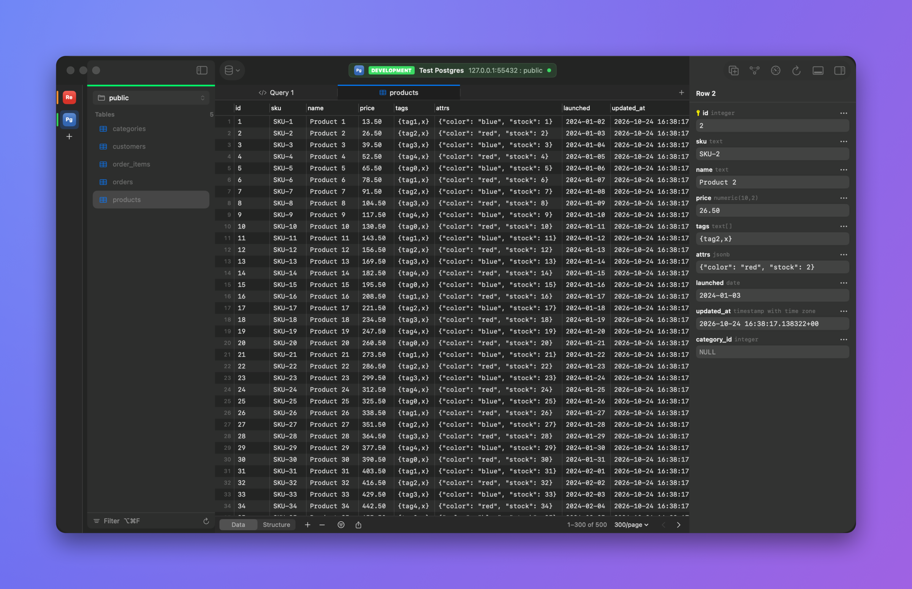
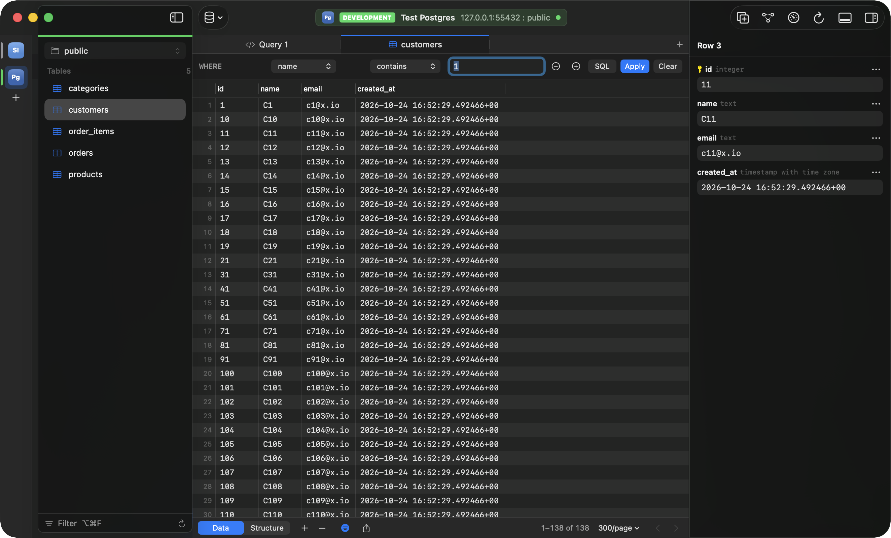
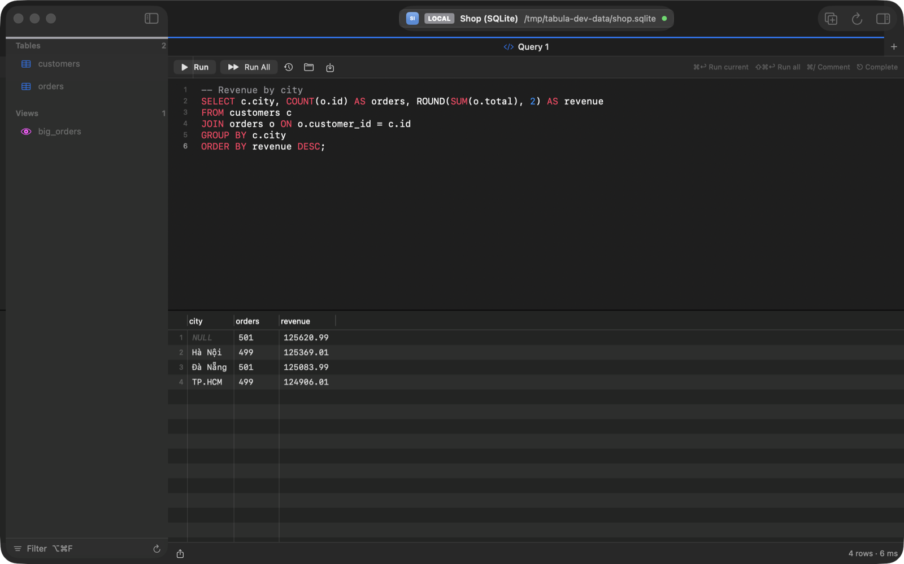
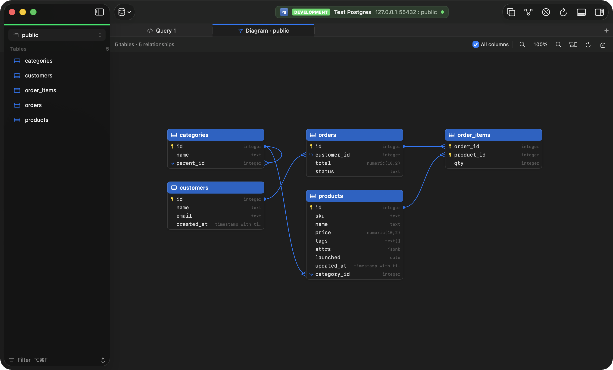
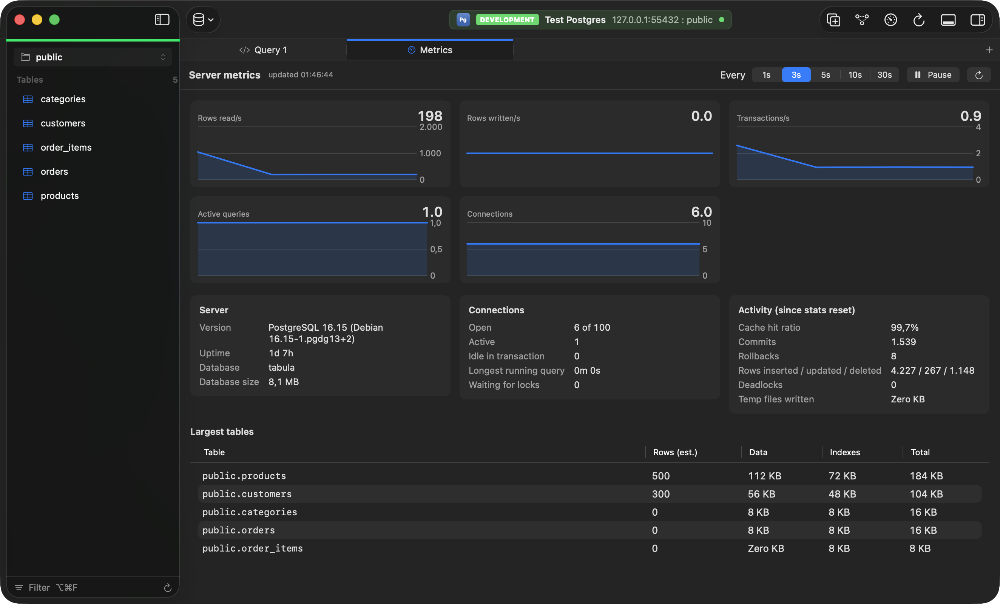
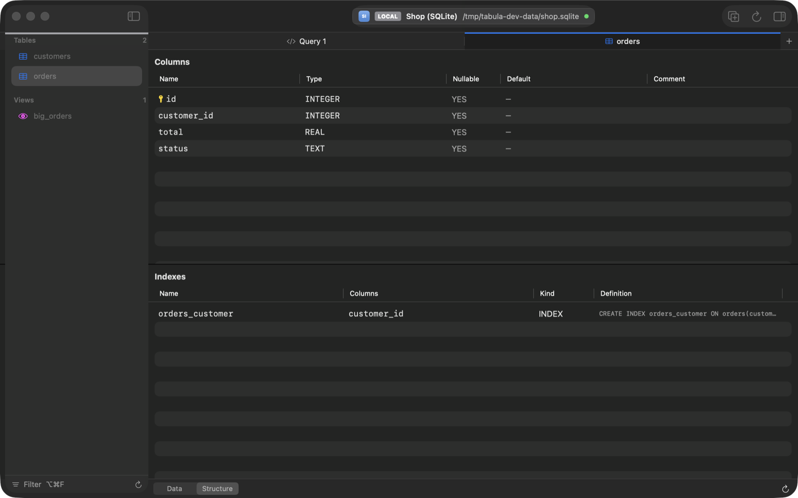
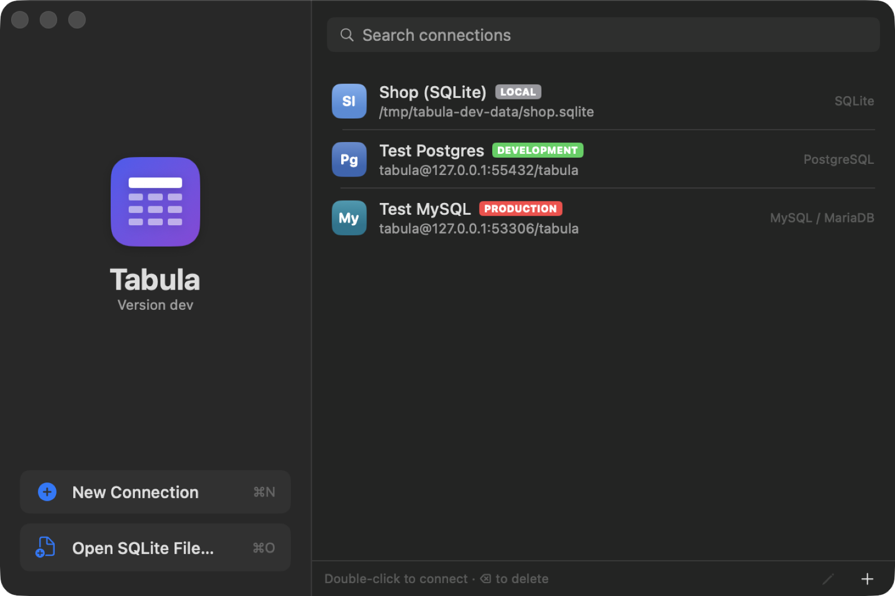
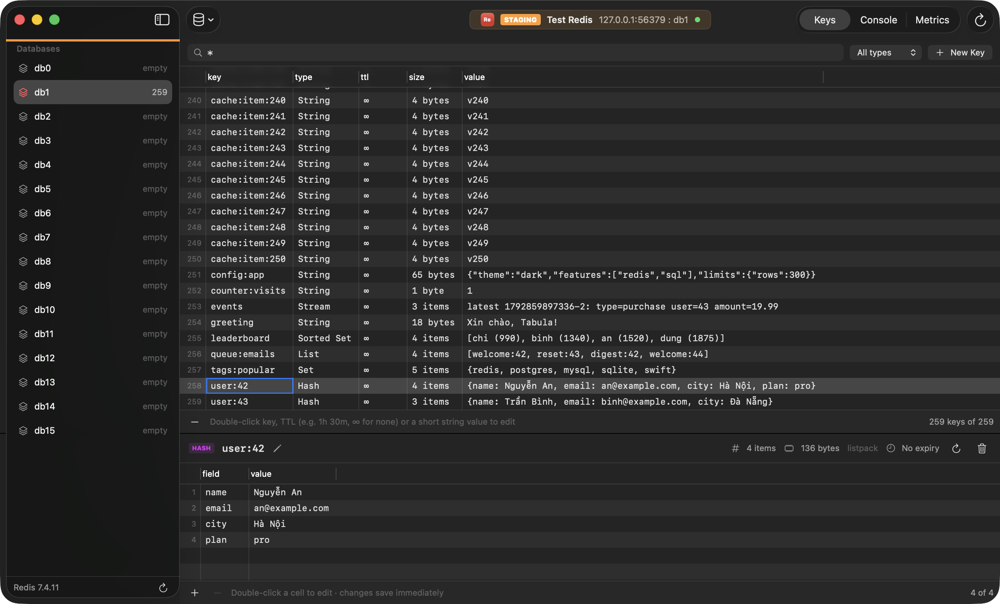

<p align="center"></p>

<h1 align="center">Tabula</h1>

<p align="center"><a href="https://github.com/tungnguyenvan/tabula/releases/latest">Download</a> · <a href="CHANGELOG.md">Changelog</a> · <a href="LICENSE">MIT License</a></p>

<p align="center">A fast, native macOS client for <b>PostgreSQL</b>, <b>MySQL / MariaDB</b>, <b>SQLite</b> and <b>Redis</b>.<br>
Free, no usage limits, keyboard-first.</p>

<p align="center"></p>

## Contents

- [Features](#features)
- [Size and resource use](#size-and-resource-use)
- [Install](#install)
- [Things to know](#things-to-know)
- [Getting started](#getting-started)
- [AI assistant](#ai-assistant)
- [Redis](#redis)
- [Updates](#updates)
- [Keyboard shortcuts](#keyboard-shortcuts)
- [Your data](#your-data)
<!-- source-only -->
- [Building from source](#building-from-source)
- [Making a release](#making-a-release)
- [Development](#development)
<!-- /source-only -->
- [Roadmap and known limitations](#roadmap-and-known-limitations)
- [License](#license)

## Features

**Connections**
- PostgreSQL, MySQL / MariaDB, SQLite files and Redis.
- Tag each connection Local, Development, Staging or Production. The tag colors the sidebar strip and the toolbar pill, and Production gets an extra warning before destructive actions.
- Passwords are stored in the macOS Keychain. TLS can be disabled, required, or required with certificate verification.
- Test a connection before saving. Connecting gives up after 15 seconds instead of hanging.
- Copy a connection as a URL (`postgresql://user@host:5432/db?sslmode=require`), with or without the password, from the connection's context menu.

**Several connections in one window**
- Open another connection from the database button in the toolbar, or from the Connections window: it joins the current window instead of replacing it.
- With two or more open, a column at the left edge of the window lists them. Hover for the name and address, click to switch, or use ⌃⌘] / ⌃⌘[. Each connection keeps its own tabs and state.

**Browsing**
- A schema (Postgres) or database (MySQL) switcher, and a table and view list you can filter. Picking a schema also makes it the default for queries (`search_path` on Postgres, `USE` on MySQL), so `SELECT * FROM transactions` finds `dev.transactions`.
- Equal-width tabs. Browsing the sidebar with the arrow keys reuses a single preview tab; press Return or double-click to keep a table open in its own tab.
- Command palette (⌘P) to jump to any table, open tab, schema or action.

<p align="center"></p>

**Data grid**
- Paged results (100 to 5,000 rows per page) with a total row count, row numbers and server-side sorting.
- Filter builder (column, operator, value), with AND or OR between conditions (AND binds tighter, as in SQL), or a hand-written `WHERE` clause. "Filter by This Value" is in the cell context menu.
- Sorting, filtering or paging asks first if it would throw away uncommitted edits.
- Spreadsheet-style keyboard control: arrow keys and Tab move between cells, Return edits, typing replaces the value, Space shows the full value (JSON is pretty-printed).
- Copy rows as TSV, with or without headers, or copy a single cell. Export CSV, TSV, JSON or SQL `INSERT`.

**Editing**
- Edit in the grid or in the row details panel (⌥⌘0). You can set NULL or an empty string, and add, duplicate or delete rows.
- Pending changes are highlighted. Undo and redo work per tab.
- Commit (⌘S) runs every change in one transaction and rolls back if any statement fails. Preview the exact SQL first with ⇧⌘S.
- Closing a tab with uncommitted changes asks you first.

<p align="center"></p>

**SQL editor**
- Syntax highlighting and line numbers.
- **Run** (⌘↩) runs only the selected text when there is a selection, otherwise the statement under the cursor (briefly highlighted). Its menu, or ⇧⌘↩, runs every statement. Scripts with several statements show one result per statement.
- **Suggestions as you type:** table names after `FROM` / `JOIN` and after `schema.`, a table's columns after `alias.`, and keywords plus columns (of the tables the statement uses, or of every table before one is named). The best match appears in grey after the cursor; press Tab to accept it. ⎋ (or ⌃Space) shows the full list.
- **Limit:** SELECTs without a `LIMIT` get one (300 rows by default, or 100 to 5,000, or none), so an accidental full-table query stays small. Statements that already limit themselves, writes and `FOR UPDATE` are left alone.
- **Beautify** (⇧⌘I) formats the selection or the whole editor: one clause per line, select items and conditions on their own lines, subqueries indented. Strings and comments are kept as written.
- Comment toggling (⌘/), query history, and opening or saving `.sql` files.

**Console log**
- ⇧⌘C (or the console button in the toolbar) opens a panel under the tabs listing every statement Tabula sent to the server: time, SQL, rows returned or affected, duration and errors. The app's own catalog queries are hidden unless you ask for them. Copy the log as a SQL script, or clear it.

<p align="center"></p>

**Relationship diagram** (⌥⌘3)
- Every table in the schema with its columns, keys and foreign-key lines between them, laid out by dependency. Drag tables, zoom with the buttons or a pinch, show key columns only, and export the diagram as PNG. Double-click a table to open it.

<p align="center"></p>

**Server metrics** (⌥⌘4)
- Live charts of reads, writes, transactions, connections and active queries, refreshed every 1 to 30 seconds (pause any time), plus server details, connection counts, cache hit ratio and the largest tables.
- PostgreSQL uses `pg_stat_database` and `pg_stat_activity`, MySQL `SHOW GLOBAL STATUS`, SQLite its pragmas, Redis `INFO`. Polling is not written to the console log.

**Structure**
- Columns with type, nullability, default, comment and primary key, plus indexes with their definitions.

<p align="center"></p>

## Size and resource use

Measured on a Mac with Apple M2 and macOS 26.1, with an optimized build of 0.2.0:

| | |
| --- | --- |
| Download | 18 MB (ZIP) in 0.2; about 28 MB from 0.3, which includes the local-model engine |
| Installed | 62 MB in 0.2; 88 MB from 0.3 (llama.cpp adds 23 MB). One universal app for Apple silicon and Intel. Models you download are stored separately, in `~/Library/Application Support/Tabula/Models`. |
| Memory, Connections window only | 26 MB |
| Memory, one Postgres table open (300 rows) | 78 MB |
| Memory, three connections open (Postgres, MySQL, Redis) | 92 MB |
| CPU when idle | 0% |
| CPU with the metrics tab refreshing every 3 s | about 1% |

Memory is the process footprint reported by macOS (`footprint`), which is also what Activity Monitor shows as Memory. It grows with the number of rows on screen: a 5,000-row page takes more than a 300-row one.

## Install

> **Why macOS warns you.** Tabula is free and not yet signed with an Apple Developer ID or notarized by Apple. macOS therefore cannot confirm who made it and blocks the first launch with a message such as *"Apple could not verify 'Tabula' is free of malware"* or *"'Tabula' cannot be opened because the developer cannot be verified"*. The steps below tell macOS you trust this app. You only do this once per installed version.

**Requirements:** macOS 14 Sonoma or later, on an Apple silicon or Intel Mac.

### 1. Download and verify

1. From the [latest release](https://github.com/tungnguyenvan/tabula/releases/latest), download `Tabula-<version>.dmg` and `SHA256SUMS.txt` into the same folder.
2. Check that the download is intact and unmodified:
   ```bash
   cd ~/Downloads
   shasum -a 256 -c SHA256SUMS.txt --ignore-missing
   ```
   You should see `Tabula-<version>.dmg: OK`. If not, delete the file and download it again.

### 2. Copy to Applications

Open the DMG and drag **Tabula** onto the **Applications** folder. Then eject the DMG. Don't run Tabula from inside the DMG.

### 3. First launch

Choose the steps for your macOS version.

**macOS 15 Sequoia and later (including 26 Tahoe)**
1. Open **Applications** and double-click **Tabula**. macOS refuses to open it. Click **Done** (not *Move to Trash*).
2. Open **System Settings › Privacy & Security** and scroll down to **Security**.
3. Next to *"Tabula" was blocked to protect your Mac*, click **Open Anyway**.
4. Confirm with **Open Anyway** again, then enter your Mac password or use Touch ID.

The *Open Anyway* button stays available for about an hour after the blocked attempt. If it isn't there, double-click Tabula again first.

**macOS 14 Sonoma**
1. In **Applications**, Control-click (or right-click) **Tabula** and choose **Open**.
2. In the dialog, click **Open**.

After the first successful launch, Tabula opens normally with a double-click.

### Alternative: Terminal

If you prefer, remove the download quarantine flag instead of using System Settings:

```bash
xattr -dr com.apple.quarantine /Applications/Tabula.app
```

Only do this for a copy you downloaded from this repository and verified in step 1.

### After launching

- **Saved passwords:** macOS may ask whether Tabula may use its Keychain items, both the first time and after each update. Choose **Always Allow**.
- **Local network (macOS 15 and later):** the first connection to a server on your local network (for example `192.168.x.x`) asks for permission. Choose **Allow**.

### Updating

From version 0.2.0, Tabula updates itself: see [Updates](#updates). To update by hand, download the new DMG and drag Tabula to Applications again, replacing the old copy. Your saved connections are kept.

Coming from **0.1.0**: that version has no updater, so install 0.2.0 by hand once.

### Uninstalling

Delete **Tabula** from Applications. To also remove saved connections, delete `~/Library/Application Support/Tabula`. Saved passwords are in **Keychain Access**, under items named `app.tabula.connections`.

## Things to know

- **macOS version.** Tabula needs macOS 14 Sonoma or later. On older systems Finder refuses to open it. Version 0.1.0 was built and tested on macOS 26 Tahoe; macOS 14 and 15 meet the minimum requirement but have not been tested yet, so please report any problems.
- **Not notarized yet.** Releases are signed with the developer's own certificate, not an Apple Developer ID, and are not notarized by Apple, so each new version needs one confirmation at first launch. See [First launch](#3-first-launch).
- **Keychain prompt.** The first time a version signed differently opens your saved passwords, macOS asks whether Tabula may use them. Choose **Always Allow**. Since 0.2.1 every release is signed with the same certificate, so this happens once (when you update from 0.2.0 or earlier) and not again after later updates. Within one launch, each connection's password is read only once. If you choose Deny, Tabula can't read the password and the connection fails to authenticate; edit the connection and enter the password again.
- **Local network permission (macOS 15 and later).** The first time you connect to a server on your local network, such as `192.168.x.x` or `10.x.x.x`, macOS asks whether Tabula may access it. If you deny it, those connections fail with "No route to host". Turn it back on in **System Settings › Privacy & Security › Local Network**. `localhost`, Docker port forwards and internet hosts are not affected.
- **TLS certificates.** "Verify certificate" checks the server against the trust store in macOS Keychain Access. Managed databases with a private CA (for example AWS RDS, or self-signed certificates) fail verification until that CA is added to Keychain Access and marked trusted. "Required" encrypts the connection without checking the certificate.
- **Updates** come from this repository's GitHub releases. See [Updates](#updates).

<p align="center"></p>

## Getting started

1. Click **New Connection** (⌘N) and pick a type.
   - **PostgreSQL:** if Database is empty, the user name is used.
   - **MySQL / MariaDB:** the database is optional, and you can switch databases from the sidebar.
   - **SQLite:** choose an existing file, or create a new one.
2. Choose a **tag**, so a Production connection is obvious at a glance.
3. Click **Test**, then **Connect**. You can also double-click a saved connection or press Return.

> **MySQL 8 and TLS:** accounts that use `caching_sha2_password`, the MySQL 8 default, can only authenticate over an encrypted connection. New MySQL connections therefore default to TLS **Required**. If the server has no TLS, either switch the account to `mysql_native_password` or enable TLS on the server.

> **SSH:** tunnels are not built in yet. Forward a local port and connect to it:
> `ssh -N -L 15432:db.internal:5432 user@bastion`, then connect to `127.0.0.1:15432`.

## AI assistant

AI is off until you turn it on in **Settings › AI** (⌘,). Then:

- **AI chat** (⌥⌘A, or the chat button in the toolbar) opens a conversation in the panel on the right, next to Row Details. Ask for queries, explanations or changes to the SQL in the editor; it remembers the conversation for that connection. Every query in an answer has **Insert**, **Run** and copy buttons. The model menu under the message field switches between downloaded models, Apple Intelligence, Claude Opus 5.5 / Sonnet 5.5 / Haiku 5.5, your OpenAI-compatible model, Claude Code and Codex.

In a query tab:

- **Ask AI** (⌘K, or the Ask AI button) opens a bar above the editor. Describe what you want ("top 5 customers by order value, with their email") and the SQL is inserted at the cursor. With SQL selected, describe the change instead ("only last month", "add the product name"); the selection is replaced. ⌘Z undoes it.
- **Fix with AI** appears under an error. It sends the failing statement and the server's message, and replaces the statement with the corrected one.
- **Suggestions while typing:** with AI suggestions on, the grey text after the cursor comes from the model (it replaces the built-in table/column/keyword suggestion; ⎋ still lists those). Tab accepts it; any key or caret move dismisses it. Models on this Mac are asked after a 0.25 s pause and, when they support it (Qwen2.5 Coder does), complete the SQL by filling in the text between what is before and after the cursor, which is how code completion models are trained. Suggestions can use a different provider from Ask AI: command-line agents and large hosted models are too slow to keep up with typing, so a small local model (such as `qwen2.5-coder:0.5b`) is the usual choice, with Claude Code or the Claude API for Ask AI.

The model sees table names written as SQL needs them (`dev.transactions`), column types, primary and foreign keys, and the default schema, so it qualifies names and joins on the real keys.

Choose where the model runs:

| Provider | Runs | Setup |
| --- | --- | --- |
| Model on this Mac | Inside Tabula, offline | Nothing to install. Choose it in Settings › AI, then download a model from the list (Qwen2.5 Coder 0.5B to 7B, Llama 3.2 1B and 3B; from about 490 MB), add any GGUF file you already have, or paste a link to one. Downloads are checked against their published SHA-256. Runs on the GPU on Apple silicon and on the CPU on Intel. |
| Apple Intelligence | On the Mac, offline | macOS 26 with Apple Intelligence turned on in System Settings |
| Local model (Ollama) | On the Mac | Install [Ollama](https://ollama.com/download) (it runs the models), then download one from the list in Settings › AI. Light models for suggestions while typing: `qwen2.5-coder:0.5b` (about 0.4 GB), `deepseek-coder:1.3b`, `qwen2.5-coder:1.5b`. For whole queries: `qwen2.5-coder:3b`, `qwen2.5-coder:7b`, `sqlcoder:7b`. Progress shows in Settings; a downloaded model can be used for Ask AI, for suggestions, or deleted. |
| OpenAI-compatible API | Your server or a provider | Base URL, API key and model: LiteLLM, LM Studio, llama.cpp, vLLM, OpenAI and others |
| Claude API | Anthropic | API key; the model defaults to `claude-opus-5-5`, and a faster one (such as `claude-haiku-5-5`) can be set for suggestions |
| Claude Code, Codex | Your installed command-line agent, with its own sign-in | Installed and signed in once in Terminal. Tabula finds them on your shell's PATH or the usual install locations, and runs them without tools (Claude Code) or in a read-only sandbox (Codex). Too slow for suggestions while typing. |

**What is sent:** the table and column names of the current schema, the SQL in the editor around the cursor (or the selection), and for Fix with AI the error message with any quoted values removed (database errors can quote row values, such as a duplicate key). Rows from your tables are never sent. Prompts reach the command-line agents on standard input, not as arguments other users of the Mac could see. AI is off for Production-tagged connections unless you allow it in Settings. API keys are stored in the login Keychain.

## Redis

<p align="center"></p>

Add a connection of type **Redis**. User is optional (an ACL user on Redis 6 and later; leave it empty for password-only `requirepass`), Database is the index (default 0), and TLS works as for SQL databases.

- **Databases** are listed in the sidebar with their key counts; click one to switch.
- **Keys** fill the main table with their type, TTL, size and a preview of the value. Keys are listed with `SCAN`, never `KEYS`, so this is safe on large production instances. Type a pattern such as `user:*` and press Return, filter by type, and load more keys as you scroll. Double-click a key, TTL or short string value to edit it in place.
- **Values:** the selected key opens below the table. Strings open in an editor (Format JSON, Save with ⌘S, the TTL is kept); hashes, lists, sets, sorted sets and streams open in a grid, with *Load more* for big collections. Double-click a cell to edit, ⌫ to delete, ⌘I to add. Changes are written to Redis immediately.
- **Key details:** type, size, memory usage, encoding and TTL. Click the TTL to set or remove an expiry; the pencil renames (it never overwrites another key).
- **Console (⌘T):** commands as in `redis-cli`, with quotes and escapes, ↑↓ history and `clear`. `SELECT` switches the sidebar too. The console refuses `SUBSCRIBE`, `MONITOR` and blocking commands with no timeout, because they would freeze the connection. It asks before `FLUSHALL`, `FLUSHDB` and `SHUTDOWN`, and on a Production connection before any command that isn't known to only read.
- **Metrics:** memory, clients, throughput, hit rate, persistence and keyspace from `INFO`, with live charts.
- Strings larger than 1 MB and binary values are shown read-only; use the console to change them.

## Updates

Tabula checks this repository's [latest release](https://github.com/tungnguyenvan/tabula/releases/latest) when it starts, at most once a day, and when you choose **Tabula › Check for Updates…**. When a newer version exists it shows the release notes, and you can **Install and Relaunch**, open the release page, or skip that version.

Installing:
1. downloads `Tabula-<version>.zip` and `SHA256SUMS.txt` from the release;
2. refuses the download unless its SHA-256 matches, the bundle identifier and version are right, and the code signature is valid;
3. replaces the app where it is, then relaunches the new version. If copying fails, the previous version is put back.

The checksum and the archive come from the same GitHub release, so this protects against corrupted or tampered downloads in transit, not against a compromised repository.

Automatic checks can be turned off in **Settings** (⌘,). Tabula needs write access to the folder it runs from; it can't update itself while running from the DMG, or from a location macOS has moved it to ("App Translocation"). Move it to Applications first.

After an update, macOS may ask again whether Tabula may use its saved passwords; choose **Always Allow**.

## Keyboard shortcuts

Everything below is also listed in **Help › Keyboard Shortcuts** (⇧⌘/).

| Area | Shortcuts |
| --- | --- |
| Tabs and windows | ⌘T new query · ⌘W close tab (or the window if no tabs are open) · ⇧⌘T reopen closed tab · ⌘1…⌘8 go to tab, ⌘9 last tab · ⌃Tab or ⇧⌘] next tab · ⌃⇧Tab or ⇧⌘[ previous tab · ⌘P open anything · ⇧⌘K connections · ⌃⌘] / ⌃⌘[ next / previous connection |
| Browsing | ⌥⌘F filter tables · ↑↓ preview a table, ↩ or double-click to keep it open · ⌥⌘1 / ⌥⌘2 Data / Structure · ⌥⌘3 diagram · ⌥⌘4 metrics · ⌘F filter rows (press again to focus the filter) · ⌘R refresh · ⌘[ / ⌘] previous / next page · ⌥⌘0 row details · ⇧⌘C console log |
| Data grid | ← → ↑ ↓ move between cells · Tab / ⇧Tab next / previous cell · ⌘← ⌘→ ⌘↑ ⌘↓ first / last column or row · ↩ or F2 edit · type any key to replace the value · Space quick look · ⌥⌫ set NULL · ⌫ delete rows · ⌘C copy rows · ⌥⇧⌘C copy rows with headers · ⌥⌘C copy cell |
| Editing a cell | ↩ save and move down · Tab / ⇧Tab save and edit the next / previous cell · ⌥↩ new line · ⎋ cancel |
| Changes | ⌘I add row · ⌘D duplicate row · ⌘Z / ⇧⌘Z undo / redo · ⌘S commit · ⇧⌘S preview SQL · ⌥⌘Z discard all changes |
| SQL editor | ⌘↩ run the selection or the current statement · ⇧⌘↩ run all · Tab accept the grey suggestion · ⎋ or ⌃Space suggestions · ⌘K ask AI · ⇧⌘I beautify · ⌘/ toggle comment · ⌘F find |
| Redis | ⌘T console · ⌘F key pattern · ⌘R refresh · ⌘N new key · ⌘I add element · ⌘S save string · ⌫ delete |

## Your data

- **Connection settings** are stored in `~/Library/Application Support/Tabula/connections.json`. This file never contains passwords.
- **Local models** you download or add live in `~/Library/Application Support/Tabula/Models` (Settings › AI › Show in Finder). Delete them there or from Settings.
- **Passwords** are stored in the login Keychain, under the service `app.tabula.connections`. Deleting a connection also deletes its password.
- **Network:** Tabula connects to the databases you configure, and to `api.github.com` / `github.com` to check for and download updates. If you turn on the AI assistant, it also talks to the provider you chose (see [AI assistant](#ai-assistant) for what is sent). There is no telemetry and no account.
- **Windows:** workspace windows are not restored at launch, so Tabula never reconnects to a database, such as Production, unless you choose to.

<!-- source-only -->
## Building from source

You need macOS 14 or later and Xcode 16 or later (the Swift 6 toolchain).

```bash
git clone https://github.com/tungnguyenvan/tabula.git && cd tabula
./scripts/fetch-llama.sh         # once: the pinned llama.cpp build (checked by SHA-256) into Vendor/
swift run Tabula                 # debug build, launched directly
./scripts/build-app.sh           # release build → dist/Tabula.app (universal)
ARCHS=arm64 ./scripts/build-app.sh   # faster, Apple silicon only
```

Builds are signed ad-hoc unless a signing identity exists. Ad-hoc signatures change on every build, so macOS asks for Keychain access again after each one. To avoid that while developing, create a local self-signed identity once; `build-app.sh` then uses it automatically:

```bash
./scripts/make-signing-identity.sh   # adds "Tabula Local Signing" to your login keychain
```

The update checker uses the GitHub repository named in `RELEASES_REPOSITORY` (override with `REPOSITORY=owner/name`).

## Making a release

1. Set the version in `VERSION` and add a matching `## [x.y.z]` section to `CHANGELOG.md`.
2. Run the release script:
   ```bash
   ./scripts/release.sh
   ```
   The script:
   - runs the tests;
   - regenerates `Resources/THIRD_PARTY_NOTICES.txt` from the resolved packages;
   - builds the universal app;
   - checks the architectures, the code signature, the Info.plist version, and that the binary contains no debug code;
   - writes `Tabula-<version>.dmg`, `Tabula-<version>.zip`, `SHA256SUMS.txt` and `RELEASE_NOTES.md` to `dist/release/`.
3. **Optional, recommended: sign and notarize** so users don't get a Gatekeeper warning. This needs an Apple Developer account.
   ```bash
   # one-time: store notarization credentials in the keychain
   xcrun notarytool store-credentials tabula --apple-id you@example.com --team-id TEAMID --password <app-specific-password>

   SIGN_IDENTITY="Developer ID Application: Your Name (TEAMID)" NOTARY_PROFILE=tabula ./scripts/release.sh
   ```
   The app is signed with the hardened runtime, submitted to Apple, stapled and checked with `spctl`. The DMG is signed as well.
4. Tag the release (`git tag v<version>`) and upload the contents of `dist/release/`, using `RELEASE_NOTES.md` as the description. The app checks the repository named in `RELEASES_REPOSITORY` for updates.
   (`scripts/publish-public.sh` can instead publish only the documentation and releases to that repository, for when the source moves to a private one.)

Other options: `SKIP_TESTS=1`, `BUILD_NUMBER=…` (defaults to a UTC timestamp) and `COPYRIGHT=…`.

## Development

```
Sources/TabulaCore   Drivers and SQL: PostgresDriver (PostgresNIO), MySQLDriver (MySQLNIO), SQLiteDriver
                     (system SQLite), RedisDriver (RediStack) and RedisCommandLine, LoggingDriver (console log),
                     SQLLexer, SQLSplitter, SQLFormatter, SQLCompletion, SQLDialect, FilterRule, SchemaInsights
                     (foreign keys, metrics), ConnectionStore (JSON + Keychain), ResultExporter, UpdateFeed,
                     Defaults (every tunable value in one place)
Sources/Tabula       SwiftUI app. ConnectionSession holds a window's connections; DataGridView (NSTableView)
                     and SQLEditorView (NSTextView) wrap AppKit for speed and keyboard control; Layout holds the
                     design tokens.
Tests/TabulaCoreTests
scripts/             build-app.sh, release.sh, seed-dev.sh, make-icon.swift, third-party-notices.sh
```

**Tests.** Unit tests and SQLite tests always run. The Postgres, MySQL and Redis tests run against real servers when ports are set:

```bash
docker run -d --name tabula-test-pg -e POSTGRES_USER=tabula -e POSTGRES_PASSWORD=tabula -e POSTGRES_DB=tabula -p 55432:5432 postgres:16
docker run -d --name tabula-test-mysql -e MYSQL_ROOT_PASSWORD=tabula -e MYSQL_DATABASE=tabula -e MYSQL_USER=tabula -e MYSQL_PASSWORD=tabula -p 53306:3306 mysql:8.4
docker run -d --name tabula-test-redis -p 56379:6379 redis:7.4 redis-server --requirepass tabula --user tabula on '>tabula' '~*' '&*' '+@all'

# optional: Redis over TLS with a throwaway self-signed certificate
mkdir -p /tmp/redis-tls && openssl req -x509 -newkey rsa:2048 -nodes -days 2 -subj /CN=localhost \
  -keyout /tmp/redis-tls/redis.key -out /tmp/redis-tls/redis.crt && chmod 644 /tmp/redis-tls/*
docker run -d --name tabula-test-redis-tls -p 56380:6380 -v /tmp/redis-tls:/tls:ro redis:7.4 redis-server --port 0 \
  --tls-port 6380 --tls-cert-file /tls/redis.crt --tls-key-file /tls/redis.key --tls-auth-clients no --requirepass tabula

TABULA_TEST_PG_PORT=55432 TABULA_TEST_MYSQL_PORT=53306 TABULA_TEST_REDIS_PORT=56379 TABULA_TEST_REDIS_TLS_PORT=56380 \
TABULA_TEST_NETWORK=1 swift test
```

`TABULA_TEST_NETWORK=1` also checks the live GitHub release feed.

**Sample data.** This creates a SQLite file, plus Postgres, MySQL and Redis data if the containers above are running, in a separate store that leaves your real connections alone. Debug builds read that store's passwords from `passwords.json`, so test runs never touch your Keychain:

```bash
./scripts/seed-dev.sh /tmp/tabula-dev-data
TABULA_DATA_DIR=/tmp/tabula-dev-data swift run Tabula
```

**Debug automation** (debug builds only; none of it is compiled into release builds). `TABULA_DEBUG_OPEN=<connection id>`, `TABULA_DEBUG_TABLE`, `TABULA_DEBUG_QUERY`, `TABULA_DEBUG_KEY` and `TABULA_DEBUG_REDIS_CONSOLE` (Redis), `TABULA_DEBUG_DIAGRAM`, `TABULA_DEBUG_METRICS`, `TABULA_DEBUG_CONSOLE`, `TABULA_UPDATE_FEED=<url>` with `TABULA_DEBUG_AUTOINSTALL=1` (test the updater against a local feed), `TABULA_DEBUG_SNAPSHOT=<dir>` (PNG snapshots of every window) and `TABULA_DEBUG_KEYS` (replays key presses such as `"down;return;type:abc;cmd+s"`; note that this brings the app to the front). See `Sources/Tabula/DebugHooks.swift`.

**Icon.** `swift scripts/make-icon.swift` regenerates `Resources/AppIcon.icns`.

**Hero image.** `swift scripts/make-hero.swift <window.png> docs/screenshots/hero.png` puts a window screenshot (taken with `TABULA_DEBUG_SNAPSHOT`, sized with `TABULA_DEBUG_WIDTH` / `TABULA_DEBUG_HEIGHT`) on the gradient background.

<!-- /source-only -->

## Roadmap and known limitations

Planned:
- SSH tunnels
- Cancelling a running query

Known limitations:
- On MySQL, a `SELECT` that returns zero rows shows no column headers.
- A running query cannot be cancelled.
- Editing existing rows needs a primary key. Tables without one are read-only, apart from inserting rows.
- Redis Cluster and Sentinel aren't supported yet; connect to a single node. Pub/Sub and `MONITOR` are not available in the console.

See [CHANGELOG.md](CHANGELOG.md) for release history.

## License

Tabula is released under the [MIT License](LICENSE). Copyright © 2026 Nguyen Van Tung.

Tabula bundles open-source components: PostgresNIO and MySQLNIO (MIT), RediStack, SwiftNIO, swift-nio-ssl, swift-crypto and related Apple packages (Apache 2.0, some of which include BoringSSL). Their full license texts and NOTICE files are in [`Resources/THIRD_PARTY_NOTICES.txt`](Resources/THIRD_PARTY_NOTICES.txt). The same file ships inside the app, at `Tabula.app/Contents/Resources`, and is linked from **Tabula › About Tabula**.
