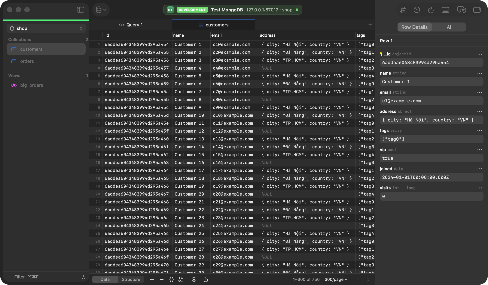
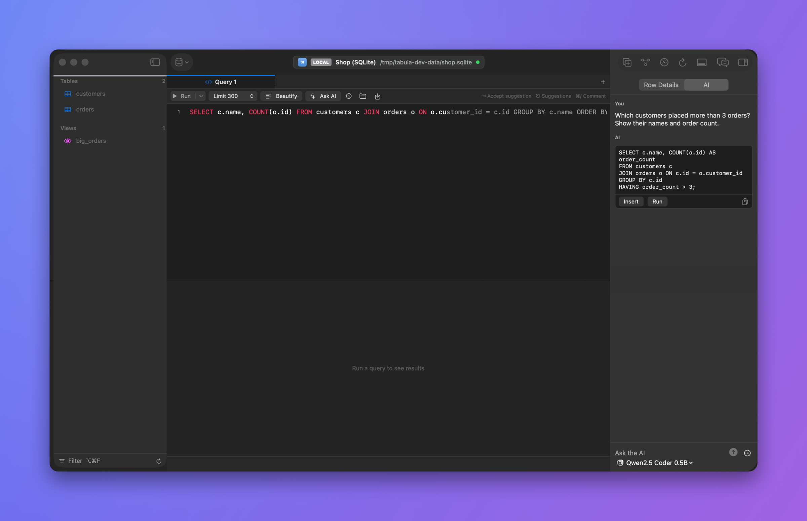
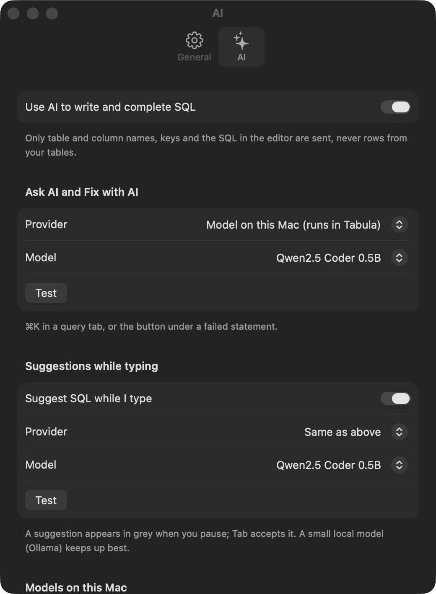
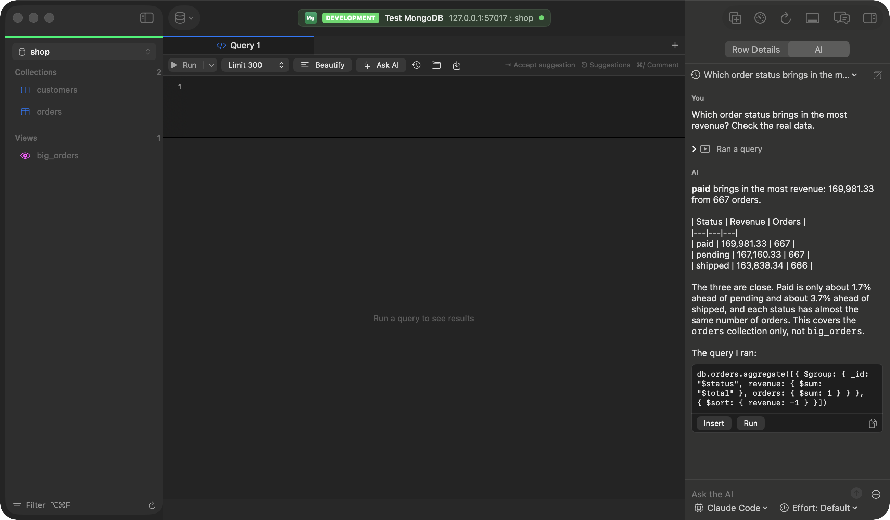
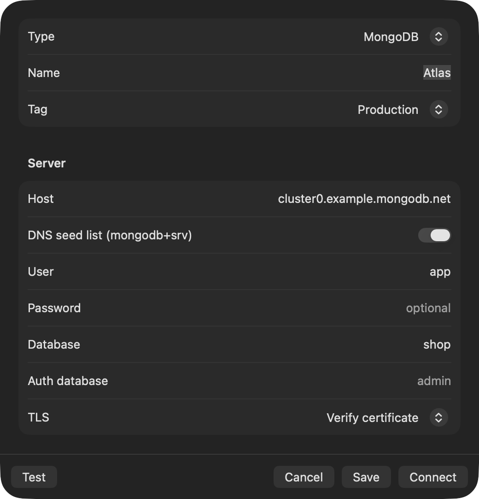
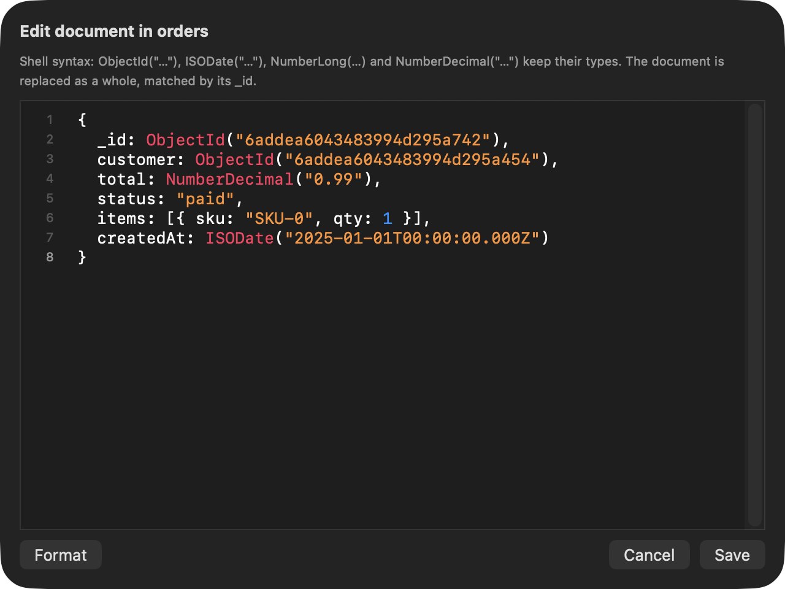
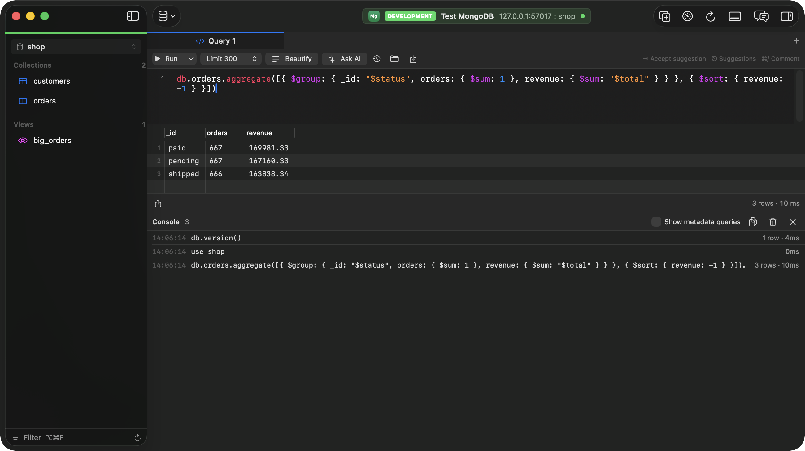

<p align="center"></p>

<h1 align="center">Tabula</h1>

<p align="center"><a href="https://github.com/tungnguyenvan/tabula/releases/latest">Download</a> · <a href="https://github.com/tungnguyenvan/tabula/releases/download/v0.5.1/Tabula-demo.mp4">Demo video</a> · <a href="CHANGELOG.md">Changelog</a> · <a href="LICENSE">MIT License</a></p>

<p align="center">A fast, native macOS client for <b>PostgreSQL</b>, <b>MySQL / MariaDB</b>, <b>SQLite</b>, <b>MongoDB</b> and <b>Redis</b>.<br>
Free, no usage limits, keyboard-first.</p>

<div align="center">

https://github.com/user-attachments/assets/24917ff7-76bb-482f-a36c-bfc87224b393

<sub>The demo (44 s): Tabula driven by real clicks and keys. <a href="https://github.com/tungnguyenvan/tabula/releases/download/v0.5.1/Tabula-demo.mp4">Full quality, 1080p at 60 fps</a>.</sub>

</div>

<p align="center"></p>

> ### 🍃 New in 0.4: MongoDB
>
> - **Collections in the grid you already know.** Databases in the sidebar, collections and views as tables, documents as rows with nested values inline. Filter with the builder or a query document, sort, and page with a total count.
> - **Edit without losing types.** Change a cell and a `NumberLong` stays a long, a date stays a date. Open a whole document as JSON (`{ }`) to edit nested fields, or insert a new one. Preview the exact `updateOne` / `deleteOne` commands before they run.
> - **The shell you know, in the query editor:** `db.orders.find({ status: "paid" }).sort({ total: -1 })`, `aggregate([…])`, `insertMany`, `updateMany`, `createIndex`, `show dbs`, `use shop`, `db.runCommand({…})`. Highlighting, Beautify, suggestions for collections, methods, fields and `$` operators, and the row limit adds `.limit()`.
> - **AI speaks MongoDB too:** chat, Ask AI and Fix with AI write shell commands from the fields Tabula sampled. Documents are never sent.
> - **Server metrics** from `serverStatus` and `dbStats`, structure with sampled field types and indexes, and every command in the console log.
> - Atlas (`mongodb+srv`), replica sets, TLS and SCRAM authentication.
>
> [More about MongoDB →](#mongodb)

<p align="center"></p>

> ### ✨ New in 0.5: an AI assistant that looks things up in your database, on your Mac or with the AI you already use
>
> - **Chat about your database** in the panel on the right (⌥⌘A). Ask for a query in plain words and get SQL you can **Insert**, **Run** or copy. The model knows your tables, columns, keys and schemas, so it writes `dev.transactions`, not a guess.
> - **An assistant that looks things up:** it describes tables and runs read-only queries on its own read-only connection to answer from the real data ("which status brings in the most revenue?"), with every step shown. On Production it asks before each query. Conversations are saved per connection, to open again later.
> - **Suggestions as you type**, written by the model in grey after the cursor; Tab accepts. With a small model on your Mac they arrive in under 100 ms.
> - **Ask AI** (⌘K) to write or change SQL in the editor, and **Fix with AI** when a statement fails.
> - **Answers stream in, with the model's thinking:** watch the reasoning and then the SQL arrive token by token, from Claude, Claude Code, Codex, OpenAI-compatible servers, Ollama or a model on your Mac.
> - **Runs inside Tabula, offline.** Download a light model from Settings (Qwen2.5 Coder from 490 MB, Llama 3.2), add any GGUF file, or paste a link. Nothing else to install.
> - **Or use what you already have:** Apple Intelligence, Claude (Opus 5.5, Sonnet 5.5, Haiku 5.5), any OpenAI-compatible API such as LiteLLM, Ollama, or the Claude Code and Codex tools on your Mac. A different model can handle suggestions while typing.
> - **You decide what it sees:** table and column names and your SQL are sent; rows only from the read-only queries the chat runs if you turn them on, at most 50 per query. Off for Production connections unless you allow it.
>
> [How it works →](#ai-assistant)

<p align="center"></p>

## Contents

- [Features](#features)
- [Size and resource use](#size-and-resource-use)
- [Install](#install)
- [Things to know](#things-to-know)
- [Getting started](#getting-started)
- [AI assistant](#ai-assistant)
- [MongoDB](#mongodb)
- [Redis](#redis)
- [Updates](#updates)
- [Keyboard shortcuts](#keyboard-shortcuts)
- [Your data](#your-data)
<!-- source-only -->
- [Building from source](#building-from-source)
- [Making a release](#making-a-release)
- [Development](#development)
<!-- /source-only -->
- [Known limitations](#known-limitations)
- [License](#license)

## Features

**AI assistant** (new in 0.3, tools and saved chats in 0.5; see [AI assistant](#ai-assistant))
- Chat panel with tools (describe tables, run read-only queries) and saved conversations, Ask AI (⌘K), Fix with AI, and model-written suggestions while typing.
- Models that run inside Tabula, Apple Intelligence, Claude, OpenAI-compatible APIs, Ollama, Claude Code or Codex.

**MongoDB** (new in 0.4, see [MongoDB](#mongodb))
- Collections in the data grid with type-preserving edits, a JSON document editor, and a query editor that runs shell commands.

**Connections**
- PostgreSQL, MySQL / MariaDB, SQLite files, MongoDB and Redis.
- Tag each connection Local, Development, Staging or Production. The tag colors the sidebar strip and the toolbar pill, and Production gets an extra warning before destructive actions.
- Passwords are stored in the macOS Keychain. TLS can be disabled, required, or required with certificate verification.
- Test a connection before saving. Connecting gives up after 15 seconds instead of hanging.
- **SSH tunnels (PostgreSQL, MySQL):** turn on **Connect over SSH** to reach a database that only an SSH server (a bastion) can reach. Host is then the database as the SSH server sees it, such as `localhost`.
  - Tabula runs the system's `/usr/bin/ssh` with key authentication only: keys come from ssh-agent, `~/.ssh`, or a key file you choose. Add a key with a passphrase to ssh-agent first (`ssh-add`). No SSH password or passphrase is stored.
  - The SSH server's host key must already be in `~/.ssh/known_hosts`; connect once with `ssh` in Terminal to check and save it. Your `~/.ssh/config` is not read, so enter the real host name, port and user.
  - The tunnel listens on 127.0.0.1 only and closes with the connection or when Tabula quits. **Verify certificate** needs a database host name, not an IP address, so TLS checks the database's real identity rather than the tunnel's loopback address.
- Copy a connection as a URL (`postgresql://user@host:5432/db?sslmode=require`), with or without the password, from the connection's context menu.
- **Create a connection from a connection string:** **Connection String…** (⇧⌘N) in the Connections window, or paste (⌘V) into the connection list. A summary shows what was read before **Continue** fills in the New Connection form, the password too. The Host field accepts the same strings. Accepted:
  - URLs: `postgresql://`, `mysql://`, `redis://`, `rediss://`, `mongodb://`, `mongodb+srv://`, `file://`, and the URLs TablePlus copies;
  - JDBC URLs (`jdbc:postgresql://host/db?user=…&password=…`, `jdbc:sqlite:/path`);
  - libpq strings (`host=… port=… dbname=… user=… password=…`);
  - semicolon-separated strings, as .NET drivers take them (`Server=…;Database=…;Uid=…;Pwd=…`, `Host=…;Username=…`).

  Escaped characters in URLs are decoded, so `p%3Fss` becomes `p?ss`. Tabula never reads the clipboard by itself.
- A password that still holds URL escapes, as some dashboards show them (`%3F` for `?`), gets a **Decode** button, and a failed login says when escapes are the likely cause.
- **Picks up where you left off:** opening a connection again brings back its query tabs (with their SQL, unsaved edits included), open tables, the selected tab, the schema (and PostgreSQL database) and the query history. Each table also keeps its last filter, so opening it again, even after closing its tab, brings back the rules, and a filter that was applied is applied again. Only the selected table loads its rows at once; the others load when you select them. Turn this off in Settings › General.
- **Dump and restore (PostgreSQL, MySQL):** **File › Dump Database…** saves the database (or one table, from its context menu in the sidebar) to a file; **File › Restore from Dump…** runs a dump into the database the window is in.
  - Tabula uses the client tools installed on your Mac (`pg_dump`, `pg_restore`, `psql`; `mysqldump`, `mysql`, or MariaDB's), the newest it finds in Postgres.app, Homebrew (including `libpq` and `mysql-client`) and your shell's PATH. pg_dump must be at least as new as the server; if a tool is missing, the sheet says how to install it.
  - Dumps: structure and data, structure only or data only; PostgreSQL as a SQL script or a compressed custom archive; with or without DROP statements and, on PostgreSQL, owners and privileges. A failed or stopped dump leaves no file behind.
  - Restores stop at the first error. On PostgreSQL they run in one transaction by default, so a failure changes nothing. Production connections ask you to type the database name. Scripts can't run commands on your Mac: Tabula refuses PostgreSQL scripts with psql commands such as `\!` (pg_dump's `\restrict` is allowed) and turns off the mysql client's `system` command and local file loading. Restore only dumps you trust: they can contain any SQL.
  - Passwords reach the tools through the environment (PostgreSQL) or a private temporary option file (MySQL), never the command line. Your `~/.my.cnf`, saved MySQL login paths, `~/.psqlrc` and `PG*` / `MYSQL_*` environment variables aren't used. Connections over SSH go through the tunnel.
  - pg_dump 17 and later write a `transaction_timeout` setting that older servers reject; Tabula leaves it out when restoring into PostgreSQL 16 or older.
- **Every database on a PostgreSQL server** from one connection: the sidebar's Database picker lists those your login may open, and choosing one moves the window there. Query tabs keep their SQL; the saved connection doesn't change.

**Several connections in one window**
- Open another connection from the database button in the toolbar, or from the Connections window: it joins the current window instead of replacing it.
- With two or more open, a column at the left edge of the window lists them. Hover for the name and address, click to switch, or use ⌃⌘] / ⌃⌘[. Each connection keeps its own tabs and state.

**Functions and triggers**
- Functions, procedures and triggers are listed in the sidebar (PostgreSQL, MySQL; triggers on SQLite). Click one to see its definition, edit it and save with ⌘S; start a new one from the sidebar's context menu.
- Saving is safe: Postgres functions use `CREATE OR REPLACE`; Postgres and SQLite triggers are dropped and recreated in one transaction; MySQL, which can't do DDL in a transaction, gets the original back if the new definition fails.

**Browsing**
- A schema (Postgres) or database (MySQL) switcher, and a table and view list you can filter. Picking a schema also makes it the default for queries (`search_path` on Postgres, `USE` on MySQL), so `SELECT * FROM transactions` finds `dev.transactions`.
- Collapse the sidebar's Tables, Views, Functions and Triggers groups by clicking a group's title; Tabula remembers which are collapsed.
- Equal-width tabs. Browsing the sidebar with the arrow keys reuses a single preview tab; press Return or double-click to keep a table open in its own tab.
- Command palette (⌘P) to jump to any table, open tab, schema or action.

<p align="center"></p>

**Data grid**
- Paged results (100 to 5,000 rows per page) with a total row count, row numbers and server-side sorting.
- Filter builder (column, operator, value), with AND or OR between conditions (AND binds tighter, as in SQL), or a hand-written `WHERE` clause. Untick a condition's checkbox to leave it out without deleting it. "Filter by This Value" is in the cell context menu.
- Sorting, filtering or paging asks first if it would throw away uncommitted edits.
- Spreadsheet-style keyboard control: arrow keys and Tab move between cells, Return edits, typing replaces the value, Space shows the full value (JSON is pretty-printed).
- Add a row with + or by double-clicking the empty space below the rows; typing starts in the first column to fill.
- Copy rows as TSV, with or without headers, or copy a single cell. Export CSV, TSV, JSON or SQL `INSERT`.

**Editing**
- Edit in the grid or in the row details panel (⌥⌘0). You can set NULL or an empty string, and add, duplicate or delete rows.
- Binary values (bytea, BLOB, BINARY, VARBINARY, BIT) show as `\x` and hex on every database, as psql shows them, and are written back as bytes: a `\x…` value in such a column is saved as those bytes, anything else typed there as text.
- Pending changes are highlighted. Undo and redo work per tab.
- Commit (⌘S) runs every change in one transaction and rolls back if any statement fails. Preview the exact SQL first with ⇧⌘S.
- Closing a tab with uncommitted changes asks you first.

<p align="center"></p>

**SQL editor**
- Syntax highlighting and line numbers.
- **Run** (⌘↩) runs only the selected text when there is a selection, otherwise the statement under the cursor (briefly highlighted). Its menu, or ⇧⌘↩, runs every statement. Scripts with several statements show one result per statement. While a query runs, **Stop** (⌘.) cancels it on the server and skips the remaining statements. Tabula never commits or rolls back your transaction for you; SQLite itself rolls back an open transaction when the stopped statement was changing rows, and documents a stopped MongoDB command already changed stay changed. MongoDB needs version 4.4 or later for Stop. In the Redis console, Stop (⌘.) ends a Lua script or function once it has run for 5 seconds (Redis serves nothing else before then; on a shared server it stops whichever script is running, so Production connections ask first) and unblocks a waiting command such as `BLPOP`.
- **Suggestions as you type:** table names after `FROM` / `JOIN` and after `schema.`, a table's columns after `alias.`, and keywords plus columns (of the tables the statement uses, or of every table before one is named). The best match appears in grey after the cursor; press Tab to accept it. ⎋ (or ⌃Space) shows the full list.
- **Limit:** SELECTs without a `LIMIT` get one (300 rows by default, or 100 to 5,000, or none), so an accidental full-table query stays small. Statements that already limit themselves, writes and `FOR UPDATE` are left alone.
- **Beautify** (⇧⌘I) formats the selection or the whole editor: one clause per line, select items and conditions on their own lines, subqueries indented. Strings and comments are kept as written.
- Comment toggling (⌘/) and query history.
- **Saved queries:** Query › Save to Library… (⌥⌘S) keeps a query under a keyword, as a `.sql` file in `~/Library/Application Support/Tabula/Queries` (folders become groups, and files added in Finder show up). The Queries panel (⌥⌘L) searches them by keyword, folder or SQL; in the editor, type a keyword and press ⌃Space to insert its query. The AI chat can search them as well.
- **Edit query results (PostgreSQL, MySQL InnoDB):** double-click a cell in a result from one table that includes its whole primary key, for example `SELECT id, name, price FROM products`. Edits wait until you **Commit** (⌘S), **Preview** or **Discard** them, as in a table tab. All changes commit in one transaction on a separate connection, and a row someone else changed since the query ran is reported, not overwritten. Results from joins, views, grouping, functions or computed columns stay read-only, as do key and generated columns. Production connections ask before committing. On MySQL, integer, DECIMAL and text columns can be edited when Tabula can prove the InnoDB table identity (this needs the PROCESS privilege); otherwise, and for temporary tables or names MySQL stores in encoded form such as names with hyphens, the result is marked **Read-only** with the reason. MySQL triggers run normally; non-transactional side effects from triggers cannot be rolled back. The table identity is captured during the editability check, not atomically with the original SELECT, so an identical replacement in that interval cannot be distinguished.
- **.sql files:** open them with ⌘O, or from Finder (Open With, or drop one on the Dock icon). Tabula offers itself for `.sql` files but never makes itself their default app. The tab takes the file's name and shows a dot while it has unsaved edits. ⌘S saves the file and ⇧⌘S saves a copy under a new name. Closing a tab with unsaved edits asks whether to save. Opening a file that's already open selects its tab.

**Console log**
- ⇧⌘C (or the console button in the toolbar) opens a panel under the tabs listing every statement Tabula sent to the server: time, SQL, rows returned or affected, duration and errors. The app's own catalog queries are hidden unless you ask for them. Copy the log as a SQL script, or clear it.

<p align="center"></p>

**Relationship diagram** (⌥⌘3)
- Every table in the schema with its columns, keys and foreign-key lines between them, laid out by dependency. Drag tables, zoom with the buttons or a pinch, show key columns only, and export the diagram as PNG. Double-click a table to open it.

<p align="center"></p>

**Server metrics** (⌥⌘4)
- Live charts of reads, writes, transactions, connections and active queries, refreshed every 1 to 30 seconds (pause any time), plus server details, connection counts, cache hit ratio and the largest tables.
- PostgreSQL uses `pg_stat_database` and `pg_stat_activity`, MySQL `SHOW GLOBAL STATUS`, SQLite its pragmas, MongoDB `serverStatus` and `dbStats`, Redis `INFO`. Polling is not written to the console log.

**Structure**
- Columns with type, nullability, default, comment and primary key, plus indexes with their definitions.

<p align="center"></p>

## Size and resource use

Measured on a Mac with Apple M2 and macOS 26.1, memory with an optimized build of 0.4.0 and sizes with 0.5.0. Sizes are in decimal megabytes, as Finder and GitHub show them. A model running in Tabula adds roughly its file size in memory while it is loaded (about 0.5 GB for Qwen2.5 Coder 0.5B), and is released after five minutes without use.

| | |
| --- | --- |
| Download | 24.0 MB (ZIP), 27.4 MB (DMG). 30.5 MB in 0.4.0, 27.5 MB in 0.3.1, 19.3 MB in 0.2.1. |
| Installed | 62 MB: the app 37 MB and llama.cpp, which runs local models, 23 MB. One universal app for Apple silicon and Intel. Since 0.4.4 the app ships without the symbol tables that only debuggers use; with them, 0.4.3 took 104 MB. Models you download are stored separately, in `~/Library/Application Support/Tabula/Models`. |
| Memory, Connections window only | 28 MB |
| Memory, one Postgres table open (300 rows) | 81 MB |
| Memory, one MongoDB collection open (300 documents) | 79 MB |
| Memory, three connections open (Postgres, MySQL, Redis) | 70 MB |
| CPU when idle | 0% |
| CPU with the metrics tab refreshing every 3 s | about 1% |

Memory is the process footprint reported by macOS (`footprint`), which is also what Activity Monitor shows as Memory. A 5,000-row page takes only a few MB more than a 300-row one, because the grid draws just the rows on screen.

**Speed:** [docs/benchmarks.md](docs/benchmarks.md) times connecting, loading pages of 300 to 5,000 rows, sorting, filtering, counting, a 50,000-row result and committing edits on PostgreSQL, MySQL, SQLite, MongoDB and Redis, each with a 100,000-row table. On this Mac a 300-row page loads in 0.2 to 4 ms and a 5,000-row page in 4 to 43 ms, depending on the database.

## Install

> **Why macOS warns you.** Tabula is free and not yet signed with an Apple Developer ID or notarized by Apple. macOS therefore cannot confirm who made it and blocks the first launch with a message such as *"Apple could not verify 'Tabula' is free of malware"* or *"'Tabula' cannot be opened because the developer cannot be verified"*. The steps below tell macOS you trust this app. You only do this once per installed version.

**Requirements:** macOS 14 Sonoma or later, on an Apple silicon or Intel Mac.

### 1. Download and verify

1. From the [latest release](https://github.com/tungnguyenvan/tabula/releases/latest), download `Tabula-<version>.dmg` and `SHA256SUMS.txt` into the same folder.
2. Check that the download is intact and unmodified:
   ```bash
   cd ~/Downloads
   shasum -a 256 -c SHA256SUMS.txt --ignore-missing
   ```
   You should see `Tabula-<version>.dmg: OK`. If not, delete the file and download it again.

### 2. Copy to Applications

Open the DMG and drag **Tabula** onto the **Applications** folder. Then eject the DMG. Don't run Tabula from inside the DMG.

### 3. First launch

Choose the steps for your macOS version.

**macOS 15 Sequoia and later (including 26 Tahoe)**
1. Open **Applications** and double-click **Tabula**. macOS refuses to open it. Click **Done** (not *Move to Trash*).
2. Open **System Settings › Privacy & Security** and scroll down to **Security**.
3. Next to *"Tabula" was blocked to protect your Mac*, click **Open Anyway**.
4. Confirm with **Open Anyway** again, then enter your Mac password or use Touch ID.

The *Open Anyway* button stays available for about an hour after the blocked attempt. If it isn't there, double-click Tabula again first.

**macOS 14 Sonoma**
1. In **Applications**, Control-click (or right-click) **Tabula** and choose **Open**.
2. In the dialog, click **Open**.

After the first successful launch, Tabula opens normally with a double-click.

### Alternative: Terminal

If you prefer, remove the download quarantine flag instead of using System Settings:

```bash
xattr -dr com.apple.quarantine /Applications/Tabula.app
```

Only do this for a copy you downloaded from this repository and verified in step 1.

### After launching

- **Saved passwords:** macOS may ask whether Tabula may use its Keychain items, both the first time and after each update. Choose **Always Allow**.
- **Local network (macOS 15 and later):** the first connection to a server on your local network (for example `192.168.x.x`) asks for permission. Choose **Allow**.

### Updating

From version 0.2.0, Tabula updates itself: see [Updates](#updates). To update by hand, download the new DMG and drag Tabula to Applications again, replacing the old copy. Your saved connections are kept.

Coming from **0.1.0**: that version has no updater, so install 0.2.0 by hand once.

### Uninstalling

Delete **Tabula** from Applications. To also remove saved connections, delete `~/Library/Application Support/Tabula`. Saved passwords are in **Keychain Access**, under items named `app.tabula.connections`.

## Things to know

- **macOS version.** Tabula needs macOS 14 Sonoma or later. On older systems Finder refuses to open it. Version 0.1.0 was built and tested on macOS 26 Tahoe; macOS 14 and 15 meet the minimum requirement but have not been tested yet, so please report any problems.
- **Not notarized yet.** Releases are signed with the developer's own certificate, not an Apple Developer ID, and are not notarized by Apple, so each new version needs one confirmation at first launch. See [First launch](#3-first-launch).
- **Keychain prompt.** The first time a version signed differently opens your saved passwords, macOS asks whether Tabula may use them. Choose **Always Allow**. Since 0.2.1 every release is signed with the same certificate, so this happens once (when you update from 0.2.0 or earlier) and not again after later updates. Within one launch, each connection's password is read only once. If you choose Deny, Tabula can't read the password and the connection fails to authenticate; edit the connection and enter the password again.
- **Local network permission (macOS 15 and later).** The first time you connect to a server on your local network, such as `192.168.x.x` or `10.x.x.x`, macOS asks whether Tabula may access it. If you deny it, those connections fail with "No route to host". Turn it back on in **System Settings › Privacy & Security › Local Network**. `localhost`, Docker port forwards and internet hosts are not affected.
- **TLS certificates.** "Verify certificate" checks the server against the trust store in macOS Keychain Access. Managed databases with a private CA (for example AWS RDS, or self-signed certificates) fail verification until that CA is added to Keychain Access and marked trusted. "Required" encrypts the connection without checking the certificate.
- **Updates** come from this repository's GitHub releases. See [Updates](#updates).

<p align="center"></p>

## Getting started

1. Click **New Connection** (⌘N) and pick a type.
   - **PostgreSQL:** if Database is empty, the user name is used.
   - **MySQL / MariaDB:** the database is optional, and you can switch databases from the sidebar.
   - **SQLite:** choose an existing file, or create a new one.
   - **MongoDB:** see [MongoDB](#mongodb).
2. Choose a **tag**, so a Production connection is obvious at a glance.
3. Click **Test**, then **Connect**. You can also double-click a saved connection or press Return.

> **MySQL 8 and TLS:** accounts that use `caching_sha2_password`, the MySQL 8 default, can only authenticate over an encrypted connection. New MySQL connections therefore default to TLS **Required**. If the server has no TLS, either switch the account to `mysql_native_password` or enable TLS on the server.

> **SSH:** tunnels are not built in yet. Forward a local port and connect to it:
> `ssh -N -L 15432:db.internal:5432 user@bastion`, then connect to `127.0.0.1:15432`.

## AI assistant

<p align="center"></p>

AI is off until you turn it on in **Settings › AI** (⌘,). Then:

- **AI chat** (⌥⌘A, or the chat button in the toolbar) opens a conversation in the panel on the right, next to Row Details. Ask for queries, explanations or changes to the SQL in the editor; conversations are saved on this Mac per connection: the title at the top of the panel lists earlier ones to open again or delete, and the pencil button starts a new one. Answers stream in as the model writes them, and when the model shares its reasoning it shows above the answer while it thinks, then folds into "Thought for N s". Every query in an answer has **Insert**, **Run** and copy buttons. The model menu under the message field switches between downloaded models, Apple Intelligence, Claude Opus 5.5 / Sonnet 5.5 / Haiku 5.5, your OpenAI-compatible model, Claude Code and Codex, and for models that reason (Claude, Claude Code, Codex, OpenAI reasoning models) an **Effort** menu sets how long they think, from Low to Max.
- **Tools in the chat:** to answer, the assistant can list tables, describe a table (columns, indexes, foreign keys) and run a read-only query, and each step shows in the conversation (click it to see the query and result). It works the same with every provider, including Claude Code and Codex, which keep their own tools off: Tabula runs the steps. Queries:
  - Only reads run: one `SELECT`, `WITH … SELECT`, `EXPLAIN`, `SHOW` or `DESCRIBE`, without comments, backslashes or server functions such as `pg_terminate_backend` and `query_to_xml`; on MongoDB `find`, `aggregate` (without `$out` / `$merge`), `countDocuments`, `distinct`, without `$where` / `$function`. Anything else is refused, and the assistant writes it as SQL for you to run instead.
  - They run on a separate connection, each in a read-only transaction of its own (PostgreSQL, MySQL) or with SQLite's `query_only`, limited to 15 seconds on every database, so they can't change data or touch your open transactions. They appear in the console log.
  - At most 50 rows of each result, with long values cut, go to the model.
  - On **Production** connections the chat asks before each query (**Allow** / **Don't Allow**).
  - **Let the chat run read-only queries** in Settings › AI turns them on or off; without them the assistant looks up only the structure. It is on for new setups, and off if you had turned on AI before the chat could run queries, until you turn it on.

<p align="center"></p>

- **Your own instructions:** each system prompt (chat, Ask AI, Fix with AI, suggestions) can be edited in Settings › AI › Instructions, for example to answer in Vietnamese or to always add a LIMIT. `{database}` stands for the database's name; Restore Default brings Tabula's back.

In a query tab:

- **Ask AI** (⌘K, or the Ask AI button) opens a bar above the editor. Describe what you want ("top 5 customers by order value, with their email") and the SQL is inserted at the cursor. With SQL selected, describe the change instead ("only last month", "add the product name"); the selection is replaced. ⌘Z undoes it.
- **Fix with AI** appears under an error. It sends the failing statement and the server's message, and replaces the statement with the corrected one.
- **Suggestions while typing:** with AI suggestions on, the grey text after the cursor comes from the model (it replaces the built-in table/column/keyword suggestion; ⎋ still lists those). Tab accepts it; any key or caret move dismisses it. Models on this Mac are asked after a 0.25 s pause and, when they support it (Qwen2.5 Coder does), complete the SQL by filling in the text between what is before and after the cursor, which is how code completion models are trained. Suggestions can use a different provider from Ask AI: command-line agents and large hosted models are too slow to keep up with typing, so a small local model (such as `qwen2.5-coder:0.5b`) is the usual choice, with Claude Code or the Claude API for Ask AI.

The model sees table names written as SQL needs them (`dev.transactions`), column types, primary and foreign keys, and the default schema, so it qualifies names and joins on the real keys.

Choose where the model runs:

| Provider | Runs | Setup |
| --- | --- | --- |
| Model on this Mac | Inside Tabula, offline | Nothing to install. Choose it in Settings › AI, then download a model from the list (Qwen2.5 Coder 0.5B to 7B, Llama 3.2 1B and 3B; from about 490 MB), add any GGUF file you already have, or paste a link to one. Downloads are checked against their published SHA-256. Runs on the GPU on Apple silicon and on the CPU on Intel. |
| Apple Intelligence | On the Mac, offline | macOS 26 with Apple Intelligence turned on in System Settings |
| Local model (Ollama) | On the Mac | Install [Ollama](https://ollama.com/download) (it runs the models), then download one from the list in Settings › AI. Light models for suggestions while typing: `qwen2.5-coder:0.5b` (about 0.4 GB), `deepseek-coder:1.3b`, `qwen2.5-coder:1.5b`. For whole queries: `qwen2.5-coder:3b`, `qwen2.5-coder:7b`, `sqlcoder:7b`. Progress shows in Settings; a downloaded model can be used for Ask AI, for suggestions, or deleted. |
| OpenAI-compatible API | Your server or a provider | Base URL, API key and model: LiteLLM, LM Studio, llama.cpp, vLLM, OpenAI and others |
| Claude API | Anthropic | API key; the model defaults to `claude-opus-5-5`, and a faster one (such as `claude-haiku-5-5`) can be set for suggestions |
| Claude Code, Codex | Your installed command-line agent, with its own sign-in | Installed and signed in once in Terminal. Tabula finds them on your shell's PATH or the usual install locations, and runs them without tools (Claude Code) or in a read-only sandbox (Codex). Too slow for suggestions while typing. |

**What is sent:** the table and column names of the current schema, the SQL in the editor around the cursor (or the selection), and for Fix with AI the error message with any quoted values removed (database errors can quote row values, such as a duplicate key). Rows are sent only as results of the read-only queries the chat runs (at most 50 per query, and only with that setting on); Ask AI, Fix with AI and suggestions never see rows. Conversations are stored on this Mac in `~/Library/Application Support/Tabula/Chats` and deleted with their connection. Prompts reach the command-line agents on standard input, not as arguments other users of the Mac could see. AI is off for Production-tagged connections unless you allow it in Settings. API keys are stored in the login Keychain.

## MongoDB

Add a connection of type **MongoDB**.

<p align="center"></p>

- **Host and port**, or several hosts (`a:27017,b:27017`) for a replica set; if the first is down, the next is tried. For Atlas and other DNS seed lists, turn on **DNS seed list (mongodb+srv)** and enter the cluster's host name; TLS is then on by default. Tabula looks the seed list up with the Mac's resolver and refuses servers outside the seed's domain, so a spoofed DNS answer can't redirect the connection. Options published in the seed list's TXT record are not read; set the auth database yourself if it isn't `admin`.
- **User and password** are optional. **Auth database** is where the user is defined (`authSource`), `admin` when left empty. **Database** is the one to open first (`test` when empty); every database you may list appears in the sidebar's picker.
- Authentication is SCRAM-SHA-1 or SCRAM-SHA-256, chosen with the server. X.509, LDAP and Kerberos aren't supported.

**Browsing and editing**
- Collections and views are listed like tables. The grid's columns are the fields of the documents, `_id` first; nested documents and arrays show inline (`{ city: "Hà Nội" }`), and Row Details (⌥⌘0) shows each field's BSON type.
- **Filter** with the builder: `=` on `42` matches the number or the string, on a 24-digit hex id the ObjectId or the string; `contains` and friends are case-insensitive regular expressions; fields can be paths such as `address.city`. The `{ }` button takes a query document instead: `{ total: { $gte: 100 }, status: "paid" }`.
- **Edit a cell** and the value keeps the field's type: `46` in a long field is stored as `NumberLong(46)`, `2025-02-03` in a date field as a date. To change a type, type a shell value such as `"text"` or `NumberDecimal("9.99")`. Commit (⌘S) sends `updateOne` / `deleteOne` / `insertOne` by `_id`; Preview (⇧⌘S) shows them. MongoDB applies them one by one (no transaction needed); if one fails, the message says which ones were saved.
- **`{ }`** opens the selected document as JSON for nested edits (replaced as a whole, matched by `_id`); the document-plus button inserts a new one.
- **Structure** lists the fields found in the first 100 documents with the types seen, and the indexes with their keys and options (unique, sparse, TTL, partial).

<p align="center"></p>

**Query editor**

Write MongoDB shell statements, one per line or separated by `;`. A statement may continue on the next line with `.sort(…)` and the like.

```js
use shop
db.orders.find({ status: "paid", total: { $gte: NumberDecimal("100") } }, { items: 0 }).sort({ createdAt: -1 })
db.orders.aggregate([{ $group: { _id: "$status", n: { $sum: 1 } } }, { $sort: { n: -1 } }])
db.customers.updateMany({ vip: true }, { $set: { tier: "gold" } })
db.getCollection("audit log").countDocuments({ at: { $gte: ISODate("2026-01-01") } })
```

<p align="center"></p>

- Collection methods: `find` / `findOne` (with `sort`, `skip`, `limit`, `projection`, `hint`, `collation`, `count()`, `explain()`), `aggregate`, `countDocuments`, `estimatedDocumentCount`, `distinct`, `insertOne` / `insertMany`, `updateOne` / `updateMany` / `replaceOne`, `deleteOne` / `deleteMany`, `findOneAndUpdate` / `Replace` / `Delete`, `createIndex(es)`, `dropIndex(es)`, `getIndexes`, `drop`, `renameCollection`, `stats`.
- Database methods: `runCommand`, `adminCommand`, `getCollectionNames`, `getCollectionInfos`, `createCollection`, `createView`, `dropDatabase`, `stats`, `serverStatus`, `version`, `currentOp`, `getUsers`, `getRoles`, `getSiblingDB("other")`; and `show dbs`, `show collections`, `show users`, `use <db>`.
- Values: JSON, the shell's relaxed syntax (unquoted keys, single quotes, trailing commas, comments, `/regex/i`) and its types: `ObjectId`, `ISODate` / `new Date`, `NumberLong`, `NumberInt`, `NumberDecimal`, `UUID`, `BinData`, `Timestamp`, `MinKey` / `MaxKey`; Extended JSON (`{ "$oid": "…" }`) works too.
- Tabula reads these statements and sends the matching commands; it doesn't run JavaScript, so variables, loops and functions aren't available.
- Results come back as a grid, at most 50,000 documents per statement; the toolbar's limit adds `.limit()` to finds and aggregations that have none.

## Redis

<p align="center"></p>

Add a connection of type **Redis**. User is optional (an ACL user on Redis 6 and later; leave it empty for password-only `requirepass`), Database is the index (default 0), and TLS works as for SQL databases.

- **Databases** are listed in the sidebar with their key counts; click one to switch.
- **Keys** fill the main table with their type, TTL, size and a preview of the value. Keys are listed with `SCAN`, never `KEYS`, so this is safe on large production instances. Type a pattern such as `user:*` and press Return, filter by type, and load more keys as you scroll. Double-click a key, TTL or short string value to edit it in place.
- **Values:** the selected key opens below the table. Strings open in an editor (Format JSON, Save with ⌘S, the TTL is kept); hashes, lists, sets, sorted sets and streams open in a grid, with *Load more* for big collections. Double-click a cell to edit, ⌫ to delete, ⌘I to add. Changes are written to Redis immediately.
- **Key details:** type, size, memory usage, encoding and TTL. Click the TTL to set or remove an expiry; the pencil renames (it never overwrites another key).
- **Console (⌘T):** commands as in `redis-cli`, with quotes and escapes, ↑↓ history and `clear`. `SELECT` switches the sidebar too. The console refuses `SUBSCRIBE`, `MONITOR` and blocking commands with no timeout, because they would freeze the connection. It asks before `FLUSHALL`, `FLUSHDB` and `SHUTDOWN`, and on a Production connection before any command that isn't known to only read.
- **Metrics:** memory, clients, throughput, hit rate, persistence and keyspace from `INFO`, with live charts.
- Strings larger than 1 MB and binary values are shown read-only; use the console to change them.

## Updates

Tabula checks this repository's [latest release](https://github.com/tungnguyenvan/tabula/releases/latest) when it starts, at most once a day, and when you choose **Tabula › Check for Updates…**. When a newer version exists it shows the release notes, and you can **Install and Relaunch**, open the release page, or skip that version.

Installing:
1. downloads `Tabula-<version>.zip` and `SHA256SUMS.txt` from the release;
2. refuses the download unless its SHA-256 matches, the bundle identifier and version are right, and the code signature is valid;
3. replaces the app where it is, then relaunches the new version. If copying fails, the previous version is put back.

The checksum and the archive come from the same GitHub release, so this protects against corrupted or tampered downloads in transit, not against a compromised repository.

Automatic checks can be turned off in **Settings** (⌘,). Tabula needs write access to the folder it runs from; it can't update itself while running from the DMG, or from a location macOS has moved it to ("App Translocation"). Move it to Applications first.

After an update, macOS may ask again whether Tabula may use its saved passwords; choose **Always Allow**.

## Keyboard shortcuts

Everything below is also listed in **Help › Keyboard Shortcuts** (⇧⌘/).

| Area | Shortcuts |
| --- | --- |
| Tabs and windows | ⌘T new query · ⌘W close tab (or the window if no tabs are open) · ⇧⌘T reopen closed tab · ⌘O open .sql files · ⌘1…⌘8 go to tab, ⌘9 last tab · ⌃Tab or ⇧⌘] next tab · ⌃⇧Tab or ⇧⌘[ previous tab · ⌘P open anything · ⇧⌘K connections · ⌃⌘] / ⌃⌘[ next / previous connection |
| Browsing | ⌥⌘F filter tables · ↑↓ preview a table, ↩ or double-click to keep it open · ⌥⌘1 / ⌥⌘2 Data / Structure · ⌥⌘3 diagram · ⌥⌘4 metrics · ⌘F filter rows (press again to focus the filter) · ⌘R refresh · ⌘[ / ⌘] previous / next page · ⌥⌘0 row details · ⇧⌘C console log |
| Data grid | ← → ↑ ↓ move between cells · Tab / ⇧Tab next / previous cell · ⌘← ⌘→ ⌘↑ ⌘↓ first / last column or row · ↩ or F2 edit · type any key to replace the value · Space quick look · ⌥⌫ set NULL · ⌫ delete rows · ⌘C copy rows · ⌥⇧⌘C copy rows with headers · ⌥⌘C copy cell |
| Editing a cell | ↩ save and move down · Tab / ⇧Tab save and edit the next / previous cell · ⌥↩ new line · ⎋ cancel |
| Changes | ⌘I add row · ⌘D duplicate row · ⌘Z / ⇧⌘Z undo / redo · ⌘S commit · ⇧⌘S preview SQL · ⌥⌘Z discard all changes |
| SQL editor | ⌘↩ run the selection or the current statement · ⇧⌘↩ run all · ⌘. stop · ⌘S commit edited result cells, otherwise save · ⇧⌘S save as · Tab accept the grey suggestion · ⎋ or ⌃Space suggestions · ⌘K ask AI · ⇧⌘I beautify · ⌘/ toggle comment · ⌘F find |
| Redis | ⌘T console · ⌘F key pattern · ⌘R refresh · ⌘N new key · ⌘I add element · ⌘S save string · ⌫ delete |

## Your data

- **Connection settings** are stored in `~/Library/Application Support/Tabula/connections.json`. This file never contains passwords.
- **Local models** you download or add live in `~/Library/Application Support/Tabula/Models` (Settings › AI › Show in Finder). Delete them there or from Settings.
- **Open tabs** of each connection (query SQL, open tables, table filters, schema, query history) are kept in `~/Library/Application Support/Tabula/Workspaces` so they come back next time. They are deleted with their connection, and all of them when you turn **Reopen tabs when connecting** off in Settings › General.
- **Passwords** are stored in the login Keychain, under the service `app.tabula.connections`. Deleting a connection also deletes its password.
- **Network:** Tabula connects to the databases you configure, and to `api.github.com` / `github.com` to check for and download updates. If you turn on the AI assistant, it also talks to the provider you chose (see [AI assistant](#ai-assistant) for what is sent). There is no telemetry and no account.
- **Windows:** workspace windows are not restored at launch, so Tabula never reconnects to a database, such as Production, unless you choose to.

<!-- source-only -->
## Building from source

You need macOS 14 or later and Xcode 16 or later (the Swift 6 toolchain).

```bash
git clone https://github.com/tungnguyenvan/tabula.git && cd tabula
./scripts/fetch-llama.sh         # once: the pinned llama.cpp build (checked by SHA-256) into Vendor/
swift run Tabula                 # debug build, launched directly
./scripts/build-app.sh           # release build → dist/Tabula.app (universal)
ARCHS=arm64 ./scripts/build-app.sh   # faster, Apple silicon only
```

Builds are signed ad-hoc unless a signing identity exists. Ad-hoc signatures change on every build, so macOS asks for Keychain access again after each one. To avoid that while developing, create a local self-signed identity once; `build-app.sh` then uses it automatically:

```bash
./scripts/make-signing-identity.sh   # adds "Tabula Local Signing" to your login keychain
```

The update checker uses the GitHub repository named in `RELEASES_REPOSITORY` (override with `REPOSITORY=owner/name`).

## Making a release

1. Set the version in `VERSION` and add a matching `## [x.y.z]` section to `CHANGELOG.md`.
2. Run the release script:
   ```bash
   ./scripts/release.sh
   ```
   The script:
   - runs the tests;
   - regenerates `Resources/THIRD_PARTY_NOTICES.txt` from the resolved packages;
   - builds the universal app;
   - checks the architectures, the code signature, the Info.plist version, and that the binary contains no debug code;
   - writes `Tabula-<version>.dmg`, `Tabula-<version>.zip`, `SHA256SUMS.txt` and `RELEASE_NOTES.md` to `dist/release/`.
3. **Optional, recommended: sign and notarize** so users don't get a Gatekeeper warning. This needs an Apple Developer account.
   ```bash
   # one-time: store notarization credentials in the keychain
   xcrun notarytool store-credentials tabula --apple-id you@example.com --team-id TEAMID --password <app-specific-password>

   SIGN_IDENTITY="Developer ID Application: Your Name (TEAMID)" NOTARY_PROFILE=tabula ./scripts/release.sh
   ```
   The app is signed with the hardened runtime, submitted to Apple, stapled and checked with `spctl`. The DMG is signed as well.
4. Tag the release (`git tag v<version>`) and upload the contents of `dist/release/`, using `RELEASE_NOTES.md` as the description. The app checks the repository named in `RELEASES_REPOSITORY` for updates.
   (`scripts/publish-public.sh` can instead publish only the documentation and releases to that repository, for when the source moves to a private one.)

Other options: `SKIP_TESTS=1`, `BUILD_NUMBER=…` (defaults to a UTC timestamp) and `COPYRIGHT=…`.

## Development

```
Sources/TabulaFoundation   Connection settings and URLs, query results, Defaults (shared tunable values)
Sources/TabulaStorage      Saved connections (JSON + Keychain) and workspace state
Sources/TabulaSQL          Query languages: SQLLexer, SQLSplitter, SQLFormatter, SQLCompletion, EditableSelect, and the
                           QueryDialect strategy (SQLDialect for each SQLFlavor)
Sources/TabulaDrivers      The DatabaseDriver protocol and what every driver shares: DatabaseCatalog (versions, foreign
                           keys, metrics, routines), result editing, LoggingDriver, query cancellation, SSH tunnels
Sources/TabulaPostgres     PostgresDriver (PostgresNIO) and its catalog, dialect settings and result editing
Sources/TabulaMySQL        MySQLDriver (MySQLNIO), likewise
Sources/TabulaSQLite       SQLiteDriver (system SQLite), likewise
Sources/TabulaMongo        MongoDriver (MongoKitten): shell parser and printer, statements, MongoQueryDialect, completion
Sources/TabulaRedis        RedisDriver (RediStack) and RedisCommandLine
Sources/TabulaConnections  DriverFactory: opens the driver for every engine except Redis
Sources/TabulaTransfer     Dump, restore and export
Sources/TabulaAI           Providers, chat history and the assistant's tools
Sources/TabulaUpdates      The release feed
Sources/Tabula             SwiftUI app. ConnectionSession holds a window's connections; DataGridView (NSTableView)
                           and SQLEditorView (NSTextView) wrap AppKit for speed and keyboard control; Layout holds
                           the design tokens.
Sources/TabulaBench        Benchmarks against the test containers (swift run -c release TabulaBench)
Tests/TabulaTests          Tests of every module
scripts/                   build-app.sh, release.sh, seed-dev.sh, benchmark.sh, make-icon.swift, third-party-notices.sh
```

**Code conventions.**
- Format with `swift format --in-place --recursive --configuration .swift-format Sources Tests`; `swift format lint` should report nothing.
- Prefer explicit steps to dense one-liners: one statement per line, no nested ternaries, guard and if bodies on their own lines.
- Errors reach the user. A failed load says so (the sidebar's error, a table tab's banner, a sheet's message) rather than showing empty data. `try?` is for cleanup, cancellable sleeps, trying to parse outside text, and optional extra detail; anywhere else it carries a comment saying why the failure doesn't matter.

**Tests.** Unit tests and SQLite tests always run. The Postgres, MySQL, Redis and MongoDB tests run against real servers when ports are set:

```bash
docker run -d --name tabula-test-pg -e POSTGRES_USER=tabula -e POSTGRES_PASSWORD=tabula -e POSTGRES_DB=tabula -p 55432:5432 postgres:16
docker run -d --name tabula-test-mysql -e MYSQL_ROOT_PASSWORD=tabula -e MYSQL_DATABASE=tabula -e MYSQL_USER=tabula -e MYSQL_PASSWORD=tabula -p 53306:3306 mysql:8.4
docker run -d --name tabula-test-redis -p 56379:6379 redis:7.4 redis-server --requirepass tabula --user tabula on '>tabula' '~*' '&*' '+@all'
docker run -d --name tabula-test-mongo -p 57017:27017 -e MONGO_INITDB_ROOT_USERNAME=tabula -e MONGO_INITDB_ROOT_PASSWORD=tabula mongo:8.0

# optional: Redis over TLS with a throwaway self-signed certificate
mkdir -p /tmp/redis-tls && openssl req -x509 -newkey rsa:2048 -nodes -days 2 -subj /CN=localhost \
  -keyout /tmp/redis-tls/redis.key -out /tmp/redis-tls/redis.crt && chmod 644 /tmp/redis-tls/*
docker run -d --name tabula-test-redis-tls -p 56380:6380 -v /tmp/redis-tls:/tls:ro redis:7.4 redis-server --port 0 \
  --tls-port 6380 --tls-cert-file /tls/redis.crt --tls-key-file /tls/redis.key --tls-auth-clients no --requirepass tabula

TABULA_TEST_PG_PORT=55432 TABULA_TEST_MYSQL_PORT=53306 TABULA_TEST_REDIS_PORT=56379 TABULA_TEST_REDIS_TLS_PORT=56380 \
TABULA_TEST_MONGO_PORT=57017 TABULA_TEST_NETWORK=1 swift test
```

**SSH tunnel tests** need an SSH server: `scripts/test-sshd.sh start` runs a throwaway one on `127.0.0.1:52222` with its own keys (your `~/.ssh` isn't used), then `TABULA_TEST_SSH_DIR=/tmp/tabula-sshd TABULA_TEST_PG_PORT=55432 swift test --filter SSHTunnelTests` tunnels to the Postgres container; `scripts/test-sshd.sh stop` ends it.

`TABULA_TEST_NETWORK=1` also checks the live GitHub release feed. `TABULA_TEST_MONGO_PORT` can also point at a replica set (user and password `tabula`), and `TABULA_TEST_MONGO_PLAIN_PORT` at a server without authentication. With `TABULA_TEST_NETWORK=1` the seed-list checks use MongoDB's public test records, and `TABULA_TEST_MONGO_SRV_SEED=test1.test.build.10gen.cc` connects through them to a server without authentication on `localhost:27017`.

**Sample data.** This creates a SQLite file, plus Postgres, MySQL, Redis and MongoDB data if the containers above are running, in a separate store that leaves your real connections alone. Debug builds read that store's passwords from `passwords.json`, so test runs never touch your Keychain:

```bash
./scripts/seed-dev.sh /tmp/tabula-dev-data
TABULA_DATA_DIR=/tmp/tabula-dev-data swift run Tabula
```

**Debug automation** (debug builds only; none of it is compiled into release builds). `TABULA_DEBUG_OPEN=<connection id>`, `TABULA_DEBUG_EDIT=<connection id>` (open its editor), `TABULA_DEBUG_TABLE` (with `TABULA_DEBUG_DOCUMENT=<row>` for the MongoDB document editor), `TABULA_DEBUG_QUERY` (and `TABULA_DEBUG_QUERY_THEN` for a second one), `TABULA_DEBUG_CHAT_DEMO` / `TABULA_DEBUG_ASK_DEMO` (a made-up streamed answer, to look at the AI panels), `TABULA_DEBUG_KEY` and `TABULA_DEBUG_REDIS_CONSOLE` (Redis), `TABULA_DEBUG_DIAGRAM`, `TABULA_DEBUG_METRICS`, `TABULA_DEBUG_CONSOLE`, `TABULA_UPDATE_FEED=<url>` with `TABULA_DEBUG_AUTOINSTALL=1` (test the updater against a local feed), `TABULA_DEBUG_SNAPSHOT=<dir>` (PNG snapshots of every window) and `TABULA_DEBUG_KEYS` (replays key presses such as `"down;return;type:abc;cmd+s"`; note that this brings the app to the front; `call:savelibrary` and `call:completesaved` drive the saved query library without the menu or the modal completion list). See `Sources/Tabula/DebugHooks.swift`.

**Benchmarks.** With the test containers running, `scripts/benchmark.sh` times every database (100,000 rows each; `--rows`, `--runs` to change that), measures the app's memory with 300- and 5,000-row pages open, and rewrites [docs/benchmarks.md](docs/benchmarks.md). `swift run -c release TabulaBench --only mongodb` runs just the timings for one database.

**Icon.** `swift scripts/make-icon.swift` regenerates `Resources/AppIcon.icns`.

**Hero image.** `swift scripts/make-hero.swift <window.png> docs/screenshots/hero.png` puts a window screenshot (taken with `TABULA_DEBUG_SNAPSHOT`, sized with `TABULA_DEBUG_WIDTH` / `TABULA_DEBUG_HEIGHT`) on the gradient background.

**Halloween clip.** `scripts/render-halloween.sh` renders `dist/demo/tabula-halloween.mp4` (5 s, 1080×1080): the icon turns into its Halloween version (`Sources/Tabula/SeasonalIcon.swift`, exported by a debug build with `TABULA_DEBUG_SEASON_ICON`) and bats fly around it, with sound from `demo/audio/make-audio.mjs`.

**Demo video.** `scripts/render-demo.sh` renders `dist/demo/tabula-demo.mp4` with [Remotion](https://www.remotion.dev) (project in `demo/`, `npm run studio` there to preview). It shows recordings of a debug build driven by real clicks and keys (`TABULA_DEBUG_KEYS` with `click:x,y` tokens, recorded with `TABULA_DEBUG_RECORD`; the script's header shows the commands) and the screenshots in `docs/screenshots`. The music and sound effects are synthesized by `demo/audio/make-audio.mjs`, so the video contains no third-party audio. The README plays a copy under 10 MB uploaded through GitHub's editor (render one with `npx remotion render src/index.ts TabulaDemo out.mp4 --scale=0.75 --crf=27` in `demo/`); the full-quality file is attached to a release as `Tabula-demo.mp4`.

<!-- /source-only -->

## Known limitations

- MySQL / MariaDB: `CALL` of a procedure that returns rows fails with error 1312, because the MySQL driver doesn't ask for multiple result sets ([#185](https://github.com/tungnguyenvan/tabula/issues/185)). Procedures that answer through OUT parameters, or change data, work.
- Stop ends a MongoDB command on version 4.4 or later, and a Redis script only once it has run for 5 seconds; other Redis commands run to the end.
- Editing existing rows needs a primary key. Tables without one are read-only, apart from inserting rows.
- Redis Cluster and Sentinel aren't supported yet; connect to a single node. Pub/Sub and `MONITOR` are not available in the console.
- MongoDB: the query editor runs shell statements, not JavaScript. Edits from the grid aren't wrapped in a transaction. X.509, LDAP and Kerberos authentication aren't supported. The grid's columns come from the first 100 documents, so a field that appears only later shows up after it is seen on a page.

See [CHANGELOG.md](CHANGELOG.md) for release history.

## License

Tabula is released under the [MIT License](LICENSE). Copyright © 2026 Nguyen Van Tung.

Tabula bundles open-source components: PostgresNIO and MySQLNIO (MIT), RediStack, SwiftNIO, swift-nio-ssl, swift-crypto and related Apple packages (Apache 2.0, some of which include BoringSSL). Their full license texts and NOTICE files are in [`Resources/THIRD_PARTY_NOTICES.txt`](Resources/THIRD_PARTY_NOTICES.txt). The same file ships inside the app, at `Tabula.app/Contents/Resources`, and is linked from **Tabula › About Tabula**.
