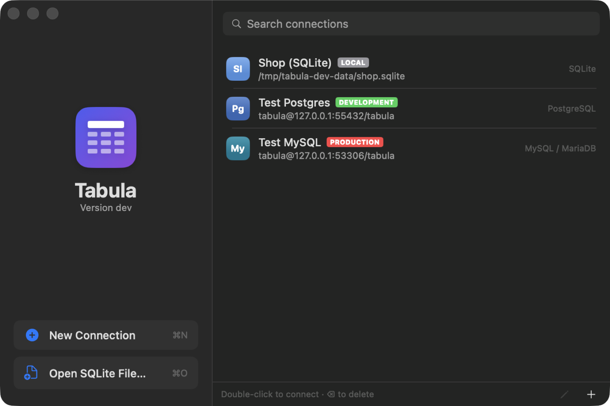

# Connections

[Back to the README](../README.md)

- [Creating a connection](#creating-a-connection)
- [Tags and Production safeguards](#tags-and-production-safeguards)
- [Read-only connections](#read-only-connections)
- [Several connections in one window](#several-connections-in-one-window)
- [Picking up where you left off](#picking-up-where-you-left-off)
- [TLS](#tls)
- [SSH tunnels](#ssh-tunnels)
- [Connection strings](#connection-strings)
- [Dump and restore](#dump-and-restore)

## Creating a connection

Tabula connects to PostgreSQL, MySQL / MariaDB, SQLite files, MongoDB, Redis and SQL Server.

1. Click **New Connection** (⌘N) and pick a type, or paste a [connection string](#connection-strings).
   - **PostgreSQL** uses the user name when Database is empty.
   - **MySQL / MariaDB:** the database is optional; switch it from the sidebar.
   - **SQLite:** choose a file or create one (⌘O in the Connections window opens a SQLite file).
   - **Redis:** User is optional (an ACL user on Redis 6 and later; empty for `requirepass`) and Database is the index, 0 by default.
   - **MongoDB:** see [MongoDB connections](mongodb.md#connecting).
   - **SQL Server:** a server or `server\instance`, a SQL login, and Encrypt; see [SQL Server connections](sqlserver.md#connecting).
2. Choose a [tag](#tags-and-production-safeguards), so a Production connection is obvious at a glance.
3. Click **Test**, then **Connect**, or double-click a saved connection. Connecting gives up after 15 seconds instead of hanging.

Passwords are stored in the macOS Keychain, never in the settings file. **Copy URL** and **Copy URL with Password** in a connection's context menu copy it back as a URL.

> **MySQL 8 and TLS:** accounts that use `caching_sha2_password`, the MySQL 8 default, can only authenticate over an encrypted connection, so new MySQL connections default to TLS **Required**. If the server has no TLS, switch the account to `mysql_native_password` or enable TLS on the server.

## Tags and Production safeguards

Tag each connection **Local**, **Development**, **Staging** or **Production**. The tag colors the sidebar strip and the toolbar pill. On a Production connection Tabula asks before:

- running a statement from the editor that may change data, with what [Tabula's checks](queries.md#checks-before-a-statement-runs) found and, with AI on, **Review with AI**. Development, Staging and untagged connections ask only before a statement that changes every row or drops a table, unless you choose **Don't ask again for this connection**;
- committing changes (from a table tab, a query result, a document, or the preview sheet and ⌘S);
- destructive actions, such as restoring a dump (you type the database name) and Redis commands not known to only read;
- each read-only query the [AI chat](ai.md#read-only-queries) or an [AI agent](mcp.md) wants to run (unless you chose **Always Allow**, below), and searching with [Find in Database](queries.md#find-in-database).

AI is off for Production connections unless you allow it in Settings.

### Always Allow for AI's reads

The question before an AI query offers **Don't Allow**, **Allow Once** and **Always Allow**, as macOS asks for permissions. **Always Allow** runs the query and stops the questions for read-only AI queries on that connection. It is saved per connection, and separately for **AI in Tabula** (the chat, its code blocks, charts and forms, notebooks and dashboards) and **agents over MCP**, so allowing one doesn't allow the other.

- Only the question goes away: each query still has to pass the read-only check, runs on the assistant's read-only connection in a read-only transaction with the time limit and row limits, and shows in the console log. Writes and schema changes are refused as before, and a dashboard still refreshes only when you ask.
- While it is on, the AI chat's description says the connection lets AI read without asking, with **Ask Before Each Query** to take it back, and the toolbar pill's details list it. Agents are told in `list_connections`.
- Take it back at any time in the connection's form: **Let AI in Tabula read without asking**, and, under **Allow AI agents (MCP)**, **Let agents read without asking**. The next query asks again; nothing needs to reconnect. Tagging the connection anything but Production drops both.

## Read-only connections

Turn on **Read-only** in a connection's form to make Tabula refuse anything that writes on it. The form suggests it for Production connections. A read-only connection shows a lock in the toolbar pill ("Read-only"), in the column of open connections and in the Connections window.

While it is locked:

- the grid's cells can't be edited, and **+**, **−**, **Duplicate**, **Paste**, **Import…** and **Generate Rows…** are off ("Read-only connection" on hover); query results can't be edited either;
- **Run**, **Run All** and **Explain Analyze** refuse a script with a statement that [the checks](queries.md#checks-before-a-statement-runs) say may change data or the schema, or one that would make the session read-write again (`SET … READ WRITE`, `default_transaction_read_only`, `query_only`, `RESET ALL`). Nothing of the script runs; the message names the statement and offers **Allow Changes…**. Reads run as usual;
- commits, saving a document, saving or deleting a routine, **Truncate** and **Drop** in the sidebar, **Restore from Dump…**, and [Activity](queries.md#activity-sessions-and-locks)'s **Cancel Query…** and **Kill Session…** are refused;
- the AI chat's [proposed changes](ai.md) are refused, and the model is told why. The chat and [AI agents](mcp.md) only read anyway;
- Redis: the console sends only commands known to only read (`GET` runs, `SET` is refused), and keys can't be created, edited, renamed, expired or deleted.

On the server, Tabula also makes the connection's sessions read-only where the database supports it: PostgreSQL with `SET SESSION CHARACTERISTICS AS TRANSACTION READ ONLY`, MySQL / MariaDB with `SET SESSION TRANSACTION READ ONLY`, SQLite with `PRAGMA query_only`. A statement that got past Tabula's checks is still refused by the server. MongoDB, Redis and SQL Server have no read-only session, so Tabula's checks are all there is; for a guarantee, connect with a database user that may only read.

**Allow Changes…** (the toolbar's lock button, or **Database › Allow Changes for 10 Minutes…**) asks first, naming the connection, then lifts both for 10 minutes: Tabula lets edits and statements through and the session becomes read-write. The toolbar shows **Lock Again** with the time left, and the pill says "Changes allowed". When the time runs out, or you choose **Lock Again**, the connection locks again. Changes still pending in a table tab or a query result stay pending, marked "Locked: allow changes to commit", and can be committed after the next **Allow Changes…**.

Turning **Read-only** on or off in the form of an open connection takes effect at once.

## Several connections in one window

Opening another connection, from the toolbar's database button, adds it to the current window. With two or more, a column left of the sidebar lists them: hover for details, click or press ⌃⌘] / ⌃⌘[ to switch. The connection pill in the toolbar shows details on click.

On PostgreSQL, the sidebar's **Database** picker, above the schema picker, lists the databases your login may connect to and opens any of them from the same connection. Query tabs keep their SQL, tabs of the old database's tables close (Tabula asks first if they hold unsaved edits), and the toolbar shows `database.schema`. The saved connection keeps its database. The new database is connected first: if it can't be opened, nothing in the window changes and the sidebar says why. The AI chat starts over in the new database.

## Reconnecting by itself

After the Mac sleeps, or Wi-Fi or a VPN changes, a connection may have been dropped. Tabula notices three ways: the Mac waking up, the network changing, and a statement failing because the connection is gone (the server closed it, the connection was reset, MySQL's "server has gone away", a Redis connection that closed, an SSH tunnel that ended). It then checks the connection with a cheap ping (`SELECT 1`, `PING`) and, if the server doesn't answer, opens a new one quietly. The connection pill shows **Reconnecting…** meanwhile, and the console log notes it. Tabs stay as they are.

- **The new connection is set up as the old one was:** a new SSH tunnel where there is one, the schema or database selected in the sidebar (`search_path`, `USE`, the Redis database), a read-only connection's read-only session, and the read-only settings of the AI assistant's connection. The AI assistant's and AI agents' (MCP) connections reconnect the same way.
- **Reads run again by themselves.** Page loads, row counts, the sidebar's lists and SELECTs run from the editor are retried once on the new connection.
- **Nothing that may have changed data is run again.** A commit, an `INSERT`, `UPDATE`, `DELETE`, DDL, a procedure call, or the rest of a script stops with "The connection was lost while this ran; it may or may not have been applied." Check the data before running it again.
- **An open transaction is reported as lost.** When you ran `BEGIN` in a query tab and the connection was lost, the server rolled back what wasn't committed. Your next statement says so instead of running on its own outside the transaction; start again from `BEGIN`. Settings you made yourself with `SET` or `USE` aren't put back, so a read that depended on them isn't retried either.
- **Tabula doesn't hammer the server.** Each notice makes one reconnect of a few tries, waiting longer before each one; if they all fail, the window shows why with **Try Again**, as when connecting fails, and the next wake or network change tries once more. A connection you closed is never reopened.
- Production connections behave the same way: reconnecting is safe, and only reads are retried.

## Picking up where you left off

Reopening a connection brings back its query tabs (their SQL, unsaved edits included, and the `.sql` files they are tied to), the open tables (Data or Structure) in their order, the selected tab, filters, the schema, the PostgreSQL database the window had moved to, and the query history. Only the selected table loads its rows at once; the others load when selected. Reconnect keeps the tabs too.

The state is saved when a connection, its window or Tabula closes, and every few seconds while it changes. A connection that is still connecting, or failed to, never overwrites what was saved. **Reopen tabs when connecting** in Settings › General turns this off and forgets what was kept; deleting a connection deletes its state.

Windows aren't restored at launch, so Tabula never reconnects to a database, such as Production, unless you choose to.

## TLS

TLS can be off, **Required**, or required with **Verify certificate**.

- **Verify certificate** checks the server against the macOS trust store. Databases with a private CA (such as AWS RDS, or self-signed certificates) fail until that CA is added to Keychain Access and trusted.
- **Required** encrypts without checking the certificate.

SQL Server has settings of its own, as Microsoft's drivers name them: Encrypt, Trust server certificate and a certificate authority. See [SQL Server encryption](sqlserver.md#encryption).

## SSH tunnels

Turn on **Connect over SSH** (PostgreSQL, MySQL, SQL Server) to reach a database through an SSH server (a bastion). The form takes the SSH host, port, user and, optionally, a private key file. Host is then the database as the SSH server sees it, such as `localhost`.

- Tabula runs the system's `/usr/bin/ssh` with key authentication only: keys from ssh-agent, `~/.ssh`, or a key file you choose. Add a key with a passphrase to ssh-agent first (`ssh-add`). No SSH password or passphrase is stored.
- The server's host key must already be in `~/.ssh/known_hosts`; connect once with `ssh` in Terminal to check and save it. `~/.ssh/config` isn't read, so enter the real host name, port and user. IPv6 addresses work for the SSH server and the database host.
- The tunnel listens on 127.0.0.1 only and closes with the connection or when Tabula quits. **Verify certificate** needs a database host name, not an IP address, so TLS checks the database's real identity rather than the tunnel's.

## Connection strings

**Connection String…** (⇧⌘N) in the Connections window, paste (⌘V) into the connection list, or type one in the Host field. A summary shows what was read before **Continue** fills in the form, password included. Tabula never reads the clipboard by itself.

- It accepts `postgresql://`, `mysql://`, `redis://`, `rediss://`, `mongodb://`, `mongodb+srv://`, `sqlserver://`, `mssql://` and `file://` URLs (and those TablePlus copies, with their name, tag and TLS settings), JDBC URLs, libpq `key=value` strings and .NET-style `Server=…;Uid=…;Pwd=…` strings (SQL Server's ADO.NET ones too, such as `Server=tcp:db,1433;Initial Catalog=shop;User ID=app`).
- URL escapes are decoded (`p%3Fss` becomes `p?ss`). A password that still holds escapes, as some dashboards show them, gets a **Decode** button, and a failed login says when escapes are the likely cause.
- Copy a connection back as a URL, with or without the password, from its context menu.

## Dump and restore

**File › Dump Database…** (or **Dump Table…** in the sidebar) and **File › Restore from Dump…**, for PostgreSQL and MySQL, with progress and Stop. SQL Server has no client tool like `pg_dump` that writes a database out as a script, so there the menu items say what to use instead: `BACKUP DATABASE` and `RESTORE DATABASE` on the server, or SQL Server Management Studio's Generate Scripts.

- Tabula uses the newest `pg_dump`, `pg_restore`, `psql`, `mysqldump` and `mysql` (or MariaDB's) it finds in Postgres.app, Homebrew and your PATH; pg_dump must be at least as new as the server. If one is missing, the sheet says how to install it.
- Dumps: structure, data or both; PostgreSQL as a SQL script or a custom archive; optional DROP statements and, on PostgreSQL, owners and privileges. A failed or stopped dump leaves no file behind.
- Restores stop at the first error. On PostgreSQL they run in one transaction by default, so a failure changes nothing. Production connections ask you to type the database name.
- Scripts can't run commands on your Mac: PostgreSQL scripts with psql commands such as `\!` are refused (pg_dump's `\restrict` is allowed), and the mysql client's `system` command and local file loading are off. **Restore only dumps you trust:** they can contain any SQL.
- Passwords reach the tools through the environment (PostgreSQL) or a private temporary option file (MySQL), never the command line. `~/.my.cnf`, MySQL login paths, `~/.psqlrc` and `PG*` / `MYSQL_*` variables aren't used. SSH connections go through the tunnel.
- The `transaction_timeout` setting pg_dump 17 writes is left out when restoring into PostgreSQL 16 or older, which reject it.
