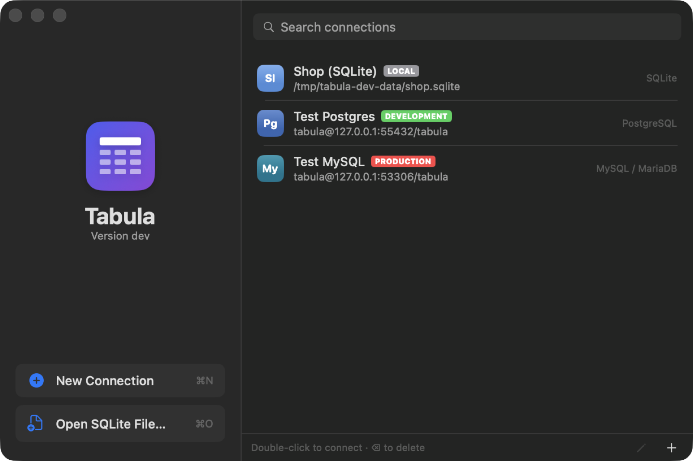

# Connections

[Back to the README](../README.md)

- [Creating a connection](#creating-a-connection)
- [Groups](#groups)
- [Tags and Production safeguards](#tags-and-production-safeguards)
- [Read-only connections](#read-only-connections)
- [Structure changes as migrations only](#structure-changes-as-migrations-only)
- [Several connections in one window](#several-connections-in-one-window)
- [Picking up where you left off](#picking-up-where-you-left-off)
- [TLS](#tls)
- [SSH tunnels](#ssh-tunnels)
- [Connection strings](#connection-strings)
- [Dump and restore](#dump-and-restore)

## Opening a connection

In the Connections window (⇧⌘K), double-click a connection, or use the keyboard: type in the search field to narrow the list, **↑** and **↓** move through the connections shown without leaving the field, and **Return** connects to the one chosen (the first match of a search when none is). A search keeps the connection you had chosen while it is still shown, and otherwise chooses the first match. The same keys work in the list itself, and in the picker a new, empty window tab shows.

## Creating a connection

Tabula connects to PostgreSQL, MySQL / MariaDB, SQLite files, MongoDB, Redis and SQL Server.

1. Click **New Connection** (⌘N) and pick a type, or paste a [connection string](#connection-strings).
   - **PostgreSQL** uses the user name when Database is empty.
   - **MySQL / MariaDB:** the database is optional; switch it from the sidebar.
   - **SQLite:** choose a file or create one (⌘O in the Connections window opens a SQLite file).
   - **Redis:** User is optional (an ACL user on Redis 6 and later; empty for `requirepass`) and Database is the index, 0 by default.
   - **MongoDB:** see [MongoDB connections](mongodb.md#connecting).
   - **SQL Server:** a server or `server\instance`, a SQL login, and Encrypt; see [SQL Server connections](sqlserver.md#connecting).
2. Choose a [tag](#tags-and-production-safeguards), so a Production connection is obvious at a glance.
3. Click **Test**, then **Connect**, or double-click a saved connection. Connecting gives up after 15 seconds instead of hanging.

Passwords are stored in the macOS Keychain, never in the settings file. **Copy URL** and **Copy URL with Password** in a connection's context menu copy it back as a URL.

> **MySQL 8 and TLS:** accounts that use `caching_sha2_password`, the MySQL 8 default, can only authenticate over an encrypted connection, so new MySQL connections default to TLS **Required**. If the server has no TLS, switch the account to `mysql_native_password` or enable TLS on the server.

## Groups

With many connections, put them in groups: one for each project, say, with its development, staging and production databases.

- **Move to Group** in a connection's menu (right-click it in the Connections window) lists the groups to move it to, **New Group…** for a group of a new name, and **Remove from Group**. The form has the same as a field: type a group's name in **Group**, or a new name.
- The list shows the connections of no group first, then each group under its name with the number of its connections. Click a group's name to close it, and again to open it; closed groups stay closed the next time Tabula opens.
- Right-click a group's name for **Rename Group…** and **Ungroup**, which lists its connections without a group again. Renaming a group to the name of another puts its connections in that one, and a group's name is the same whatever its capitals: typing `shop` joins **Shop**. A group is there while a connection is in it: there are no empty groups to tidy away.
- A search looks through every connection, in closed groups too, and matches a group's name as well as a connection's. The search chooses the first connection that matches by its own name or address, before one shown only for its group's name. **↑**, **↓** and **Return** go through the connections shown, so they skip a closed group; closing a group takes the choice off a connection in it, so **Delete** and **Edit** never act on one you can't see.
- Dragging a connection changes its place among the connections of its group. Groups stand in the order their first connections were saved in. There are no groups inside groups.

Groups are only where a connection is listed: moving one changes nothing about the connection, and nothing reconnects. The other lists of connections show the same groups, always open: the picker of a new, empty window tab (its search matches group names too), the **Connections** toolbar menu, the rail's **Open Connection** menu, the pill's list, and the pickers of **Compare Schemas** and **Compare Data**.

## Tags and Production safeguards

Tag each connection **Local**, **Development**, **Staging** or **Production**. The tag colors the sidebar strip and the toolbar pill. On a Production connection Tabula asks before:

- running a statement from the editor that may change data, with what [Tabula's checks](queries.md#checks-before-a-statement-runs) found and, with AI on, **Review with AI**. Development, Staging and untagged connections ask only before a statement that changes every row or drops a table, unless you choose **Don't ask again for this connection**;
- committing changes (from a table tab, a query result, a document, or the preview sheet and ⌘S);
- destructive actions, such as restoring a dump (you type the database name) and Redis commands not known to only read;
- each read-only query the [AI chat](ai.md#read-only-queries) or an [AI agent](mcp.md) wants to run (unless you chose **Always Allow**, below), and searching with [Find in Database](queries.md#find-in-database).

AI is off for Production connections unless you allow it in Settings.

### Always Allow for AI's reads

The question before an AI query offers **Don't Allow**, **Allow Once** and **Always Allow**, as macOS asks for permissions. **Always Allow** runs the query and stops the questions for read-only AI queries on that connection. It is saved per connection, and separately for **AI in Tabula** (the chat, its code blocks, charts and forms, notebooks and dashboards) and **agents over MCP**, so allowing one doesn't allow the other.

- Only the question goes away: each query still has to pass the read-only check, runs on the assistant's read-only connection in a read-only transaction with the time limit and row limits, and shows in the console log. Writes and schema changes are refused as before, and a dashboard still refreshes only when you ask.
- While it is on, the AI chat's description says the connection lets AI read without asking, with **Ask Before Each Query** to take it back, and the toolbar pill's details list it. Agents are told in `list_connections`.
- Take it back at any time in the connection's form: **Let AI in Tabula read without asking**, and, under **Allow AI agents (MCP)**, **Let agents read without asking**. The next query asks again; nothing needs to reconnect. Tagging the connection anything but Production drops both.

## Read-only connections

Turn on **Read-only** in a connection's form to make Tabula refuse anything that writes on it. The form suggests it for Production connections. A read-only connection shows a lock in the toolbar pill ("Read-only"), in the column of open connections and in the Connections window.

While it is locked:

- the grid's cells can't be edited, and **+**, **−**, **Duplicate**, **Paste**, **Import…** and **Generate Rows…** are off ("Read-only connection" on hover); query results can't be edited either;
- **Run**, **Run All** and **Explain Analyze** refuse a script with a statement that [the checks](queries.md#checks-before-a-statement-runs) say may change data or the schema, or one that would make the session read-write again (`SET … READ WRITE`, `default_transaction_read_only`, `query_only`, `RESET ALL`). Nothing of the script runs; the message names the statement and offers **Allow Changes…**. Reads run as usual;
- commits, saving a document, saving or deleting a routine, **Truncate** and **Drop** in the sidebar, **Restore from Dump…**, and [Activity](queries.md#activity-sessions-and-locks)'s **Cancel Query…** and **Kill Session…** are refused;
- the AI chat's [proposed changes](ai.md) are refused, and the model is told why. The chat and [AI agents](mcp.md) only read anyway;
- Redis: the console sends only commands known to only read (`GET` runs, `SET` is refused), and keys can't be created, edited, renamed, expired or deleted.

On the server, Tabula also makes the connection's sessions read-only where the database supports it: PostgreSQL with `SET SESSION CHARACTERISTICS AS TRANSACTION READ ONLY`, MySQL / MariaDB with `SET SESSION TRANSACTION READ ONLY`, SQLite with `PRAGMA query_only`. A statement that got past Tabula's checks is still refused by the server. MongoDB, Redis and SQL Server have no read-only session, so Tabula's checks are all there is; for a guarantee, connect with a database user that may only read.

**Allow Changes…** (the toolbar's lock button, or **Database › Allow Changes for 10 Minutes…**) asks first, naming the connection, then lifts both for 10 minutes: Tabula lets edits and statements through and the session becomes read-write. The toolbar shows **Lock Again** with the time left, and the pill says "Changes allowed". When the time runs out, or you choose **Lock Again**, the connection locks again. Changes still pending in a table tab or a query result stay pending, marked "Locked: allow changes to commit", and can be committed after the next **Allow Changes…**.

Turning **Read-only** on or off in the form of an open connection takes effect at once.

## Structure changes as migrations only

When a database's schema belongs to a migration tool (Prisma, TypeORM, SQL files run by a deploy), a column added by hand is a column the next migration doesn't know about. Turn on **Structure changes as migrations only** in the connection's form, and Tabula doesn't change the structure of that database itself. The setting is there for PostgreSQL, MySQL / MariaDB, SQLite and SQL Server.

With it on:

- the [Structure tab](schema.md#changing-a-tables-structure) still takes pending changes and **Preview** still shows their statements, but **Commit** is off. **Save as Migration…** in the preview [writes them to the project's migrations folder](schema.md#saving-the-changes-as-a-migration), for the migration tool to run;
- **New Table…**, **Rename…** and **Drop…** are off, in the sidebar, the Database menu and the command palette;
- a function, procedure or trigger can't be saved or deleted from its tab, and **Restore from Dump…** is refused: a dump drops and creates tables;
- **Run**, **Run All** and **Explain Analyze** refuse a script with a statement that creates, alters, drops or renames something of the schema: `CREATE`, `ALTER`, `DROP` and `RENAME` statements, PostgreSQL's and SQL Server's `SELECT … INTO new_table`, and `EXPLAIN ANALYZE` of one. The refusal shows the statement, and nothing of the script runs.

What isn't structure still runs: temporary tables (`CREATE TEMP TABLE …`, MySQL's `DROP TEMPORARY TABLE`, SQL Server's `#name`, PostgreSQL's `pg_temp.name`), users, roles and logins, `ALTER SYSTEM` and `ALTER SESSION`, `CREATE DATABASE`, and `ALTER SEQUENCE` (setting a counter after a data load). Tabula can't tell that a plain name is a temporary table, so `ALTER TABLE scratch …` or `CREATE INDEX … ON scratch` is refused even when `scratch` is one: on PostgreSQL write `pg_temp.scratch`.

Rows are edited, imported and committed as usual, and **Truncate** still works: the setting is about the structure only. It isn't a lock, so there is nothing to unlock: on a connection that is also [read-only](#read-only-connections), **Allow Changes…** lets rows change for 10 minutes and the structure still waits for a migration; a refused structure statement says so and doesn't offer **Allow Changes…**. To change the structure from Tabula after all, turn the setting off in the form; it takes effect at once on an open connection.

Tabula reads the statements as its [checks before a statement runs](queries.md#checks-before-a-statement-runs) do, so a change of structure made from inside something else (a `DO` block, a stored procedure, `EXECUTE` of a built string) isn't caught. For a guarantee, connect with a database user that has no right to change the schema.

## Several connections in one window

Opening another connection, from the toolbar's database button, adds it to the current window. With two or more, a column left of the sidebar lists them: hover for details, click or press ⌃⌘] / ⌃⌘[ to switch. The connection pill in the toolbar shows details on click.

On PostgreSQL, the sidebar's **Database** picker, above the schema picker, lists the databases your login may connect to and opens any of them from the same connection. Query tabs keep their SQL, tabs of the old database's tables close (Tabula asks first if they hold unsaved edits), and the toolbar shows `database.schema`. The saved connection keeps its database. The new database is connected first: if it can't be opened, nothing in the window changes and the sidebar says why. The AI chat starts over in the new database.

## Reconnecting by itself

After the Mac sleeps, or Wi-Fi or a VPN changes, a connection may have been dropped. Tabula notices three ways: the Mac waking up, the network changing, and a statement failing because the connection is gone (the server closed it, the connection was reset, MySQL's "server has gone away", a Redis connection that closed, an SSH tunnel that ended). It then checks the connection with a cheap ping (`SELECT 1`, `PING`) and, if the server doesn't answer, opens a new one quietly. The connection pill shows **Reconnecting…** meanwhile, and the console log notes it. Tabs stay as they are.

- **The new connection is set up as the old one was:** a new SSH tunnel where there is one, the schema or database selected in the sidebar (`search_path`, `USE`, the Redis database), a read-only connection's read-only session, and the read-only settings of the AI assistant's connection. The AI assistant's and AI agents' (MCP) connections reconnect the same way.
- **Reads run again by themselves.** Page loads, row counts, the sidebar's lists and SELECTs run from the editor are retried once on the new connection.
- **Nothing that may have changed data is run again.** A commit, an `INSERT`, `UPDATE`, `DELETE`, DDL, a procedure call, or the rest of a script stops with "The connection was lost while this ran; it may or may not have been applied." Check the data before running it again.
- **An open transaction is reported as lost.** When you ran `BEGIN` in a query tab and the connection was lost, the server rolled back what wasn't committed. Your next statement says so instead of running on its own outside the transaction; start again from `BEGIN`. Settings you made yourself with `SET` or `USE` aren't put back, so a read that depended on them isn't retried either.
- **Tabula doesn't hammer the server.** Each notice makes one reconnect of a few tries, waiting longer before each one; if they all fail, the window shows why with **Try Again**, as when connecting fails, and the next wake or network change tries once more. A connection you closed is never reopened.
- Production connections behave the same way: reconnecting is safe, and only reads are retried.

## Picking up where you left off

Reopening a connection brings back its query tabs (their SQL, unsaved edits included, and the `.sql` files they are tied to), the open tables (Data or Structure) in their order, the selected tab, filters, the schema, the PostgreSQL database the window had moved to, and the query history. Only the selected table loads its rows at once; the others load when selected. Reconnect keeps the tabs too.

The state is saved when a connection, its window or Tabula closes, and every few seconds while it changes. A connection that is still connecting, or failed to, never overwrites what was saved. **Reopen tabs when connecting** in Settings › General turns this off and forgets what was kept; deleting a connection deletes its state.

Windows aren't restored at launch, so Tabula never reconnects to a database, such as Production, unless you choose to.

## TLS

TLS can be off, **Required**, or required with **Verify certificate**.

- **Verify certificate** checks the server against the macOS trust store. Databases with a private CA (such as AWS RDS, or self-signed certificates) fail until that CA is added to Keychain Access and trusted, or chosen as the connection's **Certificate authority** (below).
- **Required** encrypts without checking the certificate.

SQL Server has settings of its own, as Microsoft's drivers name them: Encrypt, Trust server certificate and a certificate authority. See [SQL Server encryption](sqlserver.md#encryption).

### Client certificates and a certificate authority of your own

For PostgreSQL, MySQL / MariaDB and Redis, once TLS is on:

- **Client certificate** and **Client key** are the PEM files of the certificate this Mac shows a server that asks every client for one (mutual TLS), and of its private key. Both are needed together. A key protected by a passphrase is refused with a message: Tabula neither asks for the passphrase nor stores it, so use a key without one (`openssl pkey -in key.pem -out plain.pem`).
- **Certificate authority**, with **Verify certificate**, is a PEM file of the authorities to trust in place of the system's, for a server whose certificate a private authority issued.
- Only the files' paths are saved with the connection; the files are read each time it connects, so a renewed certificate is picked up by itself. They aren't part of **Copy URL**; pasting a connection string over the form keeps them, and changing the connection's type drops the ones the new type doesn't take. Dump and restore pass them to `pg_dump`, `pg_restore`, `mysqldump` and `mysql` (libpq wants the key file readable by you alone: `chmod 600`).
- MongoDB's TLS is its driver's own and takes neither; SQL Server has its certificate authority under [Encryption](sqlserver.md).

## SSH tunnels

Turn on **Connect over SSH** (every kind but SQLite, which is a file) to reach a database through an SSH server (a bastion). The form takes the SSH host, port, user and, optionally, a private key file. Host is then the database as the SSH server sees it, such as `localhost`.

- **Redis** goes through a tunnel with everything it opens: the connection, its reconnects (each opens a new tunnel) and the short connection that stops a running script, so stopping takes as long as the SSH servers take to answer. **MongoDB** takes one **standalone** server through the tunnel, without TLS (the tunnel encrypts the way to the SSH server). A seed list (`mongodb+srv`), several members, and a server that says it is a member of a replica set are refused: the driver looks for a replica set's other members by itself, outside the tunnel.
- Tabula runs the system's `/usr/bin/ssh` with key authentication only: keys from ssh-agent, `~/.ssh`, or a key file you choose. Add a key with a passphrase to ssh-agent first (`ssh-add`). No SSH password or passphrase is stored.
- The host key of every SSH server on the way must already be in `~/.ssh/known_hosts`; connect once with `ssh` in Terminal to check and save it. IPv6 addresses work for the SSH servers and the database host.
- **Jump hosts** takes the SSH servers to go through first, in order, as `ssh -J` writes them: `user@bastion:22, inner.example.com`. The tunnel then opens on the SSH host, reached through them. A jump host without a user gets this Mac's user name, as with ssh. A key file you chose is used for the jump hosts too, and is then the only key offered to every server on the way.
- **Read ~/.ssh/config** lets the SSH host and the jump hosts be `Host` names from that file. Tabula reads the file itself and takes five settings for each host: `HostName`, `User`, `Port`, `IdentityFile` and `ProxyJump` plus `IdentitiesOnly` (as in ssh, the first jump host of a list is reached through its own `ProxyJump`, the others from the one before them). What the form says wins: the SSH user when it is filled in, a port other than 22, a chosen key, and jump hosts entered in the form in place of the host's `ProxyJump` (enter `none` for a direct connection). Turning the setting on empties an SSH user that is only this Mac's user name, so that the file's `User` is used. `Include`, `Host` patterns with `*`, `?` and `!`, and `Match all` are read as ssh reads them.
- ssh never reads `~/.ssh/config` for a tunnel, with or without that setting: it gets a configuration Tabula writes with those settings only, so nothing in your file runs (`ProxyCommand`, `LocalCommand`, `Match exec`) and its forwards aren't opened. A host that is reached through a `ProxyCommand` is refused with a message; use `ProxyJump` for it or enter the jump hosts. Other `Match` blocks apply to no host, and tokens in `IdentityFile` (`%h`) aren't expanded: such a key is skipped.
- The tunnel listens on 127.0.0.1 only and closes with the connection or when Tabula quits. **Verify certificate** needs a database host name, not an IP address, so TLS checks the database's real identity rather than the tunnel's.

## Connection strings

**Connection String…** (⇧⌘N) in the Connections window, paste (⌘V) into the connection list, or type one in the Host field. A summary shows what was read before **Continue** fills in the form, password included. Tabula never reads the clipboard by itself.

- It accepts `postgresql://`, `mysql://`, `redis://`, `rediss://`, `mongodb://`, `mongodb+srv://`, `sqlserver://`, `mssql://` and `file://` URLs (and those TablePlus copies, with their name, tag and TLS settings), JDBC URLs, libpq `key=value` strings and .NET-style `Server=…;Uid=…;Pwd=…` strings (SQL Server's ADO.NET ones too, such as `Server=tcp:db,1433;Initial Catalog=shop;User ID=app`).
- URL escapes are decoded (`p%3Fss` becomes `p?ss`). A password that still holds escapes, as some dashboards show them, gets a **Decode** button, and a failed login says when escapes are the likely cause.
- Copy a connection back as a URL, with or without the password, from its context menu.

## Dump and restore

**File › Dump Database…** (or **Dump Table…** in the sidebar) and **File › Restore from Dump…**, for PostgreSQL, MySQL, [SQLite](#sqlite-dumps), [MongoDB](#mongodb-dumps) and [Redis](#redis-dumps), with progress and Stop. SQL Server has no client tool like `pg_dump` that writes a database out as a script, so there the menu items say what to use instead: `BACKUP DATABASE` and `RESTORE DATABASE` on the server, or SQL Server Management Studio's Generate Scripts.

- Tabula uses the newest `pg_dump`, `pg_restore`, `psql`, `mysqldump` and `mysql` (or MariaDB's) it finds in Postgres.app, Homebrew and your PATH; pg_dump must be at least as new as the server. If one is missing, the sheet says how to install it.
- Dumps: structure, data or both; PostgreSQL as a SQL script or a custom archive; optional DROP statements and, on PostgreSQL, owners and privileges. A failed or stopped dump leaves no file behind.
- Restores stop at the first error. On PostgreSQL they run in one transaction by default, so a failure changes nothing. Production connections ask you to type the database name.
- Scripts can't run commands on your Mac: PostgreSQL scripts with psql commands such as `\!` are refused (pg_dump's `\restrict` is allowed), and the mysql client's `system` command and local file loading are off. **Restore only dumps you trust:** they can contain any SQL.
- Passwords reach the tools through the environment (PostgreSQL) or a private temporary option file (MySQL), never the command line. `~/.my.cnf`, MySQL login paths, `~/.psqlrc` and `PG*` / `MYSQL_*` variables aren't used. SSH connections go through the tunnel.
- The `transaction_timeout` setting pg_dump 17 writes is left out when restoring into PostgreSQL 16 or older, which reject it.

### SQLite dumps

Tabula writes and runs SQLite's scripts itself, so no tool has to be installed.

- A dump is a `.sql` script like the one `sqlite3`'s `.dump` writes, and `sqlite3` reads it: structure, data or both, of the whole database or of chosen tables (with their indexes and triggers), optionally with `DROP` statements. It is taken from one read transaction, so it is the database as it was at one moment. Unless the database is in WAL mode, other programs, and edits in Tabula, can't write to the file while the dump runs.
- Values are written as SQLite's own `quote()` writes them: text, BLOBs as `X'…'`, NULL, numbers with every digit. Text goes into the script byte for byte, so text that isn't UTF-8 stays as it is stored. Generated columns are left to the database, and the counters of `AUTOINCREMENT` tables come along.
- Full-text (FTS) and R-tree tables are created with their `CREATE VIRTUAL TABLE` statement and filled row by row; the tables they keep their content in aren't written, and can't be dumped by themselves. A contentless full-text table (`content=''`) has no text to read back: the script creates it and says in a comment that its rows aren't there.
- A restore runs the script in one transaction: a statement that fails, or Stop, leaves the database as it was, and the message names the line. The script's own `BEGIN` and `COMMIT` are passed over; a `ROLLBACK` in it stops the restore.
- A script can't reach another file (`ATTACH` and `DETACH` are refused), and `sqlite3`'s dot commands such as `.shell` aren't SQL: they stop the restore as an error, and nothing runs on your Mac.
- A dump made by `sqlite3` of a database with full-text or R-tree tables creates them by writing to the schema, which the system's SQLite refuses to a script: run that one with `sqlite3` in Terminal, or dump the database with Tabula. A script is read into memory whole: one larger than 1 GB is refused, and so is a file with a zero byte in it, which isn't a SQL script.
- **Dump Table…** is for tables of the file itself; a table of an attached database is dumped from a connection to that file.

### MongoDB dumps

Tabula reads and writes MongoDB's dumps itself, in the formats of `mongodump`, so neither `mongodump` nor `mongorestore` has to be installed and each tool reads what the other wrote.

- **Dump Database…** writes the selected database, and **Dump Collection…** one collection, to one file: the archive `mongodump --archive` writes. It holds every document as the server stores it, each collection's options (capped, validator, collation, time series) and indexes, and the views. `mongorestore --archive=<file>` restores it.
- **Restore from Dump…** takes an archive, the folder `mongodump` writes by default (the database's folder, or the folder around it when it holds one database), or one collection's `.bson` file, plain or compressed with `--gzip`. It restores into the database selected in the sidebar, whatever the database was called when it was dumped.
- As with `mongorestore`, a restore adds to what is there: collections the database doesn't have are created with their options, documents are inserted, then indexes are built and views created. A document whose `_id` its collection already has is skipped, and the sheet says how many were. **Drop existing collections first** drops each collection of the dump before restoring it; collections the dump doesn't have stay.
- A restore isn't a transaction: it stops at the first error, or at Stop, and what it wrote by then stays. Production connections ask you to type the database name.
- Every collection's documents carry a checksum in an archive. An archive that is cut short, or whose documents don't match their checksum, stops the restore with a message saying so.
- A dump reads each collection as it is at that moment, not the whole database at one moment: on a database being written to, collections can be a little apart, as with `mongodump` without `--oplog`.
- Not dumped or restored: the server's own `system.` collections, so users and roles aren't part of a dump. A time series collection is dumped as the buckets the server keeps its documents in, the way `mongodump` does it.
- An archive of several databases (`mongodump --archive` without `--db`) isn't restored: Tabula restores one database at a time, into the selected one. Dump one database with `mongodump --db`, or use `mongorestore`.

### Redis dumps

Tabula dumps and restores a Redis database itself, with nothing to install. A dump is a file of the Redis commands that write the keys again, in the protocol's own format, so `redis-cli --pipe < file` restores it too, into any server version.

- A dump of no keys (an empty database, or a pattern nothing matches) saves no file and says so.
- **Dump Database…** writes the database selected in the window (`db0`, `db1`…), or only the keys matching a pattern such as `user:*`. Every key is written with its value and its expiry time: strings with `SET`, lists with `RPUSH`, sets with `SADD`, hashes with `HSET`, sorted sets with `ZADD` and streams with `XADD`, then `PEXPIREAT`. Values are kept byte for byte, whatever they hold.
- Streams keep their entries under their own IDs, the last ID they generated, and their consumer groups with the ID each has read up to. Which consumer has which entry pending isn't kept. Hash fields that expire on their own (Redis 7.4) keep their expiry.
- A value of a type only a module knows, such as a RedisJSON document, is written the way the server serialises it (`DUMP`) and loaded with `RESTORE`. Unlike the rest of the file, such a value restores only into a server with that module, of the same version or newer.
- **Restore from Dump…** runs the file's commands in the selected database. A key that is already there is replaced by the dump's, and the other keys stay; **Delete every key first** empties the database before, so it ends up with the dump's keys only.
- The whole file is read and checked before anything is sent. A restore only runs commands that write keys: a file with any other command (`CONFIG`, `EVAL`, `FLUSHALL`, `MODULE`…), one that is cut short, or one that isn't Redis commands all the way through is refused, and nothing is changed.
- A restore isn't a transaction: it stops at the first command the server refuses, or at Stop, and what ran by then stays. Commands go to the server in batches of up to 1,000, so those in the same batch after the refused one have run too. Production connections ask you to type the database's name, and a read-only connection doesn't restore.
- A dump reads the keys one batch after another while the server goes on, so it isn't one moment of the database, unlike the snapshot the server writes. Big values are read and written in pages, so a list of millions of items needs no more memory than a small one.
- Not read: the server's own snapshot (`dump.rdb`, also what `redis-cli --rdb` saves), which only a server loads from its data directory; and files of several databases (with `SELECT`), which `redis-cli --pipe` restores.
