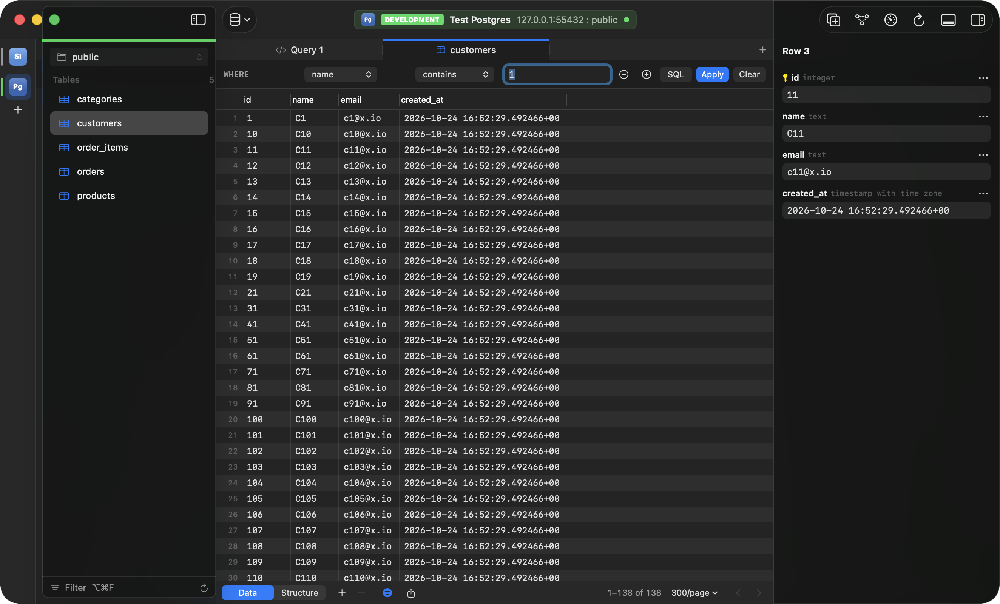

# Browsing and editing data

[Back to the README](../README.md)

- [Browsing](#browsing)
- [Filtering](#filtering)
- [Following foreign keys](#following-foreign-keys)
- [Editing and committing](#editing-and-committing)
- [The value editor](#the-value-editor)
- [Pasting rows](#pasting-rows)
- [Copying and exporting](#copying-and-exporting)
- [Tables without a primary key](#tables-without-a-primary-key)
- [Editing query results](#editing-query-results)
- [Importing files](#importing-files)

## Browsing

- **Schema or database switcher** in the sidebar. The one you pick also becomes the default for queries, so `transactions` finds `dev.transactions`.
- **Table list** you can filter (⌥⌘F), with collapsible groups (Tables or Collections, Views, Functions, Triggers); Tabula remembers which are collapsed, and while the filter has text every group shows its matches. Searching tables, connections and the command palette ignores case and accents: "cafe" finds "café".
- **Tabs:** arrow keys preview tables in one reusable tab; Return or a double-click keeps one open. Drag tabs to reorder them, or use **Move Tab Left / Move Tab Right** in the View menu or the tab's context menu; the order is kept for the next time the connection opens. A middle-click closes a tab, as its close button and ⌘W do. ⌘P jumps to any table, tab or action.
- **Grid:** pages of 100 to 5,000 rows with a total count, server-side sorting, row numbers and spreadsheet-style keys. Space opens the [value editor](#the-value-editor) on a cell. Double-click the empty space below the rows to add a row.

## Filtering

- **Builder:** conditions joined with AND or OR. Each condition has a checkbox: unticked ones stay in the bar but are left out when you apply the filter, and the ticks are remembered with it.
- **SQL:** a `WHERE` clause written by hand.
- **Filter by This Value** on a cell.
- Each table remembers its filter, applied again when you open the table again, even after closing the tab, the connection or Tabula.
- With AI on, [describe the rows](ai.md#filter-by-description) in words instead.

## Following foreign keys

On PostgreSQL, MySQL / MariaDB and SQLite, a value in a foreign key column (such as `orders.customer_id`) leads to the row it refers to, in table tabs and in [query results from one table](#editing-query-results):

- **⌘-click** the value: it shows as a link while ⌘ is held over it, as in Xcode.
- The **arrow** at the end of the cell, shown while the pointer is over it.
- **Open Referenced Row** in the cell's context menu, or ⌥⌘→ (**Database › Open Referenced Row**) on the selected cell.

The referenced table opens in a tab (or in its tab, if it is open) filtered to that key with ordinary filter conditions, one per column of a composite key, and the row is selected. **Back** (⌃⌘←) returns to where you were: the tab, its filter, page and sort, and the row; **Forward** (⌃⌘→) goes again, as in a browser. Following a key in a table to itself (an employee's `manager_id`) filters the same tab, and Back puts it back.

- A NULL key refers to no row and can't be followed; neither can a key with an uncommitted change, nor one in a new row. The context menu item is disabled and its tooltip says why.
- A table in another schema is named with its schema (`sales.invoices`).
- SQLite keys that leave out the referenced columns refer to the other table's primary key.

**Rows Referencing This Row**, in a row's context menu and at the bottom of Row Details (⌥⌘0), lists each table whose foreign key points at the row's table, with how many rows refer to this one (for a customer: its orders). Choosing one opens that table filtered to them. The counts are read-only `COUNT` queries that stop at 1,000 ("1,000+"), on the window's connection, so they show in the console log. Tables are looked for in the row's schema and the other schemas the sidebar lists, up to 20. MongoDB and Redis have no foreign keys.

## Editing and committing

Edit in the grid or in the row details panel (⌥⌘0): set NULL or empty text, add, duplicate and delete rows. Undo and redo work per tab.

- **Nothing is written until you commit.** Changes are highlighted. ⇧⌘S previews the exact SQL (the first 1,000 statements of a large change; **Copy SQL** copies them all), and ⌘S runs every change in one transaction and rolls back if any statement fails. Production connections ask before the commit.
- A commit that can't reach one of its rows, such as a row someone else deleted meanwhile, names the row and rolls back.
- Sorting, filtering, paging or closing a tab asks first if it would throw away uncommitted edits.
- Duplicating rows (⌘D) adds copies of them, selected, as [pasting rows](#pasting-rows) copied from the same table does: the primary key, a column a unique index covers alone, and generated columns are left empty, for the server or you to fill.

## The value editor

A cell shows one line. To see or change a whole value (a JSON document, a long text, bytes) open it in the value editor, a sheet sized to the value (resize it and the next one opens at that size):

- **Space** on the focused cell, or **Open Value Editor** in the cell's context menu.
- **Double-click** a value that spans lines, is longer than 200 characters or is JSON; other values are edited in the cell. Hold ⌥ to open any value.
- The expand button (two arrows) beside a long value, JSON or bytes in the row details panel (⌥⌘0). There a value longer than 1,000 bytes shows in a field eight lines tall that scrolls; it holds the whole value, to select, copy or edit in place.

It shows the value one of three ways, picked from the column's type and the value, and you can switch:

- **JSON:** laid out over indented lines and colored, with line numbers. It is checked as you type; a mistake tints its line and the bar below names the line and column. **Format** lays it out, **Minify** puts it on one line. Numbers keep every digit, strings keep their `\u` escapes and objects keep their key order. A `json` or `jsonb` column only saves valid JSON; text that only looks like JSON can be saved as it is.
- **Text:** wrapped lines, the find bar (⌘F, ⌘G, ⇧⌘G) and a character and line count.
- **Binary:** a hex view (offset, hex, ASCII), with a preview when the bytes are a PNG, JPEG, GIF or HEIC image (the first 256 KB are shown). **Save to File…** writes the bytes, **Load from File…** replaces them. Bytes aren't typed; in a text column, **Load from File…** reads a UTF-8 file as the new text.

**Save** (⌘S) keeps a changed value as a pending change, like an edit in the grid: highlighted, in Preview (⇧⌘S), undone with ⌘Z, written with Commit. JSON is saved as compact or as indented as you left it. **Cancel** (⎋) leaves the cell as it was. Values that can't be changed (views, rows without a key, generated columns, read-only query results) open read-only, with the reason at the top.

## Pasting rows

⌘V pastes rows copied from Tabula, Numbers, Excel or Google Sheets as new rows, committed with ⌘S like any other change. **Edit › Paste** and **Paste** in the grid's context menu say when rows will be added, and how many ("Paste 3 Rows as New Rows"). The new rows are selected, the first scrolled into view, and one ⌘Z takes them all back.

- **Rows copied in Tabula and pasted into the same table** are copies, as **Duplicate Rows** makes them: every value as it is in the grid, pending edits included, with NULL and the text `NULL` told apart. The primary key, the columns that identify rows, a column a unique index covers alone, and generated columns are left empty, for the database (or you) to fill. On MongoDB every value keeps its type (`NumberLong`, `NumberDecimal`, dates, `ObjectId`, nested documents), `_id` is a new one, and a field the page has no column for comes with its document. Copy (⌘C) puts the rows on the clipboard as tab-separated text for other apps, and in Tabula's own form beside it.
- **Rows from another table, Numbers, Excel or Google Sheets** are read from their text. When the first line is a header, such as the one Copy with Column Names writes, columns are matched by name; otherwise in order. `NULL` pastes as NULL (a quoted `"NULL"` is the text). Generated columns, and keys the database numbers itself (an `AUTO_INCREMENT`, `serial` or identity column, SQLite's `INTEGER PRIMARY KEY`, MongoDB's `_id`), are left to the database.
- Several lines, or rows copied in Tabula, are always added as rows, whichever cell is selected. A single value pasted with a cell selected goes into that cell; values from a single column go into the selected column.
- Read-only connections refuse, as they do Add Row, and say why; views can't take rows.

## Copying and exporting

- Copy rows as TSV (⌘C), with column names (⌥⇧⌘C), or a single cell (⌥⌘C). A value with a tab or a line break is quoted, so rows paste into Numbers and Excel cell for cell.
- **Edit › Copy As** (and **Copy As** in the grid's context menu) copies the selected rows, every column, in another format. Nothing selected copies the row of the focused cell.
  - **JSON** (⌃⌘C): an array of objects, keys in column order. Numbers stay numbers, NULL is `null`, booleans are `true` / `false`, JSON and JSONB columns are embedded as JSON, and bytes are base64 strings, where the column's type says so (in a table tab, or a query result that can be edited; MySQL results always); other values are strings. MongoDB documents are copied as the document editor shows them, so `ObjectId`, `NumberLong`, `NumberDecimal` and `ISODate` keep their types.
  - **SQL INSERT**: one statement per row into the table's real name (a query result goes into the table it read, as Export picks it), with the database's quoting and literals. Generated columns and a new row's DEFAULT cells are left out, as Duplicate Row does. **Settings › General › SQL INSERT: one statement for all rows** writes one `INSERT` with a `VALUES` list instead. MongoDB writes one `insertOne` per document.
  - **CSV**: a header line and RFC 4180 quoting, as Export writes it. Pasting it back into a table (⌘V) reads it as CSV, so NULL, empty text and the text `NULL` come back as they were.
  - **Markdown Table**: pipes escaped, line breaks as ` `, values longer than 60 characters cut with an ellipsis.
  - **Tab-Separated**: the same as ⌘C.
- Copy As writes plain text; JSON and CSV also carry their type (`public.json`, `public.comma-separated-values-text`) so other apps can tell what they are given.
- Export CSV, TSV, JSON or SQL `INSERT`, to a file or the clipboard. CSV and TSV exports quote empty text and the text `NULL`, so they can be told from NULL (an empty field) when imported again.
- Binary values show as `\x` and hex, as psql shows them, on every database, and are saved back as bytes by edits, Duplicate Row and SQL export.

## Tables without a primary key

Rows are found by the shortest unique index whose columns are all NOT NULL, or else by SQLite's `rowid` or PostgreSQL's `ctid`. The bottom bar says which ("Rows identified by ctid").

- A `ctid` changes when its row is updated, so editing or deleting a row someone changed since the page loaded fails the commit and nothing is saved; the page reloads after each commit.
- A MySQL / MariaDB table with no such index stays read-only apart from adding rows, and the bottom bar says so.
- Duplicating a row leaves its identifying unique columns empty, as it does a primary key.
- SQLite's `VACUUM` can renumber the `rowid` of a table without an `INTEGER PRIMARY KEY`; reload an open table after running one before editing it.

## Editing query results

Double-click a cell in a result from one table that includes its whole primary key, such as `SELECT id, name, price FROM products` (PostgreSQL, MySQL InnoDB, SQLite). Edits wait for **Commit** (⌘S), **Preview** or **Discard**, as in a table tab; the row details panel edits them too.

- Changes commit in one transaction on a separate connection, and a row someone else changed since the query ran is reported, not overwritten. Production connections ask first. Running the query again, closing the tab or window, quitting, reconnecting or switching database asks before dropping uncommitted edits.
- Joins, views, grouping, functions and computed columns stay read-only, as do key and generated columns. Results must include the whole primary key: a unique index or `ctid` isn't used here.
- **MySQL:** integer, DECIMAL and text columns, when Tabula can prove the InnoDB table's identity (this needs the PROCESS privilege). Otherwise, and for temporary tables or names MySQL stores encoded (such as names with hyphens), the result says **Read-only** and why. Triggers run normally, but their non-transactional side effects can't be rolled back.
- **SQLite:** INTEGER, REAL, NUMERIC and text columns; BLOB, untyped and generated columns, views and virtual tables stay read-only.
- The table's identity is captured when the result is checked for editing, not atomically with the SELECT, so an identical replacement in between can't be told apart.

## Importing files

**File › Import…** in a table tab, or **Import…** in the sidebar's context menu (PostgreSQL, MySQL, SQLite). Columns are matched by name (ignoring case, accents, spaces, `_` and `-`), and you can pick another or skip one; a header row is detected and can be turned off, and the first rows are previewed. The rows become new rows in the grid, committed in one transaction with ⌘S, after a preview with ⇧⌘S if you like.

- **CSV and TSV** as RFC 4180 writes them, in UTF-8 (with or without a byte order mark), UTF-16 with one, or Windows-1252. An empty field is NULL where allowed (else the column's default, or empty text); `""` is empty text and unquoted `NULL` is NULL. Tabula's exports quote empty text and the text `NULL`, so they import back unchanged.
- **JSON:** an array of objects. Numbers keep every digit, nested values become JSON text, `null` is NULL, and a missing field takes the column's default.
- Up to 100,000 rows and 256 MB per file; larger files are refused. Generated columns are left to the database.
- Files can't be imported into MongoDB collections yet.

## Generating test rows

With AI on, **Generate Rows…** (the **+** button's menu, the sidebar's context menu, or **Edit › Generate Rows…**) asks the model for up to 500 realistic rows from the table's schema, checks each value against its column, and adds the valid ones as new rows to preview and commit like these. See [Generate test rows](ai.md#generate-test-rows).
