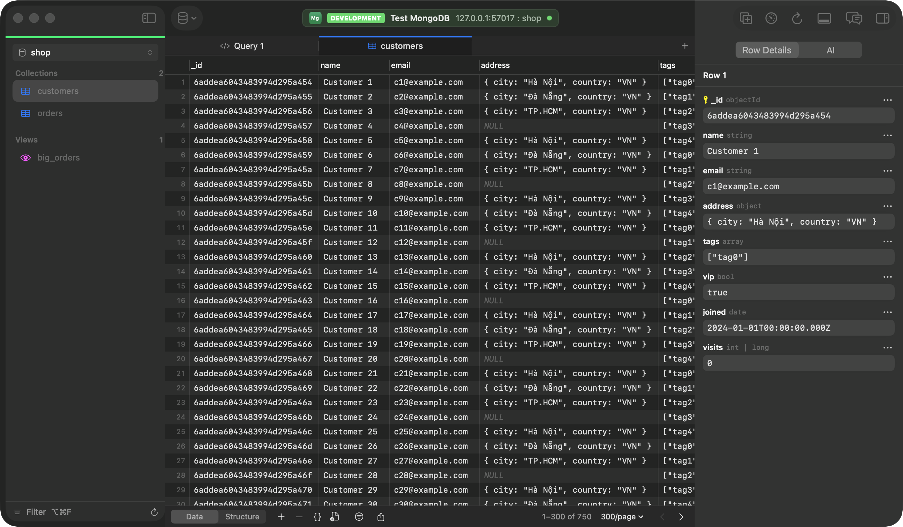
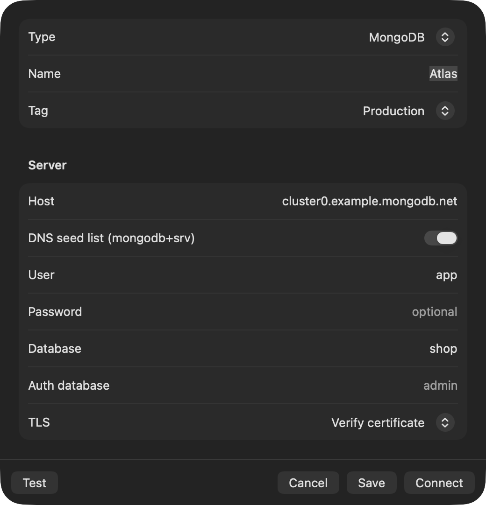
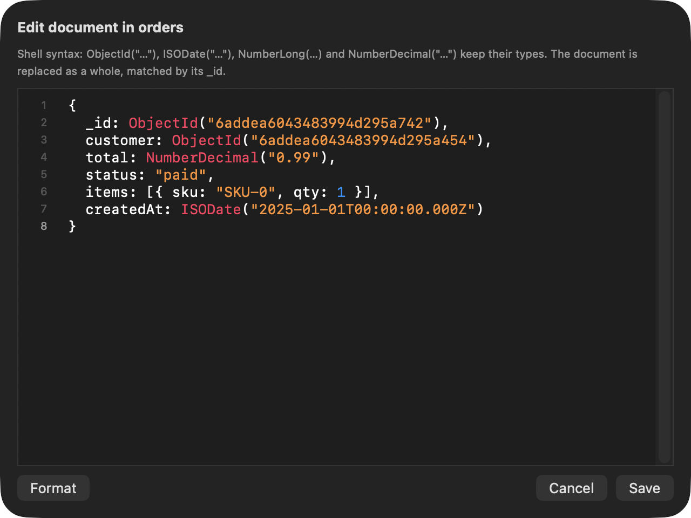
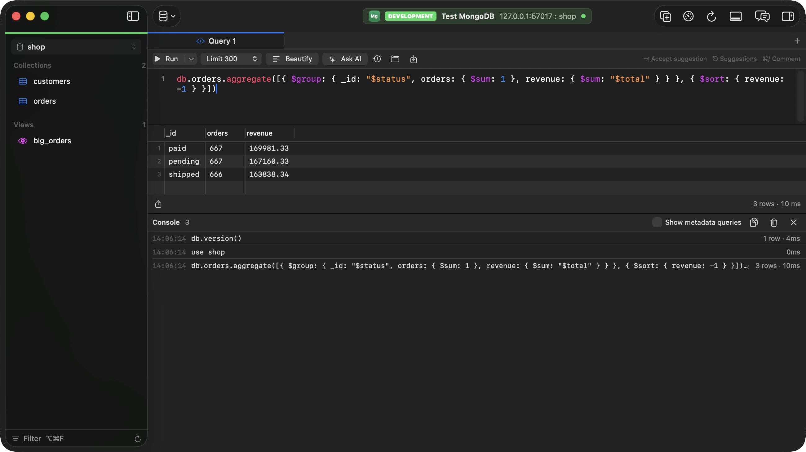

# MongoDB

[Back to the README](../README.md)

- [Connecting](#connecting)
- [Browsing and filtering](#browsing-and-filtering)
- [Editing documents](#editing-documents)
- [Structure](#structure)
- [Query editor](#query-editor)
- [Activity, Top Queries, Health, Users & Roles](#activity-top-queries-health-users--roles)
- [Limitations](#limitations)

<p align="center"></p>

## Connecting

<p align="center"></p>

- **Hosts:** one, or several (`a:27017,b:27017`) for a replica set; if the first is down, the next is tried.
- **Atlas:** turn on **DNS seed list (mongodb+srv)**, and TLS is on by default. Tabula resolves the seed list with the Mac's resolver and refuses servers outside its domain, so a spoofed DNS answer can't redirect the connection. Options in the seed list's TXT record aren't read; set the auth database if it isn't `admin`.
- **User and password** are optional. **Auth database** (`authSource`) defaults to `admin`; **Database**, the one opened first, to `test`, and the sidebar's picker lists every database you may see.
- Authentication: SCRAM-SHA-1 or SCRAM-SHA-256. TLS is available for every connection. **Copy URL** gives a `mongodb://` URL.

## Browsing and filtering

- Collections and views are listed as tables. Documents are in the grid, `_id` first, with nested values inline and BSON types in Row Details. Sorting, paging and a total count work as on the other databases.
- **Filter:** `=` on `42` matches the number or the string, on a 24-digit hex id the ObjectId or the string; `contains` and the like are case-insensitive and also match numbers, dates and ids by their text (MongoDB 4.2 or later); fields can be paths such as `address.city`. The `{ }` button takes a query document instead.

## Editing documents

- **Edits keep the field's type:** `46` in a long field is stored as `NumberLong(46)`, `2025-02-03` in a date field as a date. To change a type, type a shell value such as `NumberDecimal("9.99")`.
- Commit sends `updateOne` / `deleteOne` / `insertOne` by `_id`, one by one, previewed first with ⇧⌘S; if one fails, the message says which were saved.
- **`{ }`** edits the whole document as JSON, replaced by `_id`, or inserts a new one.
- With **Let the chat propose data changes** on, the AI chat can [propose document changes](ai.md#proposed-data-changes) by `_id` as uncommitted edits in this tab, with the same type rules.

<p align="center"></p>

## Structure

**Structure** shows the fields of the first 100 documents with their types, and indexes with their options. AI is told sampled field names and types, with hints about leftover collections, soft-delete, status and mixed-type fields ([messy schemas](ai.md#chat)); documents reach it only from the chat's [read-only queries](ai.md#read-only-queries). **Explain** shows a `find` or `aggregate`'s [plan of stages](queries.md#mongodb-plans). [Server metrics](queries.md#server-metrics) come from `serverStatus` and `dbStats`.

## Query editor

The query editor takes shell statements, one per line or separated by `;`, which may continue on the next line with `.sort(…)` and the like. It highlights them, beautifies them and completes collections, methods, fields and `$` operators:

```js
use shop
db.orders.find({ status: "paid", total: { $gte: NumberDecimal("100") } }, { items: 0 }).sort({ createdAt: -1 })
db.orders.aggregate([{ $group: { _id: "$status", n: { $sum: 1 } } }, { $sort: { n: -1 } }])
db.getCollection("audit log").countDocuments({ at: { $gte: ISODate("2026-01-01") } })
```

<p align="center"></p>

- **Collections:** `find` / `findOne` (with `sort`, `skip`, `limit`, `projection`, `hint`, `collation`, `count()`, `explain()`), `aggregate`, `countDocuments`, `estimatedDocumentCount`, `distinct`, `insertOne` / `insertMany`, `updateOne` / `updateMany` / `replaceOne`, `deleteOne` / `deleteMany`, `findOneAndUpdate` / `Replace` / `Delete`, `createIndex(es)`, `dropIndex(es)`, `getIndexes`, `drop`, `renameCollection`, `stats`.
- **Databases:** `runCommand`, `adminCommand`, `getCollectionNames`, `getCollectionInfos`, `createCollection`, `createView`, `dropDatabase`, `stats`, `serverStatus`, `version`, `currentOp`, `getUsers`, `getRoles`, `getSiblingDB("other")`, and `show dbs`, `show collections`, `show users`, `use <db>`.
- **Values:** JSON, the shell's relaxed syntax (unquoted keys, single quotes, trailing commas, comments, `/regex/i`), `ObjectId`, `ISODate` / `new Date`, `NumberLong`, `NumberInt`, `NumberDecimal`, `UUID`, `BinData`, `Timestamp`, `MinKey` / `MaxKey`, and Extended JSON.
- Tabula reads these statements and sends the matching commands; it doesn't run JavaScript. Results show at most 50,000 documents per statement, and the row limit adds `.limit()` to finds and aggregations without one.
- Stop (⌘.) ends a running command on MongoDB 4.4 or later; documents it already changed stay changed.

## Activity, Top Queries, Health, Users & Roles

The views of the **View** menu work on MongoDB too, in its words: operations, collections, users and roles. The rules are the SQL ones: a read-only connection refuses changes until **Allow Changes…**, Production asks again, and what changes the server shows in the console log.

On MongoDB 4.4 and later every command Tabula sends carries a `comment` marker, `tabula-run:<id>`, or `tabula-run:bg:<id>` for what Tabula reads on its own (catalog reads, metrics, these views). Activity and Top Queries tell Tabula's commands apart by it; a `comment` you write yourself is kept.

### Activity

**View › Activity** (⌥⌘6) lists the server's operations from `$currentOp` (everyone's with the `inprog` privilege, otherwise only your own, which the tab says), without idle connections: op ID, user, namespace, client, application, the command (`find`, `aggregate`, `getMore`…), how long it has run, whether it waits for a lock, and the command as a shell statement with **Copy**, **Explain** and **Open in Query Tab**. Idle sessions holding a transaction open are listed as idle in a transaction; the server's own threads as internal. MongoDB doesn't say which operation holds a lock, so **Blocking** stays empty.

**Kill Op…** (`killOp`) asks first, with the operation, its user and its command, asks again on Production, and is refused on a read-only connection. It isn't offered for Tabula's own operations (stop those with Stop in their tab) or for the server's threads. Killing another user's operation needs the `killop` privilege.

### Top Queries

**View › Top Queries** reads the database profiler (`system.profile`) of the current database and groups its records by the shape of the operation: the statement with its values as `?`, so `db.orders.find({ customer: 7 })` and `db.orders.find({ customer: 9 })` count as `db.orders.find({ customer: ? })`. Each has its runs, total, mean and longest time, documents returned, documents and index keys examined, collection scans (`COLLSCAN`) and the plan of its slowest run. A `getMore` adds its time to the query that opened the cursor. **Explain…** and **Open in Query Tab** use the slowest run, with its values; **AI about This Query** sends its plan, the collection's indexes and the figures, and suggests `createIndex` commands that are never run.

The profiler records only while it is on, and Tabula never changes it. When it is off, the tab says so with the commands to copy:

```js
db.runCommand({ profile: 1, slowms: 100 })   // operations slower than 100 ms; 2 records every operation
db.runCommand({ profile: 0 })                // off again
```

The profile is a capped collection (1 MB by default), so it keeps the latest operations; there is nothing to reset, and the tab has no **Reset Statistics…**. The setting is per database and is lost when the server restarts. Reading it needs the `dbAdmin` role (or `enableProfiler` and `find` on `system.profile`).

### Health

**View › Schema Health** checks the current database:

- **Unused indexes:** no use in `$indexStats` since the server started or the index was built (shown for each), leaving out `_id_`, unique and TTL indexes. The count is the connected server's only: other replica set members and shards keep their own.
- **Duplicate and redundant indexes:** the same fields in the same order, or the first fields of a longer index.
- **Collections scanned without an index:** when the profiler has records, collections it saw scanned whole more often than read through an index, with the fields those scans filtered on and a `createIndex` on them.
- **Largest collections and indexes**, from `$collStats`.

Suggested commands (`db.orders.dropIndex("status_1")`, `db.orders.createIndex({ customer: 1 })`) are only shown, copied or opened in a query tab.

### Users & Roles

**View › Users & Roles** lists the users and roles of the current database from `usersInfo` and `rolesInfo` (tick **Admin Database** for those of `admin`), each as `name@database` with the roles it has; built-in roles are listed with **Show built-in roles**, so they can be given. **Privileges** shows the custom roles' privileges on the database and its collections.

**New User…**, **New Role…**, **Edit…** (a new password, the roles it has), **Grant…** (privilege actions such as `find` or `insert`, to a custom role) and **Drop** queue commands (`createUser`, `updateUser`, `dropUser`, `createRole`, `dropRole`, `grantRolesToUser`, `revokeRolesFromUser` and their role forms, `grantPrivilegesToRole`, `revokePrivilegesFromRole`) that you preview with ⇧⌘S and commit with ⌘S. They run one by one and stop at the first that fails, saying how many were applied. The connection's own user can't be dropped or have its roles taken away here. Passwords are typed in secure fields and shown as `pwd: "•••"` in the preview, the console log and the server's errors; the console log masks `pwd` in any statement, and `db.changeUserPassword` and `db.auth` passwords too.

## Limitations

- The query editor runs shell statements, not JavaScript.
- Edits from the grid aren't wrapped in a transaction.
- X.509, LDAP and Kerberos authentication aren't supported.
- The grid's columns come from the first 100 documents, so a field that appears only later shows up after it is seen on a page.
- Files can't be imported into collections yet.
