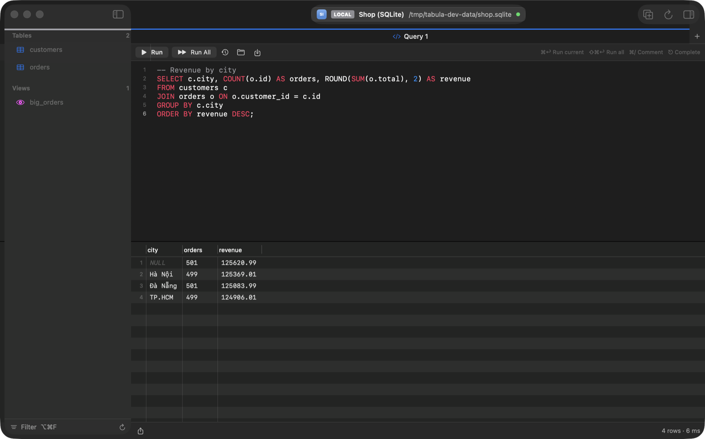
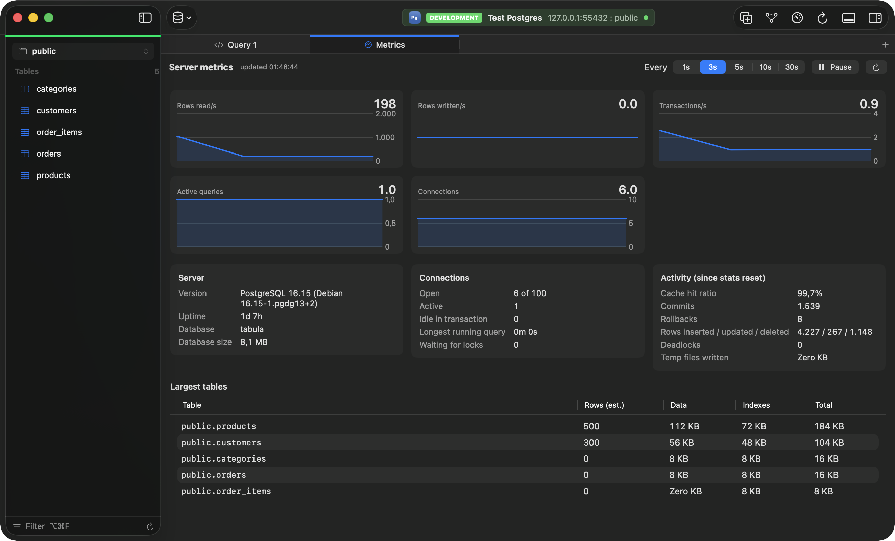

# Queries

[Back to the README](../README.md)

- [The editor](#the-editor)
- [Running and stopping](#running-and-stopping)
- [Checks before a statement runs](#checks-before-a-statement-runs)
- [Saved queries and .sql files](#saved-queries-and-sql-files)
- [Dashboard widgets](#dashboard-widgets)
- [Console log](#console-log)
- [Query plans](#query-plans)
- [Server metrics](#server-metrics)
- [Top Queries](#top-queries)
- [Activity: sessions and locks](#activity-sessions-and-locks)
- [Find in Database](#find-in-database)

## The editor

- Highlighting that follows the database's comment and quoting rules, and line numbers.
- Suggestions for tables, columns and keywords as you type: tables after `FROM` / `JOIN` (including `schema.` for another schema), columns after `alias.`, and every table's columns before the statement names one. The first one shows in grey and Tab accepts it; ⎋ or ⌃Space opens the list. With AI on, the grey suggestion can come from a model instead: see [Suggestions while typing](ai.md#in-the-editor).
- **Beautify** (⇧⌘I) the selection or the whole query, **toggle comments** (⌘/), find (⌘F) and per-tab undo.
- Query history, kept with the connection.

## Running and stopping

- **Run** (⌘↩) the selection or the statement under the cursor, or **Run All** (⇧⌘↩), with one result each.
- **Stop** (⌘.) cancels the statement on the server and skips the rest of the script; results finished before Stop are kept. Tabula never commits or rolls back your transaction for you: on PostgreSQL a cancelled transaction stays failed until you run `ROLLBACK`. MySQL gets `KILL QUERY` for that statement only and MongoDB `killOp` for that command's operations, each from a short-lived second connection. SQLite rolls back an open transaction when the stopped statement was changing rows; documents a stopped MongoDB command already changed stay changed. MongoDB needs 4.4 or later.
- In the Redis console, Stop ends a Lua script or function once it has run for 5 seconds (on a shared server it stops whichever script is running, so Production asks first) and unblocks a waiting command such as `BLPOP`. Other Redis commands run to the end.
- A row **Limit** (100 to 5,000, or none; 300 by default) is added to SELECTs that have none, so an accidental full-table query stays small. It leaves statements that already limit themselves, writes and `FOR UPDATE` alone.
- **MySQL / MariaDB:** `CALL` of a procedure shows the rows it returns (the first result set when it returns several), and `DELIMITER` scripts run as in the mysql client.
- Results from one table that include its primary key can be edited: see [Editing query results](editing.md#editing-query-results).
- With AI on, **Fix with AI** under an error proposes a corrected statement above the editor, next to the failed one with the changes marked, for **Accept** (↩), **Reject** (⎋) or **Accept and Run** (⌘↩); nothing changes until you accept, and ⌘Z undoes it. See [Reviewing a change](ai.md#in-the-editor).

## Checks before a statement runs

Before **Run** or **Run All** sends anything, Tabula reads the statements (outside comments and strings) and looks for well-known mistakes. These checks need no AI and always run:

| Finding | Severity |
| --- | --- |
| `UPDATE` or `DELETE` without `WHERE` (with only a `LIMIT`: a warning; MySQL joins count as a condition) | Danger |
| A `WHERE` that is always true: `1 = 1`, `TRUE`, `x = x`, or an `OR` with such a branch | Danger |
| `TRUNCATE`; `DROP TABLE`, `DROP DATABASE`, `DROP SCHEMA`; `ALTER TABLE … DROP COLUMN` or `DROP PARTITION` | Danger |
| MongoDB `deleteMany({})`, `updateMany({}, …)`, `remove({})`, `drop()` and `dropDatabase()` | Danger |
| PostgreSQL `ALTER TABLE` that rewrites the table: a new column with a volatile default (`random()`, `gen_random_uuid()`, `clock_timestamp()`), a serial, identity or stored generated column, or a column type change | Warning |
| MySQL `ALTER TABLE … MODIFY`, `CHANGE`, `CONVERT TO CHARACTER SET` or `DROP PRIMARY KEY` without `ALGORITHM=INPLACE` / `INSTANT` or `LOCK=NONE`, which may copy the table | Warning |
| On Production: an `UPDATE` or `DELETE` the plan expects to change 10,000 rows or more, or 10% of a table of 1,000 rows or more | Warning |
| On Production: PostgreSQL `CREATE INDEX` without `CONCURRENTLY` on a table of 10,000 rows or more | Warning |

What happens next depends on the connection's [tag](connections.md#tags-and-production-safeguards):

- **Production** asks before any statement that may change data, with the findings, whether there are any or not. The row estimates come from a plain `EXPLAIN` (never `ANALYZE`) and the server's table statistics, read on a separate connection while the confirmation is open; nothing is counted and no row is read.
- **Development, Staging and untagged** connections ask only when there is a danger finding. **Don't ask again for this connection** stops that; **Ask Again** in the connection's editor turns it back on.
- **Local** connections and **SQLite files** never ask; the findings show above the results.

A danger confirmation has no default button, so Return doesn't run the statement. With AI on, **Review with AI** sends the statements, the findings, the columns of the tables they name and the plans (no rows) and shows the model's explanation, with a safer version when it has one, such as a narrower `WHERE`, a `LIMIT` or batches. **Use This** puts it in the editor in place of the reviewed statements and closes the confirmation without running anything; Copy copies it. The instructions can be changed in **Settings › AI › Instructions › Review**. AI is never needed to run a statement.

Commits of edits (from a table, a query result or the preview sheet) are Tabula's own statements, each matching one row by its key; the Production commit confirmation lists any findings, and they aren't sent to the AI, since they hold row values.

## Saved queries and .sql files

- **Save to Library** (⌥⌘S) keeps the selection, or the whole editor, under a keyword and an optional folder, as a `.sql` file in `~/Library/Application Support/Tabula/Queries`. You can add and arrange files there in Finder too; subfolders are groups.
- The **Queries panel** (⌥⌘L) searches them by keyword, folder or SQL, ignoring accents; double-click to insert at the caret, or Open to edit the file.
- Type a keyword in the editor and press ⌃Space: the saved query is in the completion list, and choosing it inserts its SQL. The AI chat can search the library too, so "find my revenue query" works.
- **Open** (⌘O) one or more `.sql` files, each in its own query tab, or open them from Finder (Open With, or dropped on the Dock icon); Tabula never makes itself their default app. **Save** (⌘S) and **Save As…** (⇧⌘S) write them, in the encoding they were read in. A tab tied to a file shows a dot while it has unsaved edits, and closing it asks first.
- In a table tab, or a query tab with edited result cells, ⌘S commits and ⇧⌘S previews the changes instead.

## Dashboard widgets

After a query that only reads, **Add to Dashboard…** (in the bar under the results, the Query menu or the results' context menu) makes a chart, metric cards or a grid of it on one of the connection's dashboards, previewed from the result on screen. On a dashboard, **Add Widget…** starts from a query you write there, and **Edit Widget…** changes any card. Widgets refresh read-only on the assistant's separate connection and don't need the AI. See [Dashboard](ai.md#dashboard).

## Console log

**Console log** (⇧⌘C) shows every statement sent to the server, with time, rows, duration and errors. **Copy log as SQL** gives a script that runs. Statements from the AI chat and from [AI agents](mcp.md) appear here too; metrics polling doesn't.

## Query plans

**Explain** (⌥⌘E, or the Explain button) shows how the database would run the selected statement, or the one at the cursor, without running it: an outline of each operation with its table, index, estimated rows and cost. **Explain Analyze** (⌥⇧⌘E) runs it and adds actual rows and time.

Explain uses PostgreSQL `EXPLAIN (VERBOSE, FORMAT JSON)`, MySQL `EXPLAIN FORMAT=JSON` and SQLite `EXPLAIN QUERY PLAN` (no estimates). Explain Analyze uses PostgreSQL `EXPLAIN (ANALYZE, BUFFERS)`, MySQL 8.0.18+ `EXPLAIN ANALYZE` and MariaDB `ANALYZE FORMAT=JSON`; SQLite has no Analyze.

- A statement that only reads runs as Run would. On PostgreSQL, any other statement runs on a separate connection in a transaction that is rolled back, after Tabula asks, since sequences and other effects outside the transaction stay. MySQL, which commits some statements on its own, analyzes only statements that read.
- The **Share** column is each operation's own part of the time (or, without Analyze, the cost): a quarter or more is orange, half or more red. Full scans of tables with 10,000 rows or more are flagged.
- **Copy Plan** copies the plan as the server returned it.
- With AI on, **Ask AI about This Plan** explains it and suggests `CREATE INDEX` statements to insert or copy. Nothing is run. It sends the statement, the plan, and the tables' names, column types and indexes, never rows.

## Server metrics

**Server metrics** (⌥⌘4) shows live charts of reads, writes, transactions, connections and active queries, refreshed every 1 to 30 seconds, plus the cache hit ratio and the largest tables. Point at a chart to read the time and value of the sample under the pointer. MongoDB's come from `serverStatus` and `dbStats`, including the largest collections; Redis's from `INFO` (see [Redis metrics](redis.md#metrics)). Polling isn't written to the console log.

## Top Queries

**View › Top Queries** (or Open Anything, ⌘P) lists the statements that cost the server the most, from PostgreSQL's `pg_stat_statements` or MySQL and MariaDB's `performance_schema.events_statements_summary_by_digest`. The server counts each statement with its constants replaced by placeholders (`$1` on PostgreSQL, `?` on MySQL), so every run of one shape is one row. The statistics are read when the tab opens and on **Refresh**, never on a timer.

- The table shows the statement, calls, total, mean and longest time and rows; on PostgreSQL also the shared blocks found in the cache (**Shared Hit**) and read (**Shared Read**) and the temporary blocks, on MySQL the rows examined, the temporary tables on disk and the calls that used no index. Click a column's title to sort; the 500 statements with the most total time are read. **Search** filters by statement, user (PostgreSQL) or schema (MySQL). Tabula's own background statements (its catalog and metadata reads, metrics, the assistant's and agents' queries, dashboard refreshes, Find in Database) are left out until you tick **Show Tabula's Statements**, which is remembered for every connection; the header says how many are hidden. What you run from a query or table tab is always listed. Tabula starts each statement it sends with a comment, `/* tabula-run:<id> */` for yours and `/* tabula-run:bg:<id> */` for its own, which is how it tells them apart; statements are shown, copied and explained without it.
- The header says since when they were counted: on PostgreSQL 14 and later when they were last reset (`pg_stat_statements_info`); on MySQL, which doesn't record resets, when the oldest statement listed was first seen. On PostgreSQL the list is of the database the window is in.
- Select a statement to see it in full with all its figures (MySQL 8 also keeps one run of it with its values). **Copy** copies it, **Open in Query Tab** opens it in a new query tab without running it, and double-clicking a row does the same.
- **Explain…** shows its plan in a new query tab, without running it. A statement with placeholders asks for an example value for each first, written as SQL (`42`, `'paid'`, `NULL`, or `1, 2, 3` for MySQL's `(...)` list), with the statement filled in as you type; **Open in Query Tab** opens it with the values given so far to finish there, and on MySQL 8 **Use Sample** explains the run the server kept. Explain Analyze is never run from Top Queries: choose it in the query tab if you want the statement run. A MySQL statement cut short when it was counted (`performance_schema_max_digest_length`) can only be opened in a query tab.
- With AI allowed for the connection, **AI about This Query** explains why the statement is costly (slow on each call, or quick but run very often) and suggests `CREATE INDEX` statements to open in a query tab or copy; nothing is run. It sends the statement, its figures, the plan (estimated, of the statement with your example values) and the tables' names, column types and indexes, never rows. Without values it can ask without a plan.
- **Reset Statistics…** runs `pg_stat_statements_reset()` (every database on the server) or empties MySQL's digest table, after asking, and asks again on a Production connection. A read-only connection refuses it until **Allow Changes…**. The reset shows in the console log; reading the statistics doesn't.

When the database doesn't count statements, the tab says why and how to turn it on; Tabula never changes the server's settings or creates the extension itself:

- **PostgreSQL:** add `pg_stat_statements` to `shared_preload_libraries` in `postgresql.conf` (or the parameter group of a managed service), restart the server, then run `CREATE EXTENSION pg_stat_statements;` in the database as a user who may create extensions. A login that may not read other users' statements (without `pg_read_all_stats`) sees them as `<insufficient privilege>`.
- **MySQL and MariaDB:** `performance_schema = ON` in the server's configuration and a restart (MariaDB starts with it off), the `statements_digest` consumer on, and a login with `SELECT` on `performance_schema` (and `DROP` on the digest table to reset it).

## Activity: sessions and locks

**View › Activity** (⌥⌘6) lists what runs on a PostgreSQL, MySQL or MariaDB server right now, one row per session: its process ID, user, database, client address, application (PostgreSQL), state, what it waits on, when its transaction and its query began, how long it has been in its state, and the query. Click a column's title to sort by it. **Show** keeps only active sessions, those idle in a transaction, or those waiting for a lock; **Hide Idle** (on at first) hides idle sessions except ones others wait for, and **Hide Tabula** hides this window's own connections, which are marked **Tabula** (its queries' and the assistant's). The list refreshes every 2, 5 or 10 seconds while the tab is shown, or only with the refresh button when **Refresh** is Off, and it doesn't change while a menu is open. SQLite, MongoDB and Redis have no Activity: their tab says it isn't available.

- **Blocking** shows who waits for whom as an outline: each session that holds others up, with the sessions waiting for it below it and the lock each one wants ("ShareLock on transaction 754", "RECORD X on shop.orders (PRIMARY)"). PostgreSQL's comes from `pg_blocking_pids`; MySQL 8's from `performance_schema.data_lock_waits`; MySQL 5.7's and MariaDB's from `information_schema.INNODB_LOCK_WAITS`.
- Select a session to see all of its query, with **Copy**, **Explain** (its plan in a new query tab; of several statements sent together, the last) and **Open in Query Tab**.
- **Cancel Query…** stops the session's running query (`pg_cancel_backend`, `KILL QUERY`) and **Kill Session…** disconnects it, rolling back its transaction (`pg_terminate_backend`, `KILL CONNECTION`). Both are in the detail pane and the session's context menu. Each asks first, showing the session, its user and the start of its query, and on a Production connection asks again. A [read-only connection](connections.md#read-only-connections) refuses both until **Allow Changes…**. Neither is offered for Tabula's own sessions: stop their query with Stop in their tab. On PostgreSQL they only reach the session you chose, never a later one that got its process ID. Both show in the console log; the polling doesn't.
- Activity lists sessions over a connection of its own, so it still answers while your query waits for a lock; that connection isn't listed.
- **Privileges.** When the login can't see or end other users' sessions, Activity says so: PostgreSQL shows other users' queries only to `pg_read_all_stats` (and lets `pg_signal_backend` cancel or kill them); MySQL lists other users' sessions only with `PROCESS`, tells who blocks whom only with `SELECT` on `performance_schema`, and lets `CONNECTION_ADMIN` (or `SUPER`) end them. A refused Cancel or Kill says which privilege is missing.

## Find in Database

**Edit › Find in Database…** (⇧⌘F) finds a value in every table of the current schema, or the ones you tick (views only when ticked), and lists each column it is in with the number of matching rows. Double-click a result to open the table filtered to those rows, with the conditions in the filter bar.

- Text columns contain the value, ignoring case (and accents on MySQL); numeric, UUID, date and binary (`\xcafe`, `0xcafe`) columns must equal it; other columns are skipped. On MongoDB, string fields are searched.
- Rows are counted up to 1,000.
- Tables are searched one at a time on a separate read-only connection, with a one-minute limit per statement. Stop (⌘.) ends the search, and Production connections ask first.
