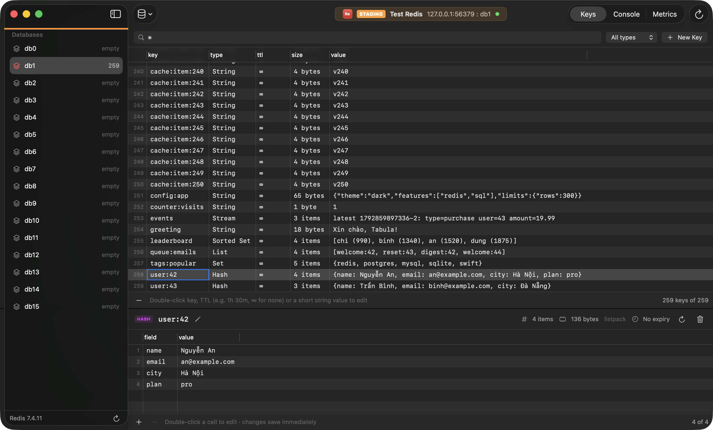

# Redis

[Back to the README](../README.md)

- [Connecting](#connecting)
- [Keys](#keys)
- [Values](#values)
- [Key details](#key-details)
- [Console](#console)
- [Metrics](#metrics)
- [Activity](#activity)
- [Slow Log](#slow-log)
- [Health](#health)
- [ACL users](#acl-users)
- [AI](#ai)
- [Limitations](#limitations)

## Connecting

Redis 6 and 7, including managed services: a password or an ACL user, the database index, and TLS (`rediss://` in a [connection string](connections.md#connection-strings)). User is optional (an ACL user on Redis 6 and later; empty for `requirepass`) and Database is the index, 0 by default.

## Keys

- Keys are listed with `SCAN`, never `KEYS`, so this is safe on large production instances: type, TTL, size and a preview, filtered by a pattern such as `user:*` (⌘F) or by type, sorted naturally and loading more as you scroll.
- The sidebar lists databases with their key counts.
- Create (⌘N) and delete (⌫) keys.

## Values

- **Strings** in an editor, with Format JSON; ⌘S saves and keeps the TTL.
- **Hashes, lists, sets, sorted sets and streams** in a grid, with *Load more* for big ones; ⌘I adds an element and ⌫ deletes the selected ones.
- Double-click to edit a key, TTL, short value or cell in place. A value with a line break or bytes that aren't text is edited in the key's pane instead.
- **Changes are written to Redis immediately.** Multi-step edits, such as renaming a hash field or changing a set member, run in `MULTI` / `EXEC`; renaming onto a field or member that exists is refused.
- Strings over 1 MB and binary values are read-only; use the console for them.

## Key details

Size, memory usage, encoding and TTL. Set or remove an expiry, or rename (never over another key).

## Console

The console (⌘T) works as `redis-cli` does, with quotes, escapes, formatted replies and history (↑ ↓); `SELECT` switches the sidebar too. Its input takes several lines (⌥↩), run one after another; lines starting with `#` are skipped.

- It refuses `SUBSCRIBE`, `MONITOR` and blocking commands with no timeout, which would freeze the connection, and `MULTI` and `WATCH`, which would hold the connection it shares with the key browser. `EVAL` runs several commands at once.
- It asks before `FLUSHALL`, `FLUSHDB`, `SHUTDOWN`, `REPLICAOF`, `FUNCTION FLUSH`, `CLUSTER RESET` / `FLUSHSLOTS`, `DEBUG` and `FAILOVER`, and on Production before any command not known to only read.
- Stop (⌘.) ends a Lua script or function once it has run for 5 seconds (on a shared server it stops whichever script is running, so Production asks first) and unblocks a waiting command such as `BLPOP` or `XREAD BLOCK`. Other commands run to the end.

## Metrics

Server metrics (⌥⌘4) from `INFO`: memory, clients, throughput, hit rate, persistence and keyspace.

The window's views are in the toolbar's **View** pop-up and the **View** menu: Keys, Console (⌘T), Metrics (⌥⌘4), Dashboard (⌥⌘5), Activity (⌥⌘6), Slow Log, Health and ACL Users. Activity, Slow Log, Health and ACL Users read the server over a connection of their own, so a blocking command in the console doesn't hold them up.

## Activity

**View › Activity** (⌥⌘6) lists the server's clients from `CLIENT LIST` in a table sorted by any column: id, address, name, user, age, idle time, database, last command, flags and memory (`tot-mem`, Redis 6 and later). It refreshes every 2, 5 or 10 seconds while shown, or on demand, and not while a menu is open. **Filter** keeps clients whose address, name, user or command matches, and **Hide Tabula** hides the window's own connections (the key browser's, the assistant's and the views'), which are marked Tabula. The pane on the right shows every field of the chosen client's line, with the flags explained.

**Kill Client…** (`CLIENT KILL ID`) asks first with the client, its user, database and last command, asks again on Production, is refused on a read-only connection until **Allow Changes…**, and shows in the console. It is never offered for the window's own connections: Tabula asks each of them for its `CLIENT ID` before every kill.

## Slow Log

**View › Slow Log** lists the last 128 commands the server logged as slow (`SLOWLOG GET 128`): when, how long, the command and its arguments, and the client. A note above says which commands are logged and how many are kept (`slowlog-log-slower-than` and `slowlog-max-len` from `CONFIG GET`), or that the server doesn't allow `CONFIG`. Long arguments are cut at 80 characters, and passwords are always shown as `•••`: `AUTH`, `HELLO … AUTH`, `ACL SETUSER` rules such as `>password` and `#hash`, `MIGRATE … AUTH` and `CONFIG SET requirepass`. **Copy** and **Open in Console** give that same text, so a password never leaves the view; nothing runs until you press Return in the console.

**Reset…** (`SLOWLOG RESET`) asks first, asks again on Production, is refused on a read-only connection and shows in the console.

## Health

**View › Health** checks the server and the database shown, with findings grouped by severity, filters by severity, check and text, and for each finding why it matters, its evidence and a suggested command that Tabula never runs: **Copy** it or **Open in Console**.

- **Memory limit:** no `maxmemory` (with a limit of three quarters of the system's memory to consider), or memory nearly full.
- **Eviction policy:** `noeviction`, under which writes fail once memory is full.
- **Fragmentation:** a high `mem_fragmentation_ratio` that wastes real memory, a high ratio on a small dataset (normal), or a ratio below 1 (swapping).
- **Evicted and expired keys** since the server started.
- **The biggest keys** by `MEMORY USAGE`, **big collections** by element count (`HLEN`, `LLEN`, `SCARD`, `ZCARD`, `XLEN`) and **keys without a TTL** grouped by key pattern (`session:*`), with **Show Key** for a key.

The last three come from a sample of up to 1,000 keys read with `SCAN` (never `KEYS`), as the check's name, the evidence and the footer say; memory, evictions and expirations are the whole server's. Values are never read.

## ACL users

**View › ACL Users** (Redis 6 and later) lists the users from `ACL LIST`: on or off, how many passwords, and the commands, keys and channels they may use; the chosen user's `ACL GETUSER` fields are on the right. The user this connection signed in as is marked You.

**New User…**, **Edit…** and **Delete** queue changes as pending `ACL SETUSER` and `ACL DELUSER` commands: an edit writes only what changed (`on` / `off`, `resetpass >password` or `nopass`, `resetkeys ~pattern`, `resetchannels &pattern`, `nocommands +@read`). **Preview** (⇧⌘S) shows them and **Commit** (⌘S) sends them one by one, stopping at the first the server refuses; the ones before it stay applied. Commit asks on Production and before deleting a user, and asks again, as a critical alert, before anything that takes rights from the connection's own user: deleting it, turning it off, replacing its passwords or changing its commands, keys or channels. A read-only connection refuses until **Allow Changes…**.

Passwords are typed in secure fields, kept only until the commit, never saved or given to the AI, and shown as `•••` in the preview, the console and errors. The console now masks passwords in any command typed there too (`AUTH`, `ACL SETUSER`, `HELLO … AUTH`, `MIGRATE … AUTH`, `CONFIG SET requirepass`). On Redis before 6, which has no ACLs, the view says so and the menu item is off.

## AI

With AI turned on in Settings › AI (and allowed for Production connections there), a Redis window has:

- **AI Chat** (⌥⌘A) on the right. It knows the server's INFO summary, `DBSIZE` and key names sampled with `SCAN`, grouped into patterns with their types and TTLs, never values. With **Let the chat run read-only queries** on, it can read values with one read-only command at a time from a fixed list (bounded `SCAN`, `GET`, `HSCAN`, `LRANGE 0 99` and the like; never `KEYS`, `HGETALL`, writes, scripts or `CONFIG`), on a connection of its own, each command shown in the console with the AI's mark and, on Production, only after you allow it.
- **Charts, metric cards and grids** in its answers, from read-only commands, and **TABULA.KEYGROUPS** `prefix|type|ttl [MATCH pattern]`, Tabula's own command for keys and memory by key pattern, type or TTL from a sample of up to 1,000 keys. Pin them to the connection's **Dashboard** (⌥⌘5, or **Dashboard** in the toolbar's View pop-up).
- **Ask AI** (⌘K) in the console: describe what you want and the commands appear in the input, not run. **Fix with AI** under a failed command proposes a corrected one to accept or reject.

[The AI on Redis in detail](ai.md#redis), including exactly what is sent.

## Limitations

- Redis Cluster and Sentinel aren't supported yet; connect to a single node.
- Pub/Sub, `MONITOR`, `MULTI` and `WATCH` aren't available in the console.
- AI agents (MCP) can't use Redis connections, and AI notebooks and dashboard widgets of your own commands aren't available for Redis.
