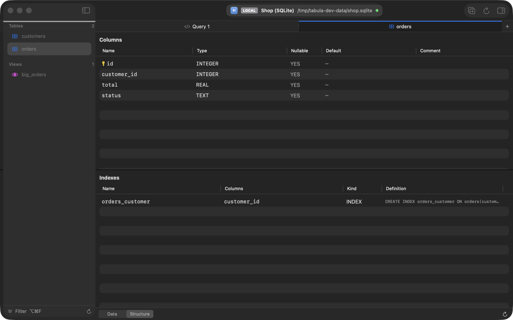
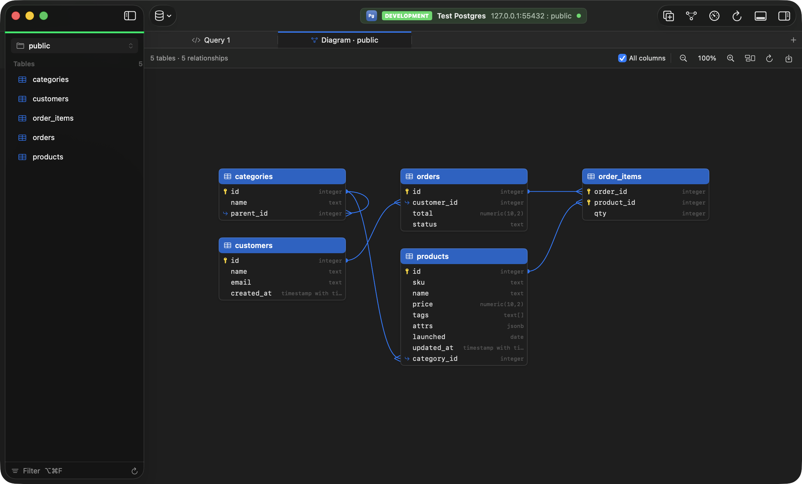

# Structure and schema

[Back to the README](../README.md)

- [Structure](#structure)
- [Relationship diagram](#relationship-diagram)
- [Functions, procedures and triggers](#functions-procedures-and-triggers)
- [Compare schemas](#compare-schemas)
- [Schema health](#schema-health)
- [Users, roles and privileges](#users-roles-and-privileges)

## Structure

**Structure** (⌥⌘2) shows a table's columns with type, nullability, default, comment, description and primary key, and its indexes with their definitions. The descriptions are Tabula's [data dictionary](ai.md#data-dictionary): type one in the **Description** column (or the field above the columns for the table) and press Return; **Describe with AI…** proposes them all for you to review, and **Open as COMMENT Statements** writes them as comments to run on PostgreSQL and MySQL. PostgreSQL's Default column shows `GENERATED ALWAYS AS …` for generated columns. Indexes that can't be read show a note instead of looking like a table without indexes. On MongoDB, Structure shows the [fields sampled from the first 100 documents](mongodb.md#structure).

## Relationship diagram

**Relationship diagram** (⌥⌘3) shows the schema's tables with foreign-key lines, laid out by dependency. Drag tables, zoom (30% to 200%), show key columns only, and export a PNG. Tables whose columns couldn't be read are named. Databases without foreign keys, such as MongoDB, don't show it.

## Functions, procedures and triggers

PostgreSQL and MySQL functions, procedures and triggers, and SQLite triggers, are in the sidebar: view, edit and save them with ⌘S, create new ones from a template, or delete them. Saving never loses a routine:

- PostgreSQL functions use `CREATE OR REPLACE`.
- PostgreSQL and SQLite triggers are recreated in one transaction.
- On MySQL, which can't run DDL in a transaction, the original is put back if the new definition fails.

## Compare schemas

**File › Compare Schemas…** (PostgreSQL, MySQL, SQLite) opens a window that compares a source with a target, each a saved connection and a schema (for example Development `public` against Production `public`, or two schemas of one connection), and writes the SQL script that makes the target match the source.

- Both sides are read on read-only connections of their own, so comparing never asks on Production.
- The tree lists each table and view that differs, with its columns (type, NOT NULL, default, generated), primary key, indexes and foreign keys marked as only in the source, only in the target or different, and the functions, procedures and triggers. **Only Differences** and the search field narrow it.
- The script is in the target's dialect and in dependency order: foreign keys, views and indexes that change or go are dropped first, then tables are created and altered, then indexes, views, foreign keys and routines are created. On PostgreSQL the script runs in one transaction.
- A column that may have been renamed (one removed and one added of the same type) is added and dropped, with the `RENAME COLUMN` to use instead in a comment.
- SQLite tables whose columns or keys change are rebuilt the usual way (a new table, the rows copied, the old one dropped, the new one renamed). Steps Tabula can't write in full, such as SQLite generated columns, are commented out with what to fill in.
- Statements that remove what only the target has (DROP TABLE, DROP COLUMN…) are commented out unless you turn on **Include Drops**.
- **Copy**, **Save As…** or **Open in Query Tab** on the target connection: Tabula never runs the script itself.
- CHECK constraints, collations, sequences, enum types and permissions aren't compared.

## Schema health

**View › Schema Health** (also in Open Anything, ⌘P) checks the indexes and tables of the schema selected in the sidebar and lists what it finds, grouped by severity (High, Medium, Low, and Info for sizes). Pick a finding to see why it matters, the evidence (sizes, scan counts, row estimates, since when the statistics count) and a suggested statement. Tabula never runs it: **Copy** it, or **Open in Query Tab** to review and run it yourself, where the usual [checks before running](queries.md) apply. **Show Table** opens the table's Structure.

| Check | PostgreSQL | MySQL / MariaDB | SQLite |
|---|---|---|---|
| **Unused indexes:** no scans since the statistics were reset (or the server started), leaving out primary keys, unique indexes, indexes a constraint uses and the only index of a foreign key; the evidence says how old the statistics are, and statistics under 7 days old make it Low | `pg_stat_user_indexes` | `performance_schema` (what `sys.schema_unused_indexes` reads), when it is on | — |
| **Duplicate indexes** (same columns, order, direction and method) and **redundant** ones (the leftmost columns of another, unless unique) | ✓ | ✓ | ✓ |
| **Foreign keys without an index** whose first columns are the key's | ✓ | (InnoDB always makes one) | ✓ |
| **Tables without a primary key** (a partition is covered by its parent) | ✓ | ✓ | ✓ (Low: rowid) |
| **Dead rows (bloat estimate):** `n_dead_tup` against `n_live_tup` from `pg_stat_user_tables`, with the last vacuum, autovacuum, analyze and autoanalyze. These are PostgreSQL's running estimates, not a measurement | ✓ | — | — |
| **Invalid indexes** left by a failed `CREATE INDEX CONCURRENTLY` | ✓ | — | — |
| **Sequential scans on large tables** (10,000 rows or 50 MB and up) read whole more often than through an index | ✓ | ✓ (rows read without an index) | — |
| **The largest tables and indexes** (five of each) | ✓ | ✓ | — |

Statements are written for the database: on PostgreSQL `CREATE INDEX CONCURRENTLY` and `DROP INDEX CONCURRENTLY` (they don't block writes, and wait for transactions already open; they can't run inside a transaction), `ALTER TABLE … DROP CONSTRAINT` for a constraint's index, and `VACUUM (ANALYZE)`; on MySQL `ALTER TABLE … ADD INDEX` / `DROP INDEX`. A table without a primary key gets `ADD PRIMARY KEY` on a unique index's columns when it has one, otherwise a numbered `id` column to rename if the table has one. SQLite can't add a primary key to a table, so none is suggested.

The severity, check and text filters at the top narrow the list. **Refresh** reads the statistics again. **Export…** saves every finding as Markdown with its evidence and statement. With AI allowed for the connection, **Ask AI** explains a finding and what to check before acting on it; it sends the finding and the names and columns of its table's indexes and foreign keys, never rows.

The bar at the bottom says what wasn't checked and why: index bloat (it needs the `pgstattuple` extension), MySQL index sizes when the account can't read `mysql.innodb_index_stats`, index use when `performance_schema` is off (MariaDB's default) or can't be read, and SQLite's missing statistics. Scans on replicas aren't counted, so check them before dropping an index a replica's queries use. MongoDB and Redis have no health checks.

## Users, roles and privileges

**View › Users & Roles** (or Open Anything, ⌘P) opens a tab for the server's roles and users on PostgreSQL and MySQL / MariaDB. It has three pages:

- **Roles:** every role or user with what it may do: whether it signs in (a user) or groups privileges (a role), superuser, create databases, create roles, its connection limit, when its password stops working (PostgreSQL) or whether it is locked or its password expired (MySQL), the roles it belongs to and its members. PostgreSQL's built-in `pg_*` roles and MySQL's `mysql.*` accounts are hidden until you tick **Show built-in roles**. The bar below names the user the connection signed in as.
- **Privileges:** who can do what on the current schema's tables, views, sequences, functions and procedures, and on the schema itself, one row per grantee, object and privilege, with its grant option. Filter by text, grantee and kind. On PostgreSQL these are effective privileges, and **How** says how each was got: granted to the role, granted to PUBLIC, as the owner, as a superuser (hidden until you tick **Superusers**) or through a role it belongs to; tick **Granted directly** for the ones REVOKE takes back. On MySQL the server-wide (`*.*`) and database (`shop.*`) grants are listed beside the table, column and routine ones.
- **Default Privileges** (PostgreSQL): what objects a role creates later are granted, in this schema or in every schema (`ALTER DEFAULT PRIVILEGES`).

MariaDB is told apart from MySQL by its version: its roles have no host (`CREATE ROLE readers`, `GRANT readers TO app@'%'`), it is flagged by `is_role` and memberships come from `mysql.roles_mapping` instead of MySQL 8's `mysql.role_edges`. MySQL 5.7, which has no roles, lists users and their grants without memberships.

A table's **Structure** has the same answer for one table: switch the lower pane from **Indexes** to **Privileges** to see each grantee's privileges on the table and its columns, and how it has them.

### Changing roles and privileges

- **New User…** and **New Role…** open a sheet with the role's attributes (on MySQL the account's host, connection limit, lock and expired password), a password and the roles it belongs to; **Edit…** (or double-click) changes one. **Grant…** grants privileges on an object to a role (PUBLIC too, on PostgreSQL), **Revoke** takes back the selected privileges, **Drop** removes the selected roles, and **Add…** on Default Privileges adds a default privilege.
- Nothing is written until you commit, as in a table: the bar below shows the pending changes (click the count to take one back), **Preview** (⇧⌘S) shows the SQL and **Commit** (⌘S) runs it. Every name is quoted for the database.
- On PostgreSQL the changes run in one transaction: if one fails, none is kept. MySQL commits each account statement by itself, so they run one by one and stop at the first that fails; the error says how many were applied, and those leave the pending list while the failed one and the rest stay.
- Commit asks first on a Production connection, when a statement drops a role or user (as the statement checks do in the query editor), and when the changes take privileges, a role, superuser or sign-in from the user the connection signed in as. A read-only connection refuses changes until **Allow Changes…**.
- When the connection's user lacks the privilege (CREATEROLE or superuser on PostgreSQL, CREATE USER or the privilege WITH GRANT OPTION on MySQL), the error says so. A MySQL user that can't read `mysql.user` sees only its own account, with a note saying why; routine privileges need `mysql.procs_priv`. A role that still has privileges can't be dropped on PostgreSQL: revoke them first, or use `REASSIGN OWNED BY` and `DROP OWNED BY`.

### Passwords

Passwords are typed in secure fields and kept only with the pending change until it commits. The preview and the console log show them as `PASSWORD '•••'` or `IDENTIFIED BY '•••'`, and the console takes them out of a server's error message too. This applies to every statement the console logs, so a `CREATE ROLE … PASSWORD` typed in a query tab is masked as well. The Users & Roles tab isn't saved with the workspace, so a pending password is never written to Tabula's files, and nothing on it is given to the AI.

MySQL reads a backslash in a password differently depending on the server's `sql_mode`, so Tabula refuses one there rather than set a different password than you typed. The role sheet lists only roles that exist on the server as ones to belong to: commit a new role before adding members to it.
