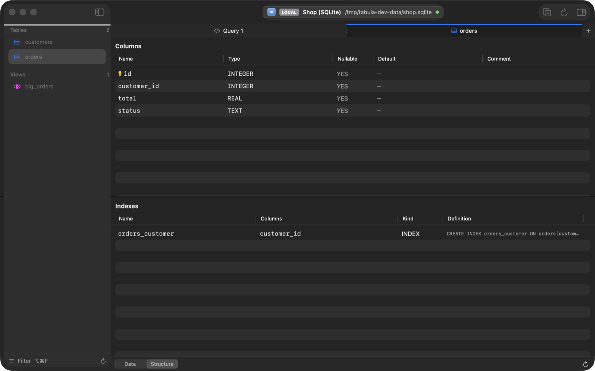
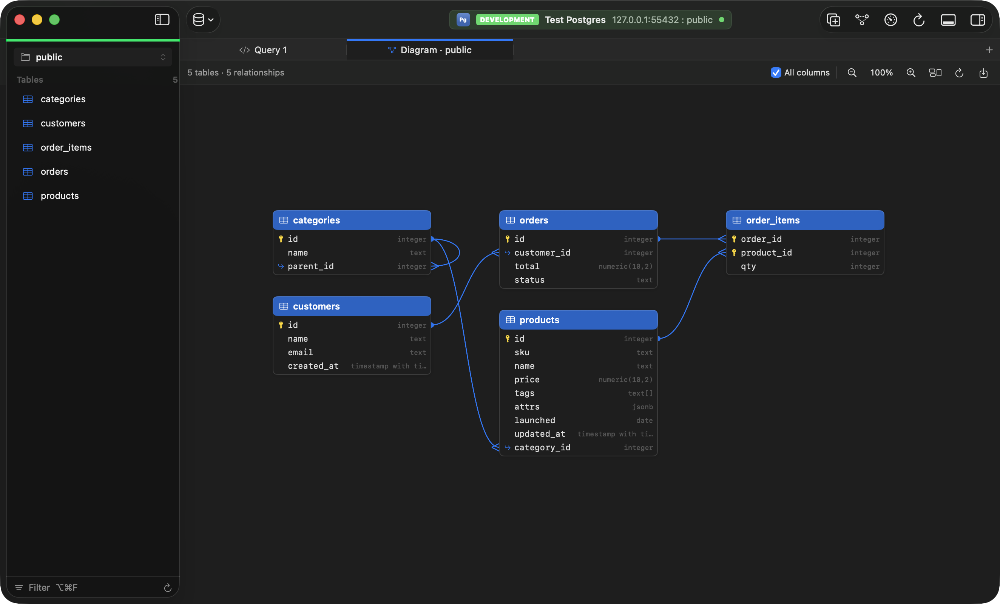

# Structure and schema

[Back to the README](../README.md)

- [Structure](#structure)
- [Changing a table's structure](#changing-a-tables-structure)
- [Migration history](#migration-history)
- [Relationship diagram](#relationship-diagram)
- [Functions, procedures and triggers](#functions-procedures-and-triggers)
- [Compare schemas](#compare-schemas)
- [Schema health](#schema-health)
- [Users, roles and privileges](#users-roles-and-privileges)

## Structure

**Structure** (⌥⌘2) shows a table's columns with type, nullability, default, comment, description and primary key, and its indexes with their definitions. The descriptions are Tabula's [data dictionary](ai.md#data-dictionary): type one in the **Description** column (or the field above the columns for the table) and press Return; **Describe with AI…** proposes them all for you to review, and **Open as COMMENT Statements** writes them as comments to run on PostgreSQL and MySQL. PostgreSQL's Default column shows `GENERATED ALWAYS AS …` for generated columns. Indexes that can't be read show a note instead of looking like a table without indexes. On MongoDB, Structure shows the [fields sampled from the first 100 documents](mongodb.md#structure).

## Changing a table's structure

On PostgreSQL, MySQL / MariaDB, SQLite and SQL Server, **Structure** also changes the table. Nothing is written until you commit, as with rows: a green dot marks what a pending change adds and an orange one what it changes, **Preview** (⇧⌘S) shows the statements, **Commit** (⌘S) runs them and **Discard** takes them back. The preview's **Save as Migration…** writes them as a [Prisma, TypeORM or SQL migration](#saving-the-changes-as-a-migration) instead.

- **Columns:** **Add Column…**, **Edit…** (or double-click a column) and **Drop** above the columns. The sheet takes the name, the type (typed, or from **Types**), whether it allows NULL, a default as SQL writes it (`'new'`, `0`, `CURRENT_TIMESTAMP`) and whether it is part of the primary key. A renamed column shows the name it had, and keeps its description in the data dictionary. A column the server computes or numbers (generated, identity, `AUTO_INCREMENT`) can be renamed and dropped, not redefined. Dropping a column also drops the indexes and foreign keys that use it.
- **Indexes:** **Add Index…** takes a name (one is suggested), the columns in the order you tick them and **Unique**; **Drop** removes the selected ones. The primary key's index changes with its columns.
- **Foreign keys:** the lower pane's **Foreign Keys** lists them. **Add Foreign Key…** takes the columns, the table and columns they reference (its primary key to start with) and what deleting or updating a referenced row does; **Drop** removes the selected ones.
- **New Table…** (Database menu, the sidebar's context menu, or Open Anything, ⌘P) creates a table with a numbered `id` primary key and opens its Structure to add the columns. **Rename…** in a table's context menu renames it, and **Copy CREATE Statement** copies the statements that create it with its indexes and foreign keys.

The statements are the ones [Compare Schemas](#compare-schemas) writes, so each database gets its own:

| | How the changes are made | If a statement fails |
|---|---|---|
| PostgreSQL | One property at a time: `ALTER COLUMN … TYPE … USING`, `SET DEFAULT`, `SET NOT NULL` | One transaction: nothing is changed |
| SQL Server | `ALTER COLUMN` with the type and nullability restated; a DEFAULT constraint the server named is looked up and dropped by its column | One transaction: nothing is changed |
| SQLite | `ADD COLUMN`, `RENAME COLUMN` and `DROP COLUMN` in place. Anything else (a type, NOT NULL, a default, the primary key, a foreign key) rebuilds the table: a new table, the rows copied, the old one dropped and the new one renamed, with its indexes and triggers created again | One transaction, with the foreign keys checked before it commits: nothing is changed |
| MySQL / MariaDB | `MODIFY COLUMN` with the whole column restated, including its collation, `ON UPDATE` and comment, which MySQL would otherwise reset. A rename is `RENAME COLUMN`, or `CHANGE COLUMN` on MySQL before 8.0 and MariaDB before 10.5.2, which have none | MySQL applies each schema change at once: the message says how many statements were applied, and the rest stay pending |

- A Production connection asks before committing, and so does any connection when the [statement checks](queries.md#checks-before-a-statement-runs) find something (a dropped column, a change that rewrites the table) or a SQLite table is rebuilt. A [read-only connection](connections.md#read-only-connections) refuses until **Allow Changes…**.
- Commit or discard the tab's changed rows first: the table is read again once its structure changes. A sort follows a renamed column, and a sort or filter that names a dropped or renamed column is cleared.
- Commit reads the table again first. If someone changed it since Structure read it, nothing runs and Tabula says so: discard the pending changes to read the table as it is now, then make them again. Otherwise they would take the other change back.
- A SQLite table created with `CHECK`, `COLLATE`, `AUTOINCREMENT`, generated columns, `WITHOUT ROWID` or `STRICT` isn't rebuilt from here, because SQLite's catalog doesn't tell those and the rebuilt table would lose them. The preview says so, and **Open in Query Tab** opens the statements to finish by hand.
- On SQLite, commit a rename by itself when the table has triggers and other pending changes rebuild it: SQLite rewrites the triggers for the rename, and the rebuild would create them again with the old name.
- **Copy CREATE Statement** on SQLite copies the statement as it was written, with its CHECK constraints and the like; on MySQL the columns keep their collation, `ON UPDATE` and comment. A renamed table keeps its remembered filter and its descriptions.
- A primary key that other tables reference can't be changed while their foreign keys are there: drop those first.
- CHECK constraints, collations, sequences, enum types, partitions and column comments aren't changed here; views open read-only.

### Saving the changes as a migration

When the project keeps its schema in migration files, **Save as Migration…** in the preview writes the pending changes to the project's migrations folder instead of running them. It takes a name, a format and the folder, and shows the files it will write; nothing already in the folder is replaced.

| Format | Files | Down migration |
|---|---|---|
| Prisma | `<timestamp>_<name>/migration.sql` | `down.sql` in the same folder. Prisma doesn't run it: use `prisma db execute --file` |
| TypeORM | `<timestamp>-<Name>.ts`, a class with `up` and `down` | The class's `down` |
| SQL files | `<timestamp>_<name>.up.sql` | `<timestamp>_<name>.down.sql` |

- The down migration is the change reversed: a renamed column gets its name back, a changed column its type, default and nullability, and what was added is dropped. A dropped column is created again without its values, which the file says. Read it before relying on it.
- The changes stay pending after saving. Discard them and let the migration tool run the file, or commit them here too and tell the tool the migration has run (`prisma migrate resolve --applied`).
- **Prisma:** choose `prisma/migrations`. `prisma migrate deploy` runs the file, and `prisma db pull` then brings `schema.prisma` up to date; `prisma migrate dev` before that would write a migration that takes the change back, because `schema.prisma` doesn't have it yet.
- **TypeORM:** change the entity to match, so `migration:generate` doesn't write the same change again. A SQLite rebuild is written without its own `BEGIN`, `COMMIT` and foreign key pragmas, which TypeORM runs itself.
- **SQL files and Prisma on SQLite:** a rebuild keeps its own transaction with foreign key checks off around it, so run the file without the tool's transaction (golang-migrate's `x-no-tx-wrap`). The file lists rows whose foreign keys no longer match, and nothing stops its commit when there are some.
- **MySQL:** the statements name the table without its database, so the file runs against whichever database the tool connects to. **SQL Server:** the file has no `GO`, and runs as one batch.
- What the preview says Tabula won't run (a SQLite table a rebuild would lose part of) is still written, with the reason as a comment, to finish in the file.

## Migration history

**View › Migrations** shows what the project's migration tool has applied to the schema shown. Tabula finds the tool's history table by its name and columns, and lists its rows newest first: the migration, its version, when it was applied, how long it took, and whether it finished, failed or was rolled back. It only reads: nothing is applied, rolled back or marked from here.

| Tool | Table | What the table keeps |
|---|---|---|
| Prisma | `_prisma_migrations` | Start and finish, the checksum, and the error log of a migration that failed |
| TypeORM | `migrations`, or the name you gave it | The name and its timestamp, in the order they ran |
| Knex, Laravel | `knex_migrations`, `migrations` | The name and the batch; Knex also the time |
| Sequelize, EF Core | `SequelizeMeta`, `__EFMigrationsHistory` | The name |
| Django | `django_migrations` | The app, the name and the time |
| Rails, dbmate | `schema_migrations` | The version |
| Flyway | `flyway_schema_history` | The script, the time, how long it took and whether it succeeded |
| Liquibase | `DATABASECHANGELOG` | Each change set, the time and how it ran |
| goose | `goose_db_version` | The version and the time |
| Drizzle | `__drizzle_migrations` | The hash; on PostgreSQL the table is in the `drizzle` schema, so choose that schema |
| golang-migrate, Alembic | `schema_migrations`, `alembic_version` | Only the version the database is at now, and for golang-migrate whether it is dirty |

- Select a migration to see what Tabula read from it, the tool's log when it failed, and the whole history row. **Open History Table** opens the table itself.
- A Prisma migration that started and never finished is **Failed**: Prisma applies nothing more until it is resolved. One marked with `migrate resolve --rolled-back` is **Rolled back**.
- A time the table keeps without a time zone is shown as it is written, not converted to yours.
- When a schema has two history tables, the header has a menu to choose between them. A table of your own that only looks like one (other columns) is left out.

### Comparing with the migrations folder

**Compare with Folder…** takes the project's migrations folder (`prisma/migrations`, or the folder TypeORM loads from) and adds what the history table can't say:

- **Pending:** a migration in the folder that this database has no row for, or whose rows were all rolled back. That is all it means: Tabula doesn't know which branch the folder is on. A history longer than 5,000 rows is read from its newest end, and then no file is called pending.
- **Applied, no file:** a row with no migration in the folder, from another branch or a file that was removed or renamed.
- **Applied, file changed** (Prisma): the file's checksum isn't the one recorded when it was applied, so the file was edited afterwards.
- The selected migration's file is shown below its row, and a SQL file opens in a query tab with **Open in Query Tab**, without running.

The folder is remembered for the connection and the tool. Prisma is matched by the folder's name, TypeORM by the timestamp the file's name starts with, Knex, Sequelize, Laravel and EF Core by the file's name, Flyway by the script, and Rails, dbmate and goose by the version the file's name starts with. Files in folders inside the one you choose aren't read (except Prisma's), and there is no comparing for Django, Liquibase, Drizzle, golang-migrate and Alembic.

## Relationship diagram

**Relationship diagram** (⌥⌘3) shows the schema's tables with foreign-key lines, laid out by dependency. Drag tables, zoom (30% to 200%), show key columns only, and export a PNG. Tables whose columns couldn't be read are named. Databases without foreign keys, such as MongoDB, don't show it.

## Functions, procedures and triggers

PostgreSQL, MySQL and SQL Server functions, procedures and triggers, and SQLite triggers, are in the sidebar: view, edit and save them with ⌘S, create new ones from a template, or delete them. Saving never loses a routine:

- PostgreSQL functions use `CREATE OR REPLACE`.
- SQL Server routines open as `CREATE OR ALTER`, which replaces them in one step; a definition runs batch by batch, split at `GO` lines ([SQL Server's routines](sqlserver.md#functions-procedures-and-triggers)).
- PostgreSQL and SQLite triggers are recreated in one transaction.
- On MySQL, which can't run DDL in a transaction, the original is put back if the new definition fails.

## Compare schemas

**File › Compare Schemas…** (PostgreSQL, MySQL, SQLite, SQL Server) opens a window that compares a source with a target, each a saved connection and a schema (for example Development `public` against Production `public`, or two schemas of one connection), and writes the SQL script that makes the target match the source.

- Both sides are read on read-only connections of their own, so comparing never asks on Production.
- The tree lists each table and view that differs, with its columns (type, NOT NULL, default, generated), primary key, indexes and foreign keys marked as only in the source, only in the target or different, and the functions, procedures and triggers. **Only Differences** and the search field narrow it.
- The script is in the target's dialect and in dependency order: foreign keys, views and indexes that change or go are dropped first, then tables are created and altered, then indexes, views, foreign keys and routines are created. On PostgreSQL and SQL Server the script runs in one transaction; SQL Server's has `GO` after each statement, and is written in T-SQL ([Compare Schemas on SQL Server](sqlserver.md#compare-schemas)).
- A column that may have been renamed (one removed and one added of the same type) is added and dropped, with the `RENAME COLUMN` to use instead in a comment.
- SQLite tables whose columns or keys change are rebuilt the usual way (a new table, the rows copied, the old one dropped, the new one renamed). Steps Tabula can't write in full, such as SQLite generated columns, are commented out with what to fill in.
- Statements that remove what only the target has (DROP TABLE, DROP COLUMN…) are commented out unless you turn on **Include Drops**.
- **Copy**, **Save As…** or **Open in Query Tab** on the target connection: Tabula never runs the script itself.
- CHECK constraints, collations, sequences, enum types and permissions aren't compared.

## Schema health

**View › Schema Health** (also in Open Anything, ⌘P) checks the indexes and tables of the schema selected in the sidebar and lists what it finds, grouped by severity (High, Medium, Low, and Info for sizes). Pick a finding to see why it matters, the evidence (sizes, scan counts, row estimates, since when the statistics count) and a suggested statement. Tabula never runs it: **Copy** it, or **Open in Query Tab** to review and run it yourself, where the usual [checks before running](queries.md) apply. **Show Table** opens the table's Structure.

| Check | PostgreSQL | MySQL / MariaDB | SQLite |
|---|---|---|---|
| **Unused indexes:** no scans since the statistics were reset (or the server started), leaving out primary keys, unique indexes, indexes a constraint uses and the only index of a foreign key; the evidence says how old the statistics are, and statistics under 7 days old make it Low | `pg_stat_user_indexes` | `performance_schema` (what `sys.schema_unused_indexes` reads), when it is on | — |
| **Duplicate indexes** (same columns, order, direction and method) and **redundant** ones (the leftmost columns of another, unless unique) | ✓ | ✓ | ✓ |
| **Foreign keys without an index** whose first columns are the key's | ✓ | (InnoDB always makes one) | ✓ |
| **Tables without a primary key** (a partition is covered by its parent) | ✓ | ✓ | ✓ (Low: rowid) |
| **Dead rows (bloat estimate):** `n_dead_tup` against `n_live_tup` from `pg_stat_user_tables`, with the last vacuum, autovacuum, analyze and autoanalyze. These are PostgreSQL's running estimates, not a measurement | ✓ | — | — |
| **Invalid indexes** left by a failed `CREATE INDEX CONCURRENTLY` | ✓ | — | — |
| **Sequential scans on large tables** (10,000 rows or 50 MB and up) read whole more often than through an index | ✓ | ✓ (rows read without an index) | — |
| **The largest tables and indexes** (five of each) | ✓ | ✓ | — |

Statements are written for the database: on PostgreSQL `CREATE INDEX CONCURRENTLY` and `DROP INDEX CONCURRENTLY` (they don't block writes, and wait for transactions already open; they can't run inside a transaction), `ALTER TABLE … DROP CONSTRAINT` for a constraint's index, and `VACUUM (ANALYZE)`; on MySQL `ALTER TABLE … ADD INDEX` / `DROP INDEX`. A table without a primary key gets `ADD PRIMARY KEY` on a unique index's columns when it has one, otherwise a numbered `id` column to rename if the table has one. SQLite can't add a primary key to a table, so none is suggested.

The severity, check and text filters at the top narrow the list. **Refresh** reads the statistics again. **Export…** saves every finding as Markdown with its evidence and statement. With AI allowed for the connection, **Ask AI** explains a finding and what to check before acting on it; it sends the finding and the names and columns of its table's indexes and foreign keys, never rows.

The bar at the bottom says what wasn't checked and why: index bloat (it needs the `pgstattuple` extension), MySQL index sizes when the account can't read `mysql.innodb_index_stats`, index use when `performance_schema` is off (MariaDB's default) or can't be read, and SQLite's missing statistics. Scans on replicas aren't counted, so check them before dropping an index a replica's queries use. MongoDB and Redis have no health checks.

## Users, roles and privileges

**View › Users & Roles** (or Open Anything, ⌘P) opens a tab for the server's roles and users on PostgreSQL and MySQL / MariaDB. It has three pages:

- **Roles:** every role or user with what it may do: whether it signs in (a user) or groups privileges (a role), superuser, create databases, create roles, its connection limit, when its password stops working (PostgreSQL) or whether it is locked or its password expired (MySQL), the roles it belongs to and its members. PostgreSQL's built-in `pg_*` roles and MySQL's `mysql.*` accounts are hidden until you tick **Show built-in roles**. The bar below names the user the connection signed in as.
- **Privileges:** who can do what on the current schema's tables, views, sequences, functions and procedures, and on the schema itself, one row per grantee, object and privilege, with its grant option. Filter by text, grantee and kind. On PostgreSQL these are effective privileges, and **How** says how each was got: granted to the role, granted to PUBLIC, as the owner, as a superuser (hidden until you tick **Superusers**) or through a role it belongs to; tick **Granted directly** for the ones REVOKE takes back. On MySQL the server-wide (`*.*`) and database (`shop.*`) grants are listed beside the table, column and routine ones.
- **Default Privileges** (PostgreSQL): what objects a role creates later are granted, in this schema or in every schema (`ALTER DEFAULT PRIVILEGES`).

MariaDB is told apart from MySQL by its version: its roles have no host (`CREATE ROLE readers`, `GRANT readers TO app@'%'`), it is flagged by `is_role` and memberships come from `mysql.roles_mapping` instead of MySQL 8's `mysql.role_edges`. MySQL 5.7, which has no roles, lists users and their grants without memberships.

A table's **Structure** has the same answer for one table: switch the lower pane from **Indexes** to **Privileges** to see each grantee's privileges on the table and its columns, and how it has them.

### Changing roles and privileges

- **New User…** and **New Role…** open a sheet with the role's attributes (on MySQL the account's host, connection limit, lock and expired password), a password and the roles it belongs to; **Edit…** (or double-click) changes one. **Grant…** grants privileges on an object to a role (PUBLIC too, on PostgreSQL), **Revoke** takes back the selected privileges, **Drop** removes the selected roles, and **Add…** on Default Privileges adds a default privilege.
- Nothing is written until you commit, as in a table: the bar below shows the pending changes (click the count to take one back), **Preview** (⇧⌘S) shows the SQL and **Commit** (⌘S) runs it. Every name is quoted for the database.
- On PostgreSQL the changes run in one transaction: if one fails, none is kept. MySQL commits each account statement by itself, so they run one by one and stop at the first that fails; the error says how many were applied, and those leave the pending list while the failed one and the rest stay.
- Commit asks first on a Production connection, when a statement drops a role or user (as the statement checks do in the query editor), and when the changes take privileges, a role, superuser or sign-in from the user the connection signed in as. A read-only connection refuses changes until **Allow Changes…**.
- When the connection's user lacks the privilege (CREATEROLE or superuser on PostgreSQL, CREATE USER or the privilege WITH GRANT OPTION on MySQL), the error says so. A MySQL user that can't read `mysql.user` sees only its own account, with a note saying why; routine privileges need `mysql.procs_priv`. A role that still has privileges can't be dropped on PostgreSQL: revoke them first, or use `REASSIGN OWNED BY` and `DROP OWNED BY`.

### Passwords

Passwords are typed in secure fields and kept only with the pending change until it commits. The preview and the console log show them as `PASSWORD '•••'` or `IDENTIFIED BY '•••'`, and the console takes them out of a server's error message too. This applies to every statement the console logs, so a `CREATE ROLE … PASSWORD` typed in a query tab is masked as well. The Users & Roles tab isn't saved with the workspace, so a pending password is never written to Tabula's files, and nothing on it is given to the AI.

MySQL reads a backslash in a password differently depending on the server's `sql_mode`, so Tabula refuses one there rather than set a different password than you typed. The role sheet lists only roles that exist on the server as ones to belong to: commit a new role before adding members to it.
